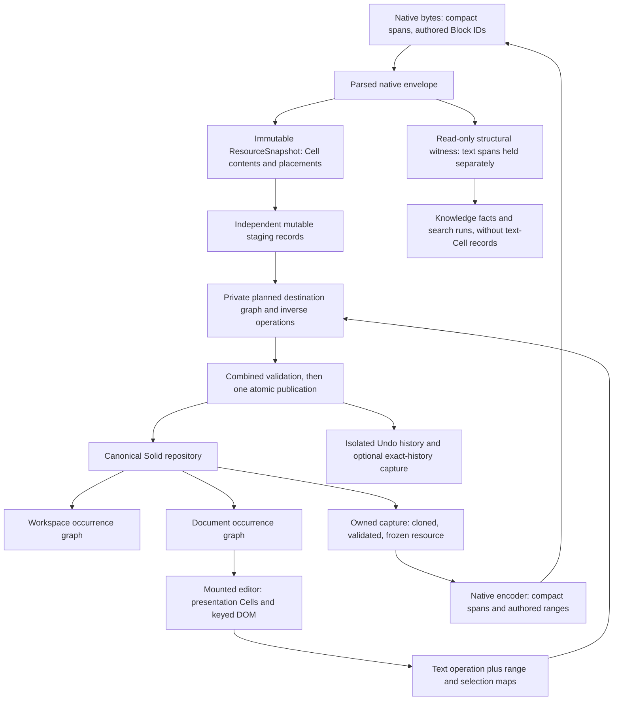

# Cell Materialisation and Canonical Text Representation — Architectural Qualification

## Recommendation and scope

**Canonical character Cells are an implementation requirement of the current reactive repository/editor, not a requirement of native document semantics.** Native files already contain compact ordered text/image spans. Ordinary native Save/Open does not preserve character keys. The current reactive editor maintains standoff boundaries by transforming numeric positions, not by persisting pointers to individual Cells.

However, removing canonical Cells is not a decoder optimisation. Commands, atomic validation, Undo history, exact historical replay, projection identity and input/rendering ports currently agree on a Cell-record graph. That agreement must be replaced coherently; an editor-private array with a “flush on save” would create two authorities and break the native lifecycle.

Recommend two tracks, subject to separate approval:

1. Reuse and extend **existing Cell-free read paths** for inspections/indexing where their validated contracts suffice; retain canonical Cells for editing in production. This is the earliest opportunity with evidence, without changing the canonical model.
2. Qualify **B, compact canonical text with eager editor Cells**, in a small test-only experiment. Use it to prove atomic text/range mutations, two live editing occurrences and Undo/Redo before considering **C, TextBlock-level materialisation**. C is a possible later target, not an initial viewport virtualisation project. Do not adopt D merely to preserve character identities that native documents do not actually expose.

No canonical schema, editor, native format or persistence implementation was changed in this investigation. Additions are this report and isolated QA instrumentation/tests under [scripts/cell-materialisation](scripts/cell-materialisation/README.md). Source baseline is `a5ab68e`, including the preceding accepted local performance fixes. This is an architectural qualification, not implementation or release approval. The previous performance blocker remains open.

## 1. What a “Cell” means here

Four different things must be distinguished:

| Representation | Identity and owner | Lifetime / invariant |
| --- | --- | --- |
| Native inline atom/span | A Block's ordered `inline` text/image array; authored Block ID | File/envelope lifetime. A text span contains many Unicode code points. No text-Cell keys are serialized. Images retain typed payloads. |
| Canonical character | `ContentRecord` with `viewType: text-cell`, `{text}` payload, plus an `inline` placement key in its host | Repository/resource lifetime. Current graph validators and editing operations address these private keys. One code point per ordinary text Cell; inline images occupy one slot. |
| Projected Cell occurrence | `BlockNode` with a new node key, canonical content/placement keys, view ID and private payload | Projection lifetime, including non-mounted occurrences. Distinct views/placements must retain independent routes, selection and presentation. |
| Character presentation and DOM | `CharacterCellPresentation`, keyed span/Text node, optional image/effect/alternative surface | Mounted TextBlock lifetime. Needed by current native selection, IME, geometry and drawing. Not the canonical record itself and not necessarily one Solid component per character. |

The older imperative [StandoffProperty](src/library/standoff-property.ts) stores `start: Cell` and `end: Cell`; the old [StandoffEditorBlock](src/blocks/standoff-editor-block.ts) serializes their indices. The current [registered reactive StandoffEditorView](src/rendering/register-core-views.ts) reads numeric property ranges from canonical payloads. Legacy pointer behaviour must not be mistaken for the current canonical persistence contract.

### Lifecycle diagram

The read-only witness is private, incomplete as an editable graph, and **must never be admitted or saved**. Its public result is validated inspection/facts, not a replacement ResourceSnapshot. The diagram's native writer is used on explicit capture/save/export; it is not a per-keystroke loop.

### Exact construction, copy and publication path

1. [parseNativeEnvelope](src/persistence/native-resource.ts) decodes UTF-8, parses JSON and validates reserved wire fields/value shape. It creates no canonical Cells. Parsing is not complete semantic admission validation.
2. [decodeGateDocument](src/history/stage-c-gates/portable.ts) allocates Block content keys, interprets authored bags and structural edges, then expands each standoff text span with `for (const text of span.text)`. Its local `atom` allocates a content key and placement key, creates a full `ContentRecord`, creates a `ResourcePlacement` with a local target object and `private-cell:` placement identity, and appends the placement key to the host. This is **first construction**. `createContentKey`/`createPlacementKey` in [ids.ts](src/block-tree/ids.ts) use runtime UUIDs, with a process-local fallback.
3. [validateResource](src/history/stage-c-gates/resource.ts) checks records, authored identities, placement slots/targets/cycles and retained components. `freeze` recursively freezes the resource. `decodeNative` then checks native root identity, definition retention and ownership. These are graph traversals, not additional Cell construction.
4. [resourceToRepository](src/history/durable-core.ts) clones content records and converts resource placements into canonical placement records. Inline placements drop the resource-only `placementId`. This is **copying existing Cell records**, with the same private keys, not a new set of logical characters.
5. [admitNativeWithResource](src/persistence/native-resource.ts) checks destination identities, ownership and eligible reference bindings, and submits one record-batch plus bank update. [Repository planning](src/block-tree/repository.ts) shallow-copies destination tables; `inverseFor` captures prior records; `applyOperation` clones the batch; full combined validation runs before publication. The newly admitted graph must not alias the caller's mutable staging records.
6. The canonical repository publishes changed records through Solid store setters inside one batch, updates structural/reference evidence and stores independently isolated history. [Undo storage](src/block-tree/undo-storage.ts) clones record-batches; its packed shared sequence optimisation applies to suitable ordinary operations, not to eliminating the imported Cell table. All these copies retain logical Cell keys.
7. [BlockTreeProjection.build](src/block-tree/projection.ts) constructs occurrence nodes, new node keys and independent payloads, including a node for every Cell. It registers route/content/placement indexes. The real Flint path builds an imported workspace branch and another active Document graph. A hidden/unmounted TextBlock may still have projected Cells.
8. [StandoffEditorView](src/rendering/standoff-editor-view.tsx) reads the projected `inlineContent`, resolves property definitions/styles, produces character presentations, registers a standoff input mount and uses shared selection/geometry facilities. [DirectCharacterCells](src/rendering/direct-character-cells.ts) creates/reuses keyed spans and Text nodes, batches DOM insertion and owns character DOM. Its default path has **no Solid root/signal/effect per character**; projected/canonical store access still has reactive costs. A fallback Solid Cell renderer remains.
9. [captureNative](src/persistence/native-resource.ts) checks canonical ownership/provenance and calls `projectOwned`, producing an independent validated frozen resource. The previous remediation already removed its redundant second clone when no foreign-definition rewrite is needed. [encodeGateDocument](src/history/stage-c-gates/portable.ts) validates the graph again, emits authored Blocks/edges, combines adjacent text Cells into text spans and preserves typed inline images. It refreshes optional property text excerpts on native serialization. Structural placement IDs persist; private Cell keys do not.

The comments at the top of some `stage-c-gates` files still call them candidates or say ordinary Save/Open does not import them. Current production imports in `native-resource.ts` contradict those stale comments. The call graph, not those historical labels, establishes their present role.

## 2. Why canonical Cells exist, and which identities matter

[The Solid migration design](docs/development/SOLID_RESTRUCTURE.MD), especially its content/placement model, CellBlock track and position-mapping sections, deliberately put mixed inline content into the common repository. This enabled generic shared-content editing, graph ownership, command inversion, live transclusion and multiple independent view occurrences. It was an architectural choice, not an accidental allocation inside the TEI importer. It does not establish that this is the optimal representation for every platform consumer.

There are three different identity requirements: authored identity across native files, private canonical identity during a live/history lineage, and view-local identity for stable editing DOM. They are not interchangeable.

| Dependency | Current requirement | Does its meaning require persistent per-character identity? |
| --- | --- | --- |
| Standoff boundaries | Inclusive numeric `start/end` in the host payload; shared replacement/split/join transforms | **No native character ID.** Requires a consistent coordinate system, operation maps, affinity/deletion policy and atomic text+range changes. |
| Selection/caret | Content and occurrence identity plus boundary index/affinity; versioned range snapshots | **No authored character ID.** Current DOM mapping requires stable mounted Cell keys; these could be session-local. |
| Local typing and shared content | Commands insert/remove content and placement records; existing Cell keys survive unaffected edits | **Yes in the current implementation**, not intrinsically. A new canonical operation and editing adapter would need equivalent local updates and all-view propagation. |
| In-memory Undo/Redo | Forward/inverse records and sequences retain exact private keys | **Yes for current replay.** Equivalent text/range deltas are conceivable but require changed history planning/storage contracts, not regenerated keys during ordinary Undo. |
| Persistent exact history | Exact record changes/checkpoints, revisions and private placement/sequence identities | **Yes within that history format/lineage.** Ordinary portable/native text is a different boundary. Old archives cannot silently be reinterpreted as compact-text histories. |
| Ownership / deletion / references | Inline placements participate in slots, incoming-reference counts, retention and validation | **Current graph requirement.** Native text Cells cannot be shared/structured atoms or authored structural targets. A host-owned atom sequence could express their ordinary ownership, but generic repository exceptions need explicit compatibility handling. |
| Native document serialization | One code point per text Cell on input to encoder, then compact text spans on disk | **No.** Cell keys are discarded and fresh ones are generated on every decode. The serializer's current graph input is a code contract. |
| Entity mentions, Claims, Relationships, anchors | Block/resource/definition/Entity IDs and numeric ranges/provenance | No supported native endpoint requiring a text-Cell UUID was found. Do not turn private keys in opaque data into a promised portable endpoint. |
| Reactive updates and keyed DOM | Canonical keys identify changed records; occurrence keys preserve render/selection continuity | Requires stable identities for surviving editing atoms, not necessarily globally canonical records for every unloaded character. |
| Read/search/index/export | Text, boundaries, inline objects, annotations, structure and provenance | Usually no Cell records. Several existing implementations already demonstrate this. |
| Real-time collaboration | No shipped OT/CRDT text sequence found in the reviewed active paths | No current distributed character-ID requirement is established. UUID Cells alone do not implement concurrent merge, causal order or collaborative Undo. |

[Block identity normalization](src/block-tree/identity.ts) explicitly excludes text/image Cells. The native encoder rejects shared/structured inline Cells and requires authored identities for structural edge targets. Generic live/extended repository APIs are broader: [extended-codec.ts](src/block-tree/extended-codec.ts) serializes the entire `RepositoryState`, including private keys. **“Not persistent in ordinary native files” must not be generalized to all snapshots, archives or legacy extended files.** A migration must inventory those formats and preserve their old readers.

No native consumer found here requires a permanent external identity for an ordinary character. There are nevertheless many consumers that currently require private Cell keys because they use exact-record operations. Removing those dependencies is substantive engineering work.

## 3. Boundary integrity and compact text semantics

### The current rules

[Replacement mapping](src/interchange/ranges.ts) is already pure and independent of Cell objects. [TreeCommands.inlineReplacementOperations](src/block-tree/commands.ts) calls it in the same transaction that changes the Cell sequence and increments `inlineRevision`:

- Authored ordinary ranges are inclusive `[start,end]`; replacements and selections use half-open boundaries `[start,end)`.
- Insertion at a range's start stays outside it and shifts both endpoints. Insertion strictly inside expands the range. Insertion immediately after its inclusive end stays outside.
- Complete deletion of a covered range removes that property; partial deletion clips/shifts survivors according to the existing mapper. Overlapping properties are independently mapped; they do not need a non-overlapping tree.
- Interior split transfers existing suffix Cell placements to the new Block. It clips/moves properties, gives a crossing property a new right-side instance ID when appropriate, and retains shared `annotationId` links. Join concatenates sequences and shifts right properties, subject to existing attachment/shared-content/mode policies.
- [Selections](src/runtime/selections.ts) map content-local numeric boundaries with affinity. [TextRanges](src/runtime/text-ranges.ts) additionally checks content, placement, occurrence, coordinate and revision; stale ranges are rejected rather than silently guessed.
- [AnnotationIdentities](src/runtime/annotation-identities.ts) preserves unique authored IDs and uses command origin hints for idless legacy instances. Property array ordering, duplicates and multiplicity remain meaningful.

The investigation's [characterisation tests](scripts/cell-materialisation/boundary-characterisation.test.ts) confirm edge/interior insertion and complete deletion without any Cell keys, plus exact native byte equivalence despite regenerated Cell keys.

**Known inconsistency to preserve/resolve explicitly:** editing helpers treat zero-width points as `start === end` with `isZeroWidth`; saved-facts validation and native excerpt refresh recognize `end === start - 1`. The replacement mapper returns early for `end < start`, so the latter form does not move in the same way. The test records both current results; it does not fix or normalize them. TEI M1 emits no zero-width ranges. A compact-text milestone must characterize and agree a compatibility policy before claiming universal point-annotation parity.

### Unicode and inline objects

A text Cell is one JavaScript string-iteration **code point**, not a UTF-16 code unit or grapheme cluster. `A😀é` has five UTF-16 units, four text Cells and three graphemes. [graphemeBoundaries](src/input/graphemes.ts) converts grapheme segments to Cell coordinates for navigation/deletion; [canonicalSearchSource](src/runtime/canonical-search-source.ts) maps UTF-16 matcher offsets to Cell boundaries and marks surrogate interiors invalid. Grapheme-aware operations and authored numeric coordinates must remain distinct. Do not normalize Unicode, line endings or malformed-but-preserved source strings during a representation migration. Existing lone-surrogate/native value behaviour also needs explicit round-trip fixtures.

Inline images occupy one position and carry authored asset/size/alt/status data. A compact canonical representation cannot be only a string if it is to preserve existing mixed inline content. It needs an ordered text-and-object sequence (or a losslessly equivalent representation) and explicit logical-position rules. U+FFFC in search output is a projection convention, not authority to replace an image's native payload. Plain/source text Blocks retain their existing UTF-16 conventions; do not silently convert all text-bearing types to standoff coordinates.

### Can boundary maintenance live entirely in the editing representation?

**Not safely as the sole authority.** Editing Cells may be private, and their positional anchors/DOM continuity may be private. But committed text, standoff ranges, object positions and semantic ownership must stay synchronized in one canonical transaction visible to every application and view. Programmatic edits, Undo, reload, background consumers and a second editor must not wait for the first editor to flush its annotations.

A viable compact model would reuse the same replacement/split/join semantics at the canonical mutation boundary, then apply the resulting delta to each active editing representation. A changed Block/revision plus operation provenance is required; merely subscribing to whole-string replacement and reconstructing every Cell on each keystroke would sacrifice identity, IME and bounded work. Immutable string replacement can also copy an entire very long TextBlock; compact storage does not automatically make editing fast. A rope/piece structure is an option only if long-Block measurements demonstrate the need, not an assumed new framework.

Existing [provisional Cells](src/features/autocomplete/provisional-cells.ts) demonstrate local presentation identity and later explicit commit for a bounded completion session. They are useful precedent, not an existing substitute for authoritative canonical text, multi-view synchronization or history.

## 4. Cell-free consumers: actual paths and opportunities

| Consumer | Implemented path now | What can be Cell-free / limits |
| --- | --- | --- |
| Native server Open | [native-document-store.mjs](server/native-document-store.mjs), `open`, uses `prepareLightweightFacts(...).inspection` and original bytes | Already avoids text-Cell records on the server. Identity/file-version guards remain. Client session admission still expands Cells even with zero projections. |
| Saved native inspection/search facts | [saved-reader.ts](src/knowledge/saved-reader.ts) validates original envelope/text grammar, removes only text spans from a private structural witness, keeps image bags, reuses native validation, then supplies inline facts | Already avoids per-character ContentRecord, placement and UUID allocation. Still builds code-point strings/boundary arrays; it is Cell-record-free, not O(Blocks) allocation or a full semantic authoring graph. |
| SQLite enrollment/index build | [saved-projection.ts](src/knowledge-sqlite/saved-projection.ts), `projectSaved`, fully decodes native, stages a repository and validates it before producing SQL rows | A concrete remaining read-only expansion. Reusing validated compact spans and existing semantic collectors is promising, but must preserve SQL identities, exact authored attributes, inline objects, extraction profiles and legacy/history-format handling. Do not substitute incomplete facts for the richer SQL projection. |
| SQLite query-time facts and semantic queries | [saved-facts.ts](src/knowledge-sqlite/saved-facts.ts) and query services read bounded, evidence-checked SQL snapshots | Already avoid repository/Cell reconstruction. They retain boundary maps and may build temporary character maps for snippets. File hash/profile/revision checks are necessary; SQL is derived saved evidence, not live authoring authority. |
| Live full-text search and analysis | [canonicalSearchSource](src/runtime/canonical-search-source.ts), knowledge collectors and live observers read canonical text without needing a UI projection | They need text, logical positions, annotations and revision validity, not Cell identity. Today they traverse Cells because canonical text is a Cell sequence. Compact text would remove that input dependency; preserve loaded/saved coverage and extraction policies. |
| TEI import | Compact native worker encoder already emits spans without constructing canonical Cells; admission expands them | Worker is already an existence proof for Cell-free semantic conversion, but its encoder is not a general canonical editor or validator replacement. Native input must still validate all supported semantics. |
| Markdown and other imports | [admitMarkdown](src/persistence/markdown.ts) currently decodes DTO text to Cells, captures/encodes it, then admits native bytes, which decode again. General fragments/collections and package paths have their own graph contracts | Some construction can be removed using qualified direct compact encoding, without changing canonical admission. Audit each importer; do not universally reuse a TEI-scoped encoder or weaken clipboard admission. |
| Workspace navigation | Catalog/identity consumers primarily need structural metadata; workspace projections currently include imported text Cells | Structural-only observations are feasible. Eliminating Cell occurrences from an existing general workspace projection affects routes/consumers and requires explicit projection policy, not an unannounced omission. |
| Document/spatial previews | [spatialDocumentPreview](src/application/spatial-document-preview.ts) reads a bounded text digest from existing records without mounting a view | Already avoids rendering/projection work, but existing canonical Cells are its input. An equivalent validated compact input would avoid that prerequisite for unopened resources. |
| History previews | [preview-text.ts](src/history/preview-text.ts) reads historical Cell records and emits styled runs | DOM output is already run-based and inert. Archive extraction still needs the old record representation. Its small style allowlist and image placeholder are not full native rendering parity. |
| Ink package read-only viewer/export | [viewer worker](src/ink-viewer/worker.ts) opens/validates a package, extracts a fragment, exports HTML; [viewer](src/ink-viewer/main.ts) displays that HTML | Read-only display already uses generated HTML rather than interactive Cell DOM. `openPackage` still calls full native decode upstream. Compact extraction can remove that stage only after package integrity/asset/provenance parity is qualified. |
| Native/Markdown/HTML export | Current native writer consumes a ResourceSnapshot; Markdown and package HTML consume graph/fragment adapters | Compact spans+ranges are sufficient in principle for text output, but unknown bags, mixed atoms, references, retained definitions and loss diagnostics must survive. Export is never a reason to drop semantics silently. |
| Dossiers | Cardex [details](src/features/cardex/details.tsx) explicitly says Dossier associations are not yet available | No implemented Dossier-specific Cell lifecycle to measure here. Existing Block/Entity/Claim facts could support it; that is a prospective consumer, not evidence of a shipped dependency. |
| Dialectic | Listed without a launch command among [desktop placeholders](src/application/desktop-applications.tsx) | No implemented text pipeline found. Do not infer a Cell requirement from the application name. |
| RAG/vector indexing | No active embedding/vector text ingestion implementation located in the reviewed `src` paths | Text runs, semantic facts and provenance are suitable future inputs; no measured saving or existing embedding behaviour is claimed. Existing full-text/knowledge indexing is real and separately assessed above. |

**The answer to the guiding question is therefore qualified:** Mutable does not need 120,000 canonical character records merely to validate the text envelope, inspect saved identity or derive supported saved facts. Those facilities already exist. It currently needs those records when admitting the document into the shared editable repository, when building some saved indexes/exports, and when feeding current projected editor views.

Read-only styled-run rendering is viable without per-character DOM: split at annotation/object boundaries, combine overlapping styles with existing precedence, retain semantic range data separately, and render unknown/nonvisual annotations without inventing visual effects. Do not use arbitrary nested tags to represent crossing intervals. However, image atoms, zero-width marks, character effects, superposition, concealed text, annotation geometry and selectable/revealable ranges need explicit capability parity. The inert history/HTML examples demonstrate feasibility for their subsets, not a drop-in replacement for the interactive renderer.

## 5. Measurements

### Method and interpretation

The previous [native admission report](NATIVE_DOCUMENT_ADMISSION_PERFORMANCE_REPORT.md) supplies matched production Flint timing samples, including five runs of each WeGA letter/58,614-Cell anthology and one extended run at 120,624 Cells. Those remain the acceptance evidence; no new implementation was benchmarked here.

Additional diagnostics use a separate production bundle and existing real Flint harness. [build.mjs](scripts/cell-materialisation/build.mjs) injects counters/timers into the QA bundle only, around native inline construction and private key allocation. Source modules on disk are unchanged. Identity timings include runtime UUID generation and prefix work up to the second clock read; the outer Cell interval also includes probe bookkeeping. They are **diagnostic attribution with instrumentation overhead**, not an exact cost removable by a faster ID generator. No per-Cell clock is added to production.

On the same Apple M1/8-GiB machine, Chrome 157, no CPU throttling, the inspection benchmark ran three sequential samples per fixture/mode. It prepares native bytes before the timed interval, then separately retains either (a) the parsed envelope, (b) the complete decoded immutable native graph, or (c) existing lightweight facts. CDP forces GC before and after; the reported delta is JS heap used with the result retained minus the cleared baseline. Preparation temporaries are no longer intentionally retained. This is sampled retained JS memory, not peak RSS, exact object sizes, or worker memory. Facts/envelopes are different products from an editable resource and are **not interchangeable admission proofs**.

A further diagnostic run uses the complete Flint worker/admission/candidate/open/two-frame path, then activates Metadata and forces GC. It includes real editor work, not just decoder microbenchmarks. Its n=1 samples, injected timers, GC conditions and host variability prevent treating it as a new before/after performance claim.

### Parse, full decode and existing Cell-free facts

Each entry is median (minimum–maximum), n=3. The parse-only row validates wire shape, not all ownership/semantic facts. The facts reader is a richer validated read-only projection but intentionally respects knowledge extraction limits rather than preserving every authoring detail in its output.

| Fixture | Operation | Elapsed ms | Retained JS delta MiB | Canonical text Cells constructed |
| --- | --- | ---: | ---: | ---: |
| small | parse | 1.00 (1.00–1.20) | 0.08 (0.08–0.11) | 0 |
| small | decode | 49.50 (39.80–53.80) | 1.58 (1.58–1.60) | 3,271 |
| small | facts | 9.30 (8.90–11.80) | 0.29 (0.07–0.30) | 0 |
| large | parse | 2.90 (2.90–3.50) | 0.17 (0.14–0.18) | 0 |
| large | decode | 201.60 (199.10–297.00) | 7.81 (7.81–7.81) | 17,283 |
| large | facts | 20.20 (19.30–22.00) | 0.24 (0.23–0.25) | 0 |
| anthology | parse | 8.10 (7.50–8.70) | 0.62 (0.62–0.64) | 0 |
| anthology | decode | 801.70 (766.50–915.50) | 26.99 (26.99–27.02) | 58,614 |
| anthology | facts | 79.70 (74.90–89.10) | 0.81 (0.79–0.83) | 0 |
| extended | parse | 17.80 (16.50–20.20) | 1.30 (1.17–1.30) | 0 |
| extended | decode | 1,709.50 (1,600.70–1,778.30) | 55.35 (55.28–55.43) | 120,624 |
| extended | facts | 182.30 (172.70–328.60) | 1.65 (1.65–1.66) | 0 |

Full decode attribution below uses the same three diagnostic samples; medians in ms. “Cell loop” is a subset of construction, and private Cell identity time is a subset of that loop. Do not add nested rows. Construction also includes Block/property/edge materialisation and local field checks. Graph validation, freeze and native ownership are separate traversals.

| Stage | Small | Large | Anthology | Extended |
| --- | ---: | ---: | ---: | ---: |
| Wire decode/parse and shape | 1.1 | 2.4 | 9.6 | 16.9 |
| All canonical construction | 19.1 | 93.1 | 354.3 | 737.1 |
| ↳ Cell loop, including identities and table insertion | 14.6 | 83.8 | 305.9 | 665.0 |
| ↳↳ Cell content/placement key allocation | 10.4 | 52.6 | 194.5 | 388.7 |
| Resource graph validation | 15.7 | 58.1 | 264.4 | 527.7 |
| Resource freeze | 7.0 | 28.8 | 103.2 | 231.7 |
| Native ownership validation | 3.7 | 20.3 | 72.6 | 190.7 |

The 120,624-Cell graph takes approximately 1.71 s to decode and retains 55.36 MiB by itself. First Cell-loop construction is approximately 665 ms including instrumentation; repeated validation, staging, history, publication and projections are additional work. The lightweight reader materialises **zero canonical text Cells** and retains about 1.65 MiB of facts. It still iterates characters and constructs boundary/string arrays; it is not a full compact-canonical editor experiment.

### Full-Flint stage attribution and retained memory

The new diagnostic samples below are n=1 per fixture, in milliseconds. Workspace `build` excludes subsequent registration/publication; active Document projection includes the existing `createView` work. Both are subsets of their enclosing admission/open intervals. The synchronous-open remainder mixes rendering/subscriptions/DOM with application work; it is not a precise isolated DOM construction timer.

| Stage | Small | Large | Anthology | Extended |
| --- | ---: | ---: | ---: | ---: |
| Usable text, full pipeline | 442.0 | 1,929.9 | 7,789.3 | 16,362.7 |
| Admission total | 230.0 | 1,061.4 | 3,817.5 | 9,291.7 |
| ↳ Repository staging | 28.2 | 84.2 | 250.0 | 712.3 |
| ↳ Planned record copies/inverses | 27.0 | 125.5 | 648.8 | 1,060.7 |
| ↳ Combined destination validation | 16.8 | 77.2 | 259.2 | 682.4 |
| ↳ Undo history storage | 15.3 | 91.9 | 356.2 | 1,234.2 |
| ↳ Solid record publication | 21.1 | 109.7 | 363.7 | 869.1 |
| ↳ Workspace branch build | 10.8 | 67.3 | 235.7 | 524.8 |
| Candidate registration | 48.1 | 301.4 | 901.8 | 2,386.4 |
| Open/render total | 111.2 | 507.6 | 2,981.8 | 4,556.9 |
| ↳ Active Document projection | 29.5 | 143.9 | 586.9 | 1,219.7 |
| ↳ Synchronous opening including projection | 79.8 | 363.3 | 1,521.4 | 3,345.9 |
| ↳ Post-synchronous frames | 31.3 | 144.2 | 1,460.4 | 1,210.7 |
| Metadata activation | 67.2 | 133.1 | 399.3 | 787.1 |

| Retained after Metadata and explicit GC | Small | Large | Anthology | Extended |
| --- | ---: | ---: | ---: | ---: |
| Total JS heap, MiB | 27.59 | 114.81 | 321.38 | 630.07 |
| Increase over pre-case baseline, MiB | 23.02 | 90.68 | 296.87 | 605.21 |
| Mounted inline spans after Metadata | 2,116 | 2,592 | 2,592 | 2,592 |
| All DOM elements after Metadata | 2,821 | 3,297 | 3,297 | 3,297 |

These DOM counts are **after Metadata activation**, not initial text mounting or total document characters. Metadata has similar content across the larger fixtures, so its mounted spans stay at 2,592 while full canonical/projection/history state grows. All diagnostic cases retained one Page, complete semantic conversion, a dirty candidate, one admission notification and zero repository snapshots. Small/large post-import typing restored text. Cell decode counts equalled the expected fixture lengths.

For context, the previous unprofiled five-run medians were 356.9 / 1,698.4 / 6,476.1 ms for small/large/anthology. Its single extended sample took 22,867.0 ms; this investigation's instrumented sample took 16,362.7 ms with **no production code change**. That variation is a reason to keep both observations, not to claim a newly improved algorithm. Raw evidence for both remains available.

Existing separate Chrome CPU/timeline evidence attributes large-letter synchronous opening to Solid store work (~161 ms exclusive samples), projection code (~51 ms), direct character construction (~44 ms), GC (~77 ms) and other consumers. Its subsequent frame interval contains ~166 ms layout and ~38 ms paint. These are diagnostic samples from the preceding report, not additional elapsed stages. Subscription/component creation/native DOM calls interleave; no clean exhaustive split of every renderer allocation was obtained. The supported finding is substantial projection/reactivity/DOM/layout cost, not that all open time is Cell allocation.

### Logical allocations and multiplication

For N text characters, first native construction creates **N content records + N resource placements + 2N private keys**. Each content record also has its own payload, two empty edge arrays and two relation objects; each resource placement has a target object. Thus the ordinary decoder constructs at least **8N object/array shells** just for text Cells, excluding strings, maps, host sequences, properties, validation Sets and engine/reactive wrappers. This count comes from the inspected allocation sites, not an allocation-profiler total. Staging/planning/history copies retain keys and multiply record objects; they do not represent newly authored characters.

Each ordinary Cell occurrence adds another node, payload, two arrays and a relation object, plus a new occurrence key and routing/index bookkeeping. Two full projections add 2N Cell occurrences even if only one is mounted. Counts measured in the diagnostic Flint run:

| Fixture | Text Cells | Cell contents + placements | Cell private keys allocated on decode | Nodes per complete imported projection, including Blocks | Two projections' Cell occurrences |
| --- | ---: | ---: | ---: | ---: | ---: |
| small | 3,271 | 6,542 | 6,542 | 3,335 | 6,542 |
| large | 17,283 | 34,566 | 34,566 | 17,355 | 34,566 |
| anthology | 58,614 | 117,228 | 117,228 | 58,950 | 117,228 |
| extended | 120,624 | 241,248 | 241,248 | 121,356 | 241,248 |

For the extended fixture this means 241,248 Cell records/placements and at least 964,992 decoder object/array shells before copies, plus 241,248 view Cell occurrences. The diagnostic ID counters separately observe 120,624 content and 120,624 placement allocations during decode, and 121,356 workspace node keys. The opening phase also includes its tab insertion and, for letters, the short typing probe; its raw key counts must not all be labelled initial Document construction.

No full object-allocation trace or per-owner retained-heap dominator analysis was collected. The repeated representations and measured post-GC differences establish a serious footprint; they do not justify assigning all 630 MiB to Cell records or predicting an exact percentage saving from B/C.

### Ordinary native `.ink` Open

[The isolated native-open diagnostic](scripts/cell-materialisation/native-open.test.ts) copies the existing `data/Document.mutable.json` unchanged into a temporary `ordinary.ink`, then uses the actual native HTTP router and `NativeDocumentSession.open`, including file guards/binding. It performs no document Save and verifies the temporary source bytes remain unchanged. This small ordinary native example has three Blocks and 71 characters; it is not an additional large-document scaling fixture.

Five sequential opens into fresh editor repositories, isolated Vitest/jsdom run: **10.59 ms median, 9.96–60.69 ms range**. The HTTP-response interval is **5.01 ms median, 4.68–34.52 ms**; it includes server work and transport to the Response, not just file I/O. Every open constructed 71 canonical text Cells while creating **zero UI projections** and retaining a clean file binding. This demonstrates the separation between native repository loading and interactive editing. The session also encodes the admitted resource to acknowledge its native baseline; that is more graph traversal even though no editor opens.

This is real storage/session behaviour in a headless test environment, not production Flint latency. The first run's cold costs remain in the sample. An earlier suite-concurrent diagnostic is retained separately and is not substituted for these isolated timings. Actual user files and workspaces were not opened or saved.

### Loading versus ongoing editing

Initial loading allocates all Cells, validates/copies graphs, stores admission history and creates occurrences before normal input. Existing ordinary typing uses specialised inline planning, changed-record publication, packed history sequences and affected projection updates; it does **not** repeat the entire admission path. Conflating these would overstate the benefit of compact canonical text.

The preceding real browser typing qualification (25,000 Cells, forty edits) retained a 1.2-ms median, zero snapshots and stable unrelated Cell DOM; its full-Flint probes were short and did not establish a tail-latency guarantee. This investigation changed no production input path and did not claim a new typing performance result. Any future representation proof must repeat the real browser benchmark and instrument scans, copies, layout reads, annotation work and unrelated updates, rather than infer typing latency from decoder timings.

## 6. Essential invariants for any alternative

1. **One committed truth.** All writers atomically change text/objects, standoff ranges, definition ownership and revisions through the canonical transaction boundary. No partial publication, deferred semantic completion, save-time flush or silently stale second editor.
2. **Coordinate fidelity.** Preserve code-point logical slots, inclusive property ends, half-open selections, explicit affinities, image slots, grapheme navigation and UTF-16 translation. Preserve existing nonvisual/unknown properties, array ordering/multiplicity and all overlapping ranges. Resolve point-convention compatibility explicitly.
3. **Identity scope.** Stable authored resource/Block/placement/property/definition/Entity identity remains. Preserve operation/history identity where its format requires it. Per-view Cell/DOM keys remain stable across unaffected edits and are never promoted to fictitious permanent semantic IDs.
4. **History and atomic failure.** Undo restores text, annotations, object payloads, ownership and structural edits together. Failed/stale operations publish nothing. Old exact-history archives remain readable/replayable under their original model.
5. **Interactive correctness.** Immediate input, caret/selection restoration, IME ownership, cross-Block operations, multiple occurrences, alternative content and shared geometry invalidation must keep their contracts. Materialisation/disposal alone is presentation work: no dirty flag, repository revision, persistent history entry or autosave.
6. **Native and application compatibility.** Unopened, partially materialised and fully editing documents save identically through manual Save. Unresolved reference descriptors, authored unknown values, resource ownership, collisions and destination bindings retain validation. Read-only facts/SQL coverage and provenance stay explicit; projected data must not become canonical authoring authority.
7. **Bounded input work.** No whole-document materialisation, capture, global validation, vault scan or unrelated projection rebuild on a keystroke. Work follows the affected text, ranges and real reflow/structural dependencies. A compact full-string copy per key is not automatically acceptable for a very long TextBlock.

## 7. On-demand editor Cells

| Granularity | What it avoids | Required mechanics and principal risk | Assessment |
| --- | --- | --- | --- |
| Entire Document on Flint open | Canonical Cell overhead while loading/inspecting/indexing unopened resources, if canonical storage is compact | Build complete editing atom sequences and occurrence views on open; preserve hidden metadata/alternatives. Still O(document characters) opening work and memory. | Best initial proof because editor semantics stay eager. Does not promise the one-second target. |
| Individual TextBlock when interactive | Cells for Blocks never actively edited; potentially lower switch/inspection memory | Materialise a complete logical sequence and ranges for each active host; read-only hosts need a different presentation/input transition. Support two views of the same content, navigation and cross-Block selection without losing positions. | Plausible next stage after eager parity. Must define “interactive”; a focused-only rule is insufficient for selected neighbouring Blocks. |
| All visible TextBlocks | Hidden tabs/alternatives and offscreen/nonmounted content | Requires reliable visibility/mount lifetime, pre-materialisation before focus and retention while selected/composing. Current rendering eagerly expects Cells for every mounted standoff host; visibility alone does not change that. | Could reduce hidden-content cost, but benefits depend on layout. Do not mistake hiding DOM for removing canonical/projection Cells. |
| Viewport / bounded region within a TextBlock | Most cells of a huge paragraph | Intra-paragraph wrapping/layout, DOM-range continuity, SVG geometry, selection crossing, IME and offscreen anchors require a more complex windowing contract. | Not recommended for the first milestone. Largest correctness and geometry risk; not needed to prove compact canonical storage. |

Reconciliation requirements are independent of the chosen granularity:

- **Input:** plan a local replacement against a Block revision, transform standoff boundaries using shared semantics, validate and publish once, then update editing sequences incrementally. Retain unaffected Cell/DOM identities. An uncommitted IME/provisional buffer has an explicit local lifetime; composition completion is a committed operation, not an implicit whole-document sync.
- **Other views/applications:** canonical updates must reach every materialised occurrence. Unmaterialised Blocks simply retain canonical text/ranges. Unexpected external mutations invalidate stale selections/provisional work or trigger a bounded reconciliation; they must not silently overwrite newer text.
- **Undo/Redo:** restore canonical text/ranges/structure and apply the equivalent view change while preserving valid selection bookmarks. Reconstituting a disposed editing representation must not depend on old DOM nodes. Historical state and current editing cache have different owners.
- **Split/join and cross-Block edits:** move content/ranges and references under one canonical transaction with existing semantic-mode and attachment barriers. Materialise participating editing hosts when necessary, not the entire Cavern. Do not leave a split committed in one private editor while repository consumers still see the old paragraph.
- **Save/reload:** export committed compact data independently of whether Cells exist; preserve mixed atoms and authored metadata. Loading old native spans does not require recreating the same random Cell keys. Loading old extended/exact history may require the original record representation.
- **Switch/dispose:** drop local Cells only when no active composition, selected occurrence or pending revision-dependent work requires them. Preserve focus/bookmarks at content/occurrence boundaries; cancel geometry/effect work through existing mount cleanup. No new global cache or background save follows from this requirement.

Cells could become an implementation detail of a **shared editing adapter** used by Flint and any other interactive standoff host. They should not become a Flint-only second repository that other applications must consult to obtain committed text. A clean separation reduces dependencies; an adapter that silently reconstructs a whole canonical Cell repository for every consumer merely relocates the cost.

## 8. Architectural alternatives

| Dimension | A. Retain canonical Cells, optimise | B. Compact canonical text, eager editor Cells | C. Compact canonical text, TextBlock materialisation | D. Hybrid canonical character representations |
| --- | --- | --- | --- | --- |
| Change size | Low for duplicate-pass removal; medium/high for projection policy or admission proof | High: canonical mutation, validators, history and editor adapters | B plus materialisation/read-only rendering/selection lifecycle | High to very high: two representations, eligibility and transitions |
| Existing semantics | Best compatibility; current record model intact | Plausible via existing position maps, but not demonstrated end-to-end | Same semantic proof plus transitions with live selection/IME | Hardest to keep uniform across joins, paste, references and shared views |
| Loading | Incremental gains; still O(N) records for editable admission | Large potential reduction in nonediting admission/capture/index paths | Same canonical benefit as B | Benefits depend on which documents qualify; worst case remains A |
| Flint opening | Optimise copies/occurrences; Cell DOM remains | Still eager Cell/DOM construction; may replace two heavyweight projections with leaner editor structures, if separately proved | Can reduce initial editing Cells, but static presentation still costs layout | Promotion can cause unpredictable pause; mixed paths complicate measurement |
| Typing | Existing qualified fast paths | New compact deltas + incremental editor update; full-string/per-view rebuild is a risk | Same, plus activation/disposal; no lazy work may surprise the first keystroke | Different mutation paths and transitions make bounded work harder |
| Memory | Record/copy multiplicity persists | Compact canonical text plus eager editing sequences; avoid building another full record graph | Lowest potential editing footprint for mostly read-only documents | May duplicate both forms or retain tombstones/IDs unless strictly owned |
| Undo/history | Preserve existing mechanisms | Need compact operations and old-history compatibility | B plus rematerialisation from canonical history | Mixed-format Undo and representation-change histories are particularly risky |
| Standoff integrity | Existing defects remain visible | Central numeric transform is reusable; Unicode/point/object semantics must be qualified | Same, plus selection of unmaterialised ranges | Range identity must survive representation conversion without offset drift |
| Native migration | None for local changes | Native spans can stay unchanged; internal/extended/history formats still need a versioned strategy | Same as B | Need explicit canonical discriminant; avoid implicit “has Cells” inference |
| Non-editor consumers | Reuse Cell-free readers; other live consumers still traverse Cells | Direct compact reads become possible for all qualified canonical consumers | Same as B | Consumers need a uniform accessor or must branch everywhere |
| Test/implementation cost | Low–medium; larger invariant changes still need review | High, but can be bounded to a test-only editing contract proof | Very high if attempted before B | High with little demonstrated need for persistent text-Cell identities |

**Recommendation: qualify B, do not yet adopt it.** The compact native wire format, pure range maps and existing Cell-free facts are strong evidence of semantic feasibility. The remaining obstacles are ownership/history/editor integration, which a one-TextBlock adapter benchmark alone cannot settle. B isolates those questions without adding visibility and caret-activation complexity. C is a possible successor once the representation boundary is proven. A remains the production baseline and provides independent opportunities now.

D needs a concrete required persistent character-identity use case before selection. Retaining typed inline images or supporting existing plain/source text types is not, by itself, a reason to use two canonical representations for ordinary standoff characters. Treating “currently editing” as a reason to promote/demote canonical representation would also turn presentation into content/history mutations; reject that shortcut.

Expected benefits above are hypotheses about avoided representations, **not measured performance of B/C/D**, which do not exist. Parsing or facts-reader speed is not evidence that a new editor can mount, edit and undo at that speed.

## 9. Migration implications and precise change boundaries

Ordinary `.ink`/`.mutable.json`/`.phosphor` native envelopes already carry text/image spans, Block IDs, property arrays and structural placement IDs. A future compact canonical implementation can potentially read/write the same bytes; this does not require permanent TEI types or semantic TextBlock subclasses. The actual qualified host remains `standoff-editor-block`, with existing Block Modes carrying semantic roles. The illustrative `standoff-text-block` name in the brief is not an existing type introduced here.

| Boundary | Files/mechanisms requiring qualification for B/C | Compatibility obligation |
| --- | --- | --- |
| Native/legacy construction | `history/stage-c-gates/portable.ts`, `persistence/native-resource.ts`, `block-tree/codecs.ts` | Preserve original native/legacy text, authored-value grammar, mixed inline objects, unknown metadata and wire presence. A schema-shaped parse alone is not semantic validation. |
| Canonical records and validators | `block-tree/types.ts`, `repository.ts`, `inline-plan.ts`, resource/boundary/reference/identity modules | Explicit authoritative text representation and structural invariants; retain loaded-resource bindings, ownership and atomic failure. Do not bypass generic validators with a trusted flag. |
| Commands and input handoff | `block-tree/commands.ts`, `interchange/ranges.ts`, `position-map.ts`, `input/gateway.ts`, multi-selection/clipboard planners | Reuse operation semantics; stop assuming canonical inline keys are the text authority. Maintain current split/join/mode policies and clipboard admission. |
| History | `undo-storage.ts`, `compact-changes.ts`, commit capture, durable/selective readers and replay | Version or adapt new changes/checkpoints explicitly. Old exact records/keys must replay under old rules. Do not silently regenerate historical keys or mix incompatible deltas in an archive. |
| View/editing boundary | `block-tree/projection.ts`, `reactive-editor/editor.ts`, `StandoffEditorView`, `DirectCharacterCells`, mounts and measurements | Separate structural occurrence and editing atom identities; stable DOM and atomic all-view updates. No parallel geometry/highlight framework. |
| Range and derived consumers | `text-ranges.ts`, selections, linked annotations, search, facts, counts, preview/export adapters | Preserve coordinate/revision contracts and narrow invalidation. A text accessor must not materialise Cells as a hidden fallback for read-only calls. |
| Native save/session | `native-session.ts`, native capture/encoder, manual save coordinator | Save committed content directly regardless of materialisation, preserve baseline/dirty/collision/recovery behaviour. No save-time editor flush or autosave. |
| Other persisted forms | `extended-codec.ts`, history envelopes/checkpoints, legacy compatibility readers | Keep old decoding and exact replay; decide conversion/version boundaries explicitly. Existing native wire compatibility does not solve these formats automatically. |

The exact-history module also has bounded graph/state limits (`DURABLE_LIMITS`), separate from native loading and ordinary Undo. The full-Flint benchmark has Undo history but no exact-history capture subscribers. Its successful 120,624-Cell load must not be interpreted as qualification of every persistent history path at that size.

A rollout would need dual-read compatibility at format boundaries, deterministic canonical export comparison, explicit handling of active sessions/history, and rollback without losing edits. A production flag could select a qualified implementation at session/resource construction; toggling a live text host between authorities mid-edit is not an acceptable migration strategy. None of these rollout changes is implemented here.

## 10. Opportunities that do not require compact canonical text

Ranked by evidence and separation from an editor redesign:

1. **Remove Cell expansion from more read-only consumers.** Reuse the saved-reader's validated compact text facts where the result contract matches. Qualify SQLite enrollment and package/preview/export adapters separately against full existing oracles; those need richer output than facts. Server native Open is already Cell-free and should not be “optimised” again on the false assumption that it expands all text.
2. **Remove disposable import graphs.** Markdown's DTO→Cells→capture→wire→Cells path is concrete. A direct compact writer for a precisely qualified input grammar can avoid the first graph while keeping normal admission. This does not authorize a general import framework or clipboard changes.
3. **Avoid global Cell scans for structural questions.** Follow the existing structural Page-query fix and ownership evidence. Audit callers by actual source data; do not replace a scan with a cache that is invalidated/rebuilt on every edit. Add enumeration-count regressions for each change.
4. **Remove redundant Block-property decoding and provably duplicate immutable copies.** The portable decoder interprets authored Block bags in its initial validation/key pass and again during construction. Reusing a validated bag within that decode is a plausible local optimisation, but smaller than Cell graph costs. Preserve caller/canonical/history isolation; profile before changing record shells or clone strategy.
5. **Qualify projection scope without changing canonical text.** A catalog-only/structural consumer need not demand a full Cell occurrence graph. Existing general workspace projections have wider consumers, so changing their content is a contract change even under option A. Review route/navigation/transclusion requirements before omission; do not share mutable node payloads between views.
6. **Revisit immediate candidate evidence and affected-resource admission validation.** These were identified in the previous report. A proof must bind exact identity, graph/revision, ownership and reference provenance; existing membership evidence alone is insufficient. They can retain canonical Cells but are not safe “skip validation” switches.
7. **Profile identity allocation and history copies individually.** Diagnostic key time is significant inside first construction, but even eliminating it would leave validation/copy/publication/projection/DOM work. Runtime key allocation must preserve uniqueness across repositories, merges, loaded snapshots and history; replacing UUIDs blindly is not a qualified fix. The previously rejected bulk Solid-setter experiment remains rejected.

Items 1–4 can be bounded local qualifications. Items 5–6 require explicit projection/admission proof even without a canonical redesign. None is implemented in this task. Deferring conversion, showing incomplete text or discarding annotations is not on the list.

## 11. Proposed next milestone: isolated compact-text editing contract proof

**Purpose:** decide whether B can preserve the existing editor's strengths at a reasonable integration cost. Do not ship a new format or replace the production repository in this milestone. Use a test-owned fixture/model and explicit adapter seams; production Cells and all current features stay intact until a separate decision.

### Bounded scope

- Two ordinary standoff TextBlocks in a Document/Page, a shared second occurrence of one Block, a typed inline image fixture, overlapping/idless/duplicate/linked properties, and an owned alternative relation. Include plain/source neighbours and Block Modes to establish boundaries; do not add `verse-line-block` or permanent TEI types.
- A compact canonical test model with one text/object authority and canonical range transformations. Instantiate the existing Cell editing presentation eagerly for the fixture; keep editing atom identities local and distinguish them from authored IDs. No canonical record or placement per ordinary text character in the compact test model, and no hidden complete shadow Cell repository presented as the solution.
- Reuse existing range/selection maps and keyed character renderer/input/geometry through narrow adapters where possible. If those ports require an unbounded rewrite, document the seam and stop: that is a meaningful negative proof outcome.
- One atomic replacement path, annotation edit, Undo/Redo, then split/join and cross-Block replacement under existing restrictions. Unrelated programmatic edits and a second occurrence must observe the same committed revision. Include IME/provisional cancellation and disposal/reopen.
- Preserve old native spans and compare capture/reload against the canonical Cell oracle. Keep old exact-history/extended formats on their current path; identify and reject unsupported cross-model replay rather than coercing it. No live migration, background saving, viewport virtualisation or generic cache/framework.

### Gates and tests

1. **Semantic differential oracle:** seeded operations plus adversarial cases compare text, image payloads/order, all property arrays/IDs, shared definitions, owned relations and native output with today's model after every commit and Undo/Redo. Cover insertion at both edges/interior, complete/partial deletion, overlapping annotations, point conventions, Unicode/non-BMP/combining/ZWJ, CR/LF, empty text and images adjacent to boundaries. Agree the point-convention policy before claiming parity; do not use a test to bless silent normalization.
2. **Atomicity and authority:** one publication; no intermediate text/range mismatch; rejected/stale operations leave state untouched; simultaneous live occurrences update; an unmaterialised consumer reads current text without creating Cells. No dirty/Undo event for construction/disposal alone.
3. **Native compatibility:** old files load, unresolved descriptors/unknown bags/ordering survive, save while no editing Cells exist equals save while mounted, manual save/dirty behaviour remains, old history is not silently rewritten. Include package/SQL/facts equality where those consumers are in scope.
4. **Real browser input:** immediate typing, selection/caret, Backspace/Delete by grapheme, IME, split/join, cross-Block selection, focus transfer, annotations/alternatives/images and a second view. Geometry must use existing caches, invalidation and cleanup. Do not accept a headless model-only proof as editor parity.
5. **Bounded-work/performance:** measure canonical record/key counts (zero ordinary text Cells), editing atom counts, retained/peak memory and GC, per-stage loading, captures, mutations and all-view updates. Repeat the real typing benchmark; count whole-repository enumerations/snapshots, unrelated DOM changes, layout reads and property work. Include one long TextBlock as well as many paragraphs to expose full-string/per-Block O(N) costs.
6. **Lifecycle benchmark:** replay the existing WeGA/anthology/120,624-Cell and populated-workspace full-Flint scenarios only once the fixture adapters are correct. Keep original acceptance targets and report every sample. Compare nonediting load, first editor activation and subsequent editing separately; an initial “loaded” state must not conceal mandatory editor preparation.

**Exit decision:** proceed toward B only if semantic/native parity, atomic two-view editing and bounded browser input pass with material nonediting benefit and a credible measured editor integration path. Consider C only afterward, with a separate materialisation/read-only selection contract. If adapting the current renderer/commands requires broad replacement or fails typing/history invariants, retain A and pursue Cell-free consumer improvements. This plan is proposed, not executed.

## 12. Qualification evidence, uncertainties and limitations

- **97 distinct focused tests passed across ten suites:** 93 in the existing contract/new native-open group, plus four new boundary characterisation tests. The ordinary native-open test was additionally rerun alone for timing (one passing test, five internal samples); do not count it as another distinct regression test. Suites cover native round-trip, SQLite lightweight/full facts equivalence, Unicode/images/linked annotations, exact changes, Undo parity, graphemes, annotation ranges and cross-Block selection.
- Client/server `npm run typecheck` passed. The isolated production diagnostic build passed in 29.79 s with existing bundle-size/dynamic-import warnings. Probe shape replacement asserts the expected source exists; it never writes production modules.
- Thirty-six browser inspection samples (four fixtures × three modes × three rounds) and four full-Flint diagnostic samples completed. Counts matched expected Cells; no truncated import or runtime failure was used as a success. The ordinary native file's source bytes were unchanged after Open. Only temporary test storage and ignored QA artefacts were written.
- No production architecture was implemented and no new typing speedup is claimed. The previously reported unrelated Flint lifecycle failures were not in this focused test selection and are not declared fixed.
- No prototype of B/C/D was built. Expected benefits are architectural deductions from removed representations, not measured new canonical performance. Real authentication/vault workflows, other machines, repeated book-sized browser runs, allocation dominators and sustained full-Flint typing tails remain unqualified.
- Current ordinary native files contain no stable text-Cell IDs, but old extended snapshots and exact history do. That compatibility boundary is the largest migration uncertainty alongside renderer/input adaptation and the cost of very long compact TextBlocks.
- RAG/Dossier/Dialectic statements describe the implementation found in this checkout, not a claim about external services, all historical branches or future plans. Existing read-only facts are deliberately bounded and can report incomplete coverage; they are not an exhaustive semantic replacement for native documents.
- Point-range conventions are inconsistent today. No new compact model can legitimately advertise stronger boundary compatibility without deciding how to handle both forms. Unknown/raw mutations and rare legacy Cell structures need fixture-based policy rather than inferred repair.

[Reproduction instructions and probe limitations](scripts/cell-materialisation/README.md) accompany these local artefacts:

- [Inspection timing/retained heap](artifacts/cell-materialisation/inspection.json), [full-Flint diagnostics](artifacts/cell-materialisation/flint.json), [isolated normal native Open](artifacts/cell-materialisation/native-open.json).
- [Focused tests](artifacts/cell-materialisation/tests.log), [boundary characterisation](artifacts/cell-materialisation/boundaries.log), [isolated native-open test](artifacts/cell-materialisation/native-open.log), [typecheck](artifacts/cell-materialisation/typecheck.log), [build](artifacts/cell-materialisation/build.log).
- Previous [production acceptance samples](artifacts/tei-performance/admission-final.json), [extended sample](artifacts/tei-performance/admission-final-extended.json), [rendering attribution](artifacts/tei-performance/admission-final-render-summary.json) and [full report](NATIVE_DOCUMENT_ADMISSION_PERFORMANCE_REPORT.md).

The report contains the principal findings independently of ignored artefacts. Retain those artefacts with a review that needs all raw measurements. The next decision is whether to authorize the bounded compact-text editing proof and/or a separately scoped Cell-free consumer improvement; it is not a decision to replace the editor now.
