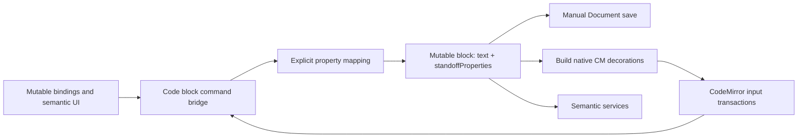
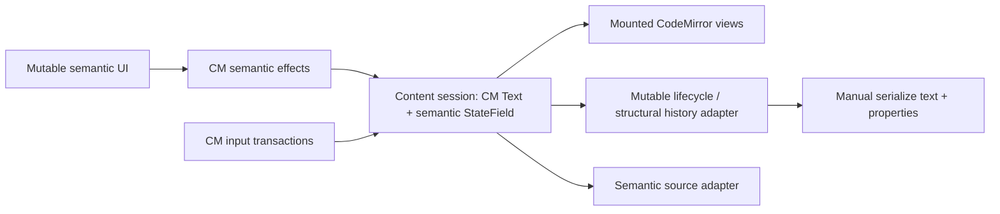
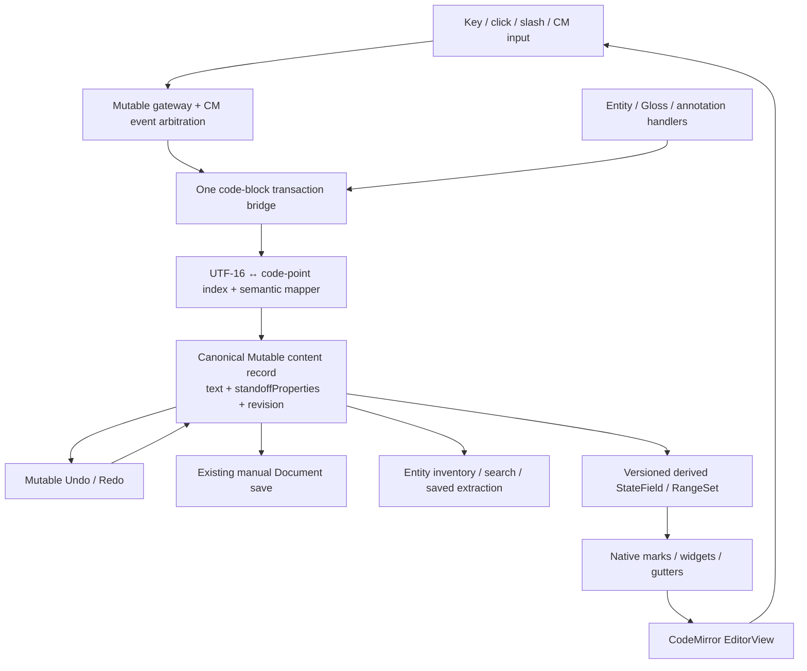

# Standoff-enabled CodeMirror investigation

**Project:** Mutable OS

**Proposed type:** `standoff-code-mirror-block`

**Date:** 23 November 2026 (Australia/Brisbane)

**Baseline:** `58732c62a2101f225dbc952cad25092aecb4cbf9`

**Status:** Investigation only. No production feature, refactor, dependency installation, or migration performed.

## Scope and evidence

This report incorporates the user's clarifications: use CodeMirror's native editing, highlights, annotations, and widgets; serialize a text property and an array of standoff-property objects shaped like ordinary Mutable annotations; do **not** introduce Cells into CodeMirror or reproduce Flint's standoff renderer. Mutable key bindings, click events, and slash commands are **core integration requirements**. The new block coexists with Flint and with the existing `code-mirror-block`.

The brief's references to autosave do not authorize it. `AGENTS.md` requires manual Document saving to the opened Mutable JSON filename and cheap dirty tracking. No background saves or Markdown sidecars are proposed. The user's explicit native-CodeMirror rendering direction governs this new surface; Flint continues using its existing SVG decoration machinery.

Evidence labels used below:

- **Verified—source:** inspected repository code, installed SDK declarations/implementation, or official upstream source.
- **Verified—experiment:** executable, isolated checks under [experiments/code-mirror-investigation](experiments/code-mirror-investigation/).
- **Recommendation:** a proposed implementation decision, not existing behavior.
- **Prototype gate:** requires a real mounted-editor experiment before claiming correctness or performance.

Official reference-page fetches returned HTTP 403 in this environment. Official CodeMirror GitHub source and its decoration example were accessible and consulted; installed package implementations/declarations supplied version-specific checks. API links point to the official reference, with an upstream source index below. No CodeMirror 5 APIs are used. Upstream `main` is moving evidence; experiments record exact installed versions.

## Part I — Executive Findings

### Feasibility and recommendation

**Feasible without changing Flint's editing engine. CodeMirror 6 already supports overlapping decoration ranges.** It accepts identical, nested, and partially overlapping ranges. An overlap does not require a CodeMirror fork or a new DOM renderer. The useful extension is a semantic annotation layer carrying Mutable identities and metadata, a deliberate edit mapper, native decoration/interaction extensions, and adapters into Mutable services.

Recommend a new, default-enabled `standoffCodeMirror` feature flag and a separately registered `standoff-code-mirror-block`. Keep committed text and standoff JSON together in the existing canonical repository. Use a CodeMirror `StateField` containing a **derived**, UTF-16 `RangeSet` to query and render those records. Route every committed text or annotation edit through one block-specific transaction bridge and Mutable's existing history. CodeMirror owns its DOM, selection, parsing, completion UI, and transient state; it does not become a second independently writable semantic database.

The persisted contract is straightforward:

```json
{
  "id": "source-block-id",
  "type": "standoff-code-mirror-block",
  "text": "const x = 1;\n",
  "metadata": { "language": "javascript" },
  "standoffProperties": [
    {
      "id": "mention-id",
      "type": "codex/entity-reference",
      "start": 6,
      "end": 6,
      "value": "entity-id",
      "metadata": {},
      "isDeleted": false
    }
  ]
}
```

Here `start`/`end` are inclusive code-point indexes, matching plain-text Mutable Cells' persisted units, but **there are no Cell objects, Cell placements, or per-character DOM nodes in this block**. The annotation covers `x`. Native normalized files place these fields in the block's `properties` envelope; the example is its ordinary block DTO representation. Retain existing optional fields, unknown types, linked `annotationId` references, and metadata rather than projecting them down to a decoration specification.

### Principal discoveries

1. **An existing name is already occupied.** The legacy [CodeMirrorBlock](src/blocks/code-mirror-block.ts) embeds CodeMirror. The active [CodeBlockView](src/rendering/core-block-views.tsx) is a textarea migration placeholder, registered by [register-core-views.ts](src/rendering/register-core-views.ts). Use the user's clarified new type; do not silently alter existing documents or defaults.
2. **The current annotation architecture is already more data-oriented than the legacy class.** [StandoffProperty](src/library/standoff-property.ts) is tightly coupled to Cells and DOM, but current canonical records store JSON properties and map them in [mapStandoffPropertiesForReplacement](src/interchange/ranges.ts). Reuse that data contract and semantic services, not legacy class instances.
3. **Native mapping is not Mutable mapping.** An exhaustive small ASCII experiment compared 1,764 nonempty-range/replacement combinations. Both a custom `RangeValue` with exclusive boundaries and `Decoration.mark({inclusive:false})` differed from the repository mapper in **182 cases**. For example, replacing the entire annotation with new text can retain a CodeMirror mark; Mutable removes the consumed property. These are compatibility results, not performance benchmarks.
4. **Offsets need two explicit translations.** Mutable's ordinary text indexes are code points; CodeMirror indexes UTF-16 units with one internal unit per line break. Emoji and CRLF invalidate simple `end + 1` conversions. Combining marks are separate code points, not separate user-perceived characters.
5. **Semantic participation is not automatic.** Live entity inventories, annotation capability adapters, gloss creation, search eligibility, saved SQL extraction, and Scry contain text-type/Cell assumptions. Merely adding `standoffProperties` to a code block does not integrate them.
6. **The canonical repository can already admit this payload shape locally.** Isolated checks for both code-block names, with 0 and 2,000 unrelated blocks, exercised commit/undo/redo and DTO serialization. There were no calls to `snapshot()` or reads of unrelated payloads. This does not establish bounded cost for every application subscriber or browser interaction.
7. **Mutable input routing needs an explicit embedded-editor path.** The current gateway treats native text as a textarea and its standoff branches assume Cells. Marking CodeMirror `opaque-widget` would suppress needed bindings; marking it `standoff` would invoke inappropriate text reconciliation. A small mount/gateway adapter is necessary.

### Risks, opportunities, and effort

Highest risks: replacement semantics; Unicode/line-ending conversion; competing undo histories; IME and provisional commands; duplicate event handling; offset-only edits triggering entity inventory refresh; and whole-block strings/annotation arrays limiting very large blocks despite CodeMirror's efficient document model.

Most promising capabilities: code-to-Entity/Claim/Gloss links, syntax-unit selection, persistent decisions attached to transient diagnostics, and navigation between source and explanatory prose. Overlap itself is already available; durable semantic meaning is the distinctive addition.

Estimated engineering effort, not a delivery commitment: **2–3 engineer-days** for the decisive mounted integration experiment; **10–18 additional days** for a useful first release including input routing, manual save, entity/gloss adapters, and tests; **10–20 additional days** for broader production qualification and large-source optimization if demanded by measurements. A developer familiar with this repository and one reviewer are assumed. Language servers, collaborative editing, and TEI Studio are excluded.

## Part II — Mutable Architecture Audit

### Evidence map and smallest integration point

| Area | Source and symbols | Finding and consequence |
|---|---|---|
| Legacy block host | [abstract-block.ts](src/blocks/abstract-block.ts), [code-mirror-block.ts](src/blocks/code-mirror-block.ts): `CodeMirrorBlock`, `getBlockBuilder`, `serialize` | Imperative hierarchy; the code block constructs `EditorView`, uses `basicSetup`/JavaScript, and serializes text. `bind` is empty, event attachment is empty, and the class has no CodeMirror-specific destroy override. This is reference material, not the active implementation target. |
| Active registration | [registry.ts](src/block-tree/registry.ts): `BlockRegistry.register/resolve`; [types.ts](src/block-tree/types.ts): `BlockTypeRegistration`; [register-core-views.ts](src/rendering/register-core-views.ts) | Registration provides view, factory, capabilities, aliases, and slots. A new type fits the existing registry; no new hierarchy is necessary. |
| Rendering/lifecycle | [block-outlet.tsx](src/rendering/block-outlet.tsx), [core-block-views.tsx](src/rendering/core-block-views.tsx): `CodeBlockView`; [mounts.ts](src/runtime/mounts.ts): `MountRegistry` | Solid renders occurrence-specific views. Mount registration carries focus and selection hooks and a generation fence. Build a new Solid component, create CodeMirror on mount, dispose registrations/plugins and call `view.destroy()` on cleanup. |
| Third-party editor precedent | [structured/source-view.ts](src/structured/source-view.ts): `sourceView` | Already creates a read-only CodeMirror view, lazy-loads language support, honors cancellation, and destroys the view. Reuse lifecycle ideas; it is not a semantic editing integration. |
| Identity and sharing | [types.ts](src/block-tree/types.ts): `ContentRecord`, `PlacementRecord`, `BlockNode`; [occurrences.ts](src/block-tree/occurrences.ts), [projection.ts](src/block-tree/projection.ts) | Persistent block identity, canonical content, placement, and mounted occurrence are distinct. Commit once per content; keep selection, geometry, and focus per occurrence. |
| Canonical mutation | [commands.ts](src/block-tree/commands.ts): `setPayloadField`, `replaceInlineRange`, `structuralTransaction`; [repository.ts](src/block-tree/repository.ts): `commit`, `commitInline`, `undo`, `redo` | Reuse operations, inverse operations, and publication. `replaceInlineRange` explicitly requires `inlineKind === 'standoff'`; it is not the code-block command. Text and annotations need one combined payload update, not two commits. |
| Bounded admission | [structural-plan.ts](src/block-tree/structural-plan.ts): `structuralChangeFor`; [inline-plan.ts](src/block-tree/inline-plan.ts); [compact-inline-plan.ts](src/block-tree/compact-inline-plan.ts) | The existing structural proof can admit a graph-preserving non-Cell payload edit. Use `requireBounded` and test real subscribed sessions; do not assume the inline fast path applies. |
| DTO persistence | [codecs.ts](src/block-tree/codecs.ts): `decodeBlockTree`, `encodeBlock`; [native-resource.ts](src/persistence/native-resource.ts): `captureNative`, `decodeNative` | Non-standoff payload fields survive generic serialization. Only `standoff-editor-block` gets inline Cell decoding. Unknown property data can be retained without inventing an inline sequence. |
| Save/dirty state | [native-session.ts](src/persistence/native-session.ts): `NativeDocumentSession`, `isDirty`, save paths; [document-save.tsx](src/application/document-save.tsx) | Resource generations and affected membership drive dirty state. Capture on explicit Save, using existing filename/conflict handling. Existing specialized save/export paths are not a reason to introduce new autosave. |
| Configuration | [configuration.ts](src/configuration.ts), [features.ts](src/runtime/features.ts): `FeatureHost` | New major feature needs a default-enabled flag. Disable authoring/view activation while retaining unknown block payloads for round-trip safety. |

The smallest integration point is **one registration plus one Solid CodeMirror view and a narrowly scoped code-block controller**. Registry, document ownership, and persistence envelopes already exist. Additional work belongs at text-range, semantic capability, and input-routing boundaries. No universal editor framework is justified.

### Standoff lifecycle: legacy versus active

| Stage | Existing behavior | CodeMirror adaptation |
|---|---|---|
| Selection → creation | [TextRanges](src/runtime/text-ranges.ts) creates versioned half-open snapshots; [RangeAnnotations.apply](src/runtime/range-annotations.ts) validates `cell`, creates UUIDs, writes inclusive `end - 1`, and batches changes. | Capture `EditorSelection`, convert UTF-16 to code-point boundaries, preserve content/occurrence/version, and use an admitted code-block annotation command. Do not fabricate Cells or falsely label raw UTF-16 as Cell coordinates. |
| Type/value/metadata | Canonical property objects and [linked-annotations.ts](src/block-tree/linked-annotations.ts) support independent segments and shared definitions. | Preserve all JSON fields. A `RangeValue` carries an ID/lookup key, not the sole copy of semantic metadata. |
| Edit mapping | [commands.ts](src/block-tree/commands.ts) and [inline-sequence.ts](src/block-tree/inline-sequence.ts) invoke [ranges.ts](src/interchange/ranges.ts). | Reuse/test the pure semantics over numeric code-point boundaries. No need for `inlineContent` or `Cell`. |
| Rendering | Legacy `StandoffProperty.applyStyling/getCells/hasOffsetChanged` touches Cells, DOM, and geometry. Active [standoff-editor-view.tsx](src/rendering/standoff-editor-view.tsx) and visual-effect infrastructure bind data to mounted text. | Use native CodeMirror marks, widgets, gutters, and tooltip/panel APIs. Reuse annotation type labels/details where compatible; do not invoke Cell render hooks. |
| Inspection/manipulation | [annotation-monitor.tsx](src/rendering/annotation-monitor.tsx), [annotation-commands.ts](src/block-tree/annotation-commands.ts), [annotation-contributions.ts](src/runtime/annotation-contributions.ts) | Share property details components and commands' semantic intent. Replace Cell-length/DOM-selection assumptions with code-block selection, length, and range-query adapters. |
| Persistence/reload | JSON survives codecs; live styling is reconstructed. [AnnotationIdentities](src/runtime/annotation-identities.ts) preserves mounted identity via IDs and `annotationOrigins`. | Reconstruct the CM range field from persisted properties. Preserve unique IDs and origin hints; keep duplicate/idless imported records distinguishable by occurrence-local keys without silently rewriting them. |
| Delete/restoration | Explicit annotation actions can mark `isDeleted`; consumed ranges can disappear from the array. Repository history stores inverse operations. | Match those distinct lifecycle cases. Undo restores original text **and** original properties/IDs; reverse position mapping alone cannot resurrect deleted records. |

The legacy `StandoffProperty` **class contract cannot be reused unchanged**: `start`/`end` are `Cell`, `block` is `StandoffEditorBlock`, and methods inspect Cell links, caches, and DOM. Its **persisted semantic contract can be reused**. The current reactive infrastructure already demonstrates that distinction. The old `bind` path also reconstructs properties without forwarding every identity/metadata field, so it should not be the model for a new loader.

### What Cells currently provide

In [cell.ts](src/library/cell.ts), a Cell has text, an index, previous/next links, DOM, and previous/current geometry. Legacy [StandoffEditorBlock](src/blocks/standoff-editor-block.ts) uses `toCells`, `knitCells`, `insertTextAtIndex`, `removeCellAtIndex`, `reindexCells`, and `shiftPropertyBoundaries`. Retained endpoints follow the same character objects through insertions. Deleting a boundary shifts it to a surviving neighbor; deleting a single-cell property marks it deleted. The legacy editor also has an EOL sentinel, which is not a source character to invent in a CodeMirror block.

The active architecture has both expanded inline records and compact inline text. [decodeBlockTree](src/block-tree/codecs.ts) splits ordinary text with `[...text]`; [replaceInlineRange](src/block-tree/commands.ts) similarly inserts code points. [inline-sequence.ts](src/block-tree/inline-sequence.ts) supports compact representations and nontext inline objects. Consequently, “Cell index” means an inline-unit coordinate generally, and a code-point coordinate only for pure text. This proposed block is pure text, so numeric conversion is sufficient.

Advantages to retain at the semantic boundary: stable property identity, insertion outside both span edges, shrinkage toward surviving text, arbitrary overlap, and coherent restoration. Features not transferable directly: per-Cell styling/wrapping, inline-object ownership, alternate readings represented as inline objects, Cell-specific geometry, and automatic movement of annotations with a moved Cell identity. CodeMirror move-line commands typically express deletion/insertion; semantic relocation needs an explicit move-aware policy if later desired.

The compatibility target should be the **current pure replacement mapper and declared policies**, not every historical rendering or undo quirk. Exact parity across legacy and reactive implementations is not a coherent promise.

### Semantic integration audit

| Capability | Reusable now | Required adaptation |
|---|---|---|
| Property types/IDs/metadata | JSON, linked definitions, `resolveLinkedProperty`, annotation contributions | Register the new block as an annotation source; validate coordinates; preserve unknown types. |
| Entity linking and details | [entity-references](src/features/entity-references/) UI/service, `codex/entity-reference`, [annotation-capabilities.ts](src/application/annotation-capabilities.ts) | Existing capabilities build `cells` from `node.inlineContent`; new source adapter must expose text/ranges without materializing per-character objects on typing. Selection and commit adapters are required. |
| Document entities/backlinks | [live-document-entities.ts](src/application/live-document-entities.ts): `Inventory`; [document-entity-changes.ts](src/application/document-entity-changes.ts): `watchDocumentEntities` | Both have explicit supported types. Teach inventories to read code-block standoff properties. Distinguish semantic membership/value changes from offset rebasing; resolve current excerpts only on demand. |
| Glosses | [gloss/model.ts](src/features/gloss/model.ts), [gloss/controller.ts](src/features/gloss/controller.ts), [gloss-plan.ts](src/block-tree/gloss-plan.ts) | `gloss.create`, target selection, click handling, and bounded admission currently require standoff text owners. Add the code-block target and native tooltip anchor; preserve Document-local shared gloss definitions. |
| Claims/arguments/relationships | [gloss/argument.ts](src/features/gloss/argument.ts), [anchor-relationships/model.ts](src/features/anchor-relationships/model.ts), [dialectic/arguments.ts](src/features/dialectic/arguments.ts) | Existing semantic records remain usable; range-target construction/navigation is not automatically CM-aware. Add supported target adapters rather than inventing a separate code relationship system. |
| In-document search | [text-search.ts](src/runtime/text-search.ts): `scopeNodes`, `TextSearch`; [canonical-search-source.ts](src/runtime/canonical-search-source.ts) | Type eligibility excludes code blocks today. Current UTF-16 results are not standoff-highlight/annotation targets. Add explicit source-coordinate conversion and native CM reveal/highlight paths. |
| Scry/slash commands | [autocomplete/index.tsx](src/features/autocomplete/index.tsx), [session.ts](src/features/autocomplete/session.ts), [model.ts](src/features/autocomplete/model.ts) | Command/session logic is useful; source capture, literal ranges, replacement, and provisional presentation are Cell-specific. Provide a CM source/commit/placement adapter and reuse handlers. See input design below. |
| Saved search/entity extraction | [knowledge/policy.ts](src/knowledge/policy.ts), [saved-projection.ts](src/knowledge-sqlite/saved-projection.ts): `projectSaved` | `nativeTextTypes` excludes this type. Current extraction infers coordinates from inline kind/type. Merely adding code-point properties to a native UTF-16 text source would misindex emoji. Add explicit code-point boundary mapping and annotation extraction together. |
| Retrieval/RAG | [retrieval/passages.mjs](src/retrieval/passages.mjs): `planPassages`; [retrieval/worker.mjs](src/retrieval/worker.mjs) | Existing saved text runs, hashes, coordinates, cancellation, and provenance are reusable once extraction supports this type. Syntax-aware chunks require a versioned new chunking profile; no network/indexing work on typing. |
| Cross-document navigation | [document-application-capabilities.tsx](src/application/document-application-capabilities.tsx), [reveal-match.ts](src/runtime/reveal-match.ts), [linked-annotations.ts](src/runtime/linked-annotations.ts) | Preserve resource/block/annotation identity. Mount the requested occurrence, check revision, unfold as needed, scroll with CodeMirror, then focus/select. A Cell DOM query is not a valid fallback. |

Only generic storage/identity and service-level data semantics work automatically. UI selection, range queries, source extraction, and navigation must explicitly admit the new surface. In particular, [saved-projection.ts](src/knowledge-sqlite/saved-projection.ts) currently rejects standoff ranges if their host has no recognized text coordinate; persistence success is not evidence of successful indexing.

The smallest coordinate seam is to register the new surface in `TextRanges` as **`coordinate:'utf16'`**, with a content-local version and CM-compatible LF text length. Keep persisted properties in inclusive code points. Code-block authoring/reveal adapters convert at this boundary; existing `validate(...,'cell')` calls must explicitly branch to the supported source adapter. Do not pass UTF-16 indexes into `RangeAnnotations.apply` unchanged. `AnnotationTarget` currently lacks a coordinate tag, so the new entry path should retain a `TextRangeSnapshot` until conversion and supply the intended units to the specific handler. Reuse metadata/details components directly; introduce no fake `inlineContent` and no eagerly generated array of character objects. This is a concrete extension to existing range/capability seams, not a new universal editor abstraction.

### Mutable input routing: key bindings, clicks, and slash commands

**This is part of the first useful release.** Native CodeMirror events must reach the appropriate existing Mutable action handlers, preserving user binding overrides, chord behavior, command enablement, and occurrence context.

Verified source constraints:

- [InputGateway](src/input/gateway.ts) listens on document **capture** for key/input/composition and mouse events. `scopes`, `runBinding`, and text reconciliation distinguish `standoff`, `native-text`, and `opaque-widget`.
- `native-text` handling checks `HTMLTextAreaElement`; CodeMirror's `contentDOM` is a contenteditable element. `standoff` would enter Cell reconciliation and commands. `opaque-widget` suppresses scopes/history/context menus. None is a correct unmodified designation.
- [BindingRegistry](src/input/bindings.ts) dispatches keyboard, chords, mouse click/double-click/contextmenu, and registered custom events. It honors `defaultPrevented`, suppresses composition key dispatch, and treats a handler returning `false` as unhandled. Other returns count as handled and prevent default/propagation.
- [autocomplete/index.tsx](src/features/autocomplete/index.tsx) requires `standoff-editor-block` in `snapshot`; command dispatch uses existing table/tab/Flint/gloss/entity/search handlers. [CompletionSession](src/features/autocomplete/session.ts) is reusable logic, but source text, replacement, and caret restoration need adapters. [ProvisionalCells](src/features/autocomplete/provisional-cells.ts) is **not** to be used in CM.

**Recommended narrow change:** introduce an embedded-code input policy, or an equivalent explicit mount capability, with callbacks for current selection, command invocation, click resolution, completion session, and composition state. Teach the gateway to recognize it at capture time. Keep the binding registry and application handlers as the single action registry. Do not synthesize a second keyboard event or copy the binding definitions into CM keymaps.

Scope matching requires care: for example, [entity-references/bindings.ts](src/features/entity-references/bindings.ts) registers `entity.open` in `editor/standoff`, while the entity listing uses `editor`. Exposing only a new `editor/code-mirror` scope would lose existing semantic shortcuts. Conversely, enabling every standoff action would admit Cell-only commands. Add a narrow eligibility check for this mount's supported existing actions **before matching both ordinary bindings and chord starts**, then route eligible semantic IDs through the adapted handlers. Preserve the registry's user-defined triggers and labels. Unsupported actions must not consume the first stroke of a chord or reach the legacy Cell branch merely because their scope matches.

| Event/action | Owner and proposed route | Important constraint |
|---|---|---|
| Save, document undo/redo, configured Mutable bindings/chords | Gateway → `BindingRegistry` → existing Mutable command/handler, using code-block context | Respect user remaps. One dispatch per physical event. History selection context needs a CM bookmark. |
| Ordinary characters, navigation, indentation, native completion | Gateway deliberately passes through → CodeMirror | Do not run Flint `beforeinput`, reconciliation, list/Markdown transforms, or snapshot collection. |
| Shared shortcut conflict | An active popup gets its navigation keys; then explicit Mutable bindings; then CM keymap; then browser | Specify conflicts such as Find/Tab/Escape. Return `false` when unsupported so a code command can handle the event. |
| Click/double-click/context menu | Gateway bindings receive raw gesture and correct occurrence; CM hit adapter supplies text position and annotation candidates | Preserve ordinary caret placement, word selection, drag selection and context menu unless a Mutable handler handles the gesture. Do not invoke both gateway and CM handlers independently. |
| Annotation-specific click | Native CM position query → annotation IDs → existing inspector/contribution handler | DOM fragments are not identity. If several annotations overlap, offer a picker rather than selecting the innermost span arbitrarily. |
| Custom Mutable input | Existing `dispatchCustom` route with the mounted occurrence and payload | Preserve registry-supported custom event names and feature ownership. |
| Slash commands | CM source/selection adapter → existing completion command provider/session → existing Mutable handler | Keep command parsing and enablement shared. Expose only applicable commands; structural insertion uses block commands, text insertion uses the atomic code-block bridge. |
| IME | CM owns native composition; mount advertises composition state to gateway | Do not open slash menus or consume composition keys. Commit finalized edits coherently; provisional session UI does not create canonical history. |

A capture listener executes before `EditorView.domEventHandlers`. Therefore `Prec.highest(keymap.of(...))` **cannot by itself resolve the existing gateway conflict**. The gateway must first delegate correctly. CodeMirror event handlers then fill gaps the gateway intentionally leaves, with a shared handled-event decision. Tests must assert exactly one handler call, not merely that the command eventually runs.

For Find, honor an existing Mutable binding first; offer source-local CodeMirror Find through a block action when that binding is occupied. For native autocomplete versus the Mutable slash panel, only the active popup owns arrow/Enter/Escape navigation. Focus transitions cancel pending chords and stale completion sessions using the existing lifetimes, rather than leaving a command aimed at the previous block.

Slash-trigger policy needs a small product decision because `/` is source syntax (division, regex, comments, paths). Recommended default: recognize a slash invocation on an otherwise blank line or after an explicit command-menu invocation; provide the existing Mutable command entry action for all other positions. Do not trigger on `a/b`, `//`, `/*`, or quoted paths. An incomplete syntax tree must not make every slash a command. This is a proposed CM-specific trigger policy; it does not change Flint's defaults.

Use native CM tooltip/panel presentation for a provisional slash session. Command query text can live in session state while a command UI is active, with ordinary source input resuming on cancellation; the explicit “keep literal” action commits literal text once if that interaction is offered. Alternatively, a normal authored slash token can be replaced through a single compound action on acceptance. Pick one policy before implementation and test cancellation, Save, undo, focus loss, and composition. Recommended initial design is a **session-local command panel** anchored to the invocation, avoiding provisional canonical edits and Cell infrastructure. It must still use the existing command provider and handlers, not a duplicate command list.

### Other document UI behavior

Block handles, selection chrome, deletion, duplicate placement, child blocks, reordering, and drag-and-drop continue through existing structural commands. Dragging **inside** CM edits source; dragging its block handle reorders the block. Duplication must follow existing clone/scoped semantic-copy rules for block/property/definition IDs ([scoped-semantic-copy.ts](src/block-tree/scoped-semantic-copy.ts)), while transclusion keeps shared content and separate view selections. Both need new-type fixtures.

Copy defaults to source text through native CM. Mutable rich copy requires an explicit custom MIME payload with text, clipped standoff JSON, coordinate declaration, and remapped IDs; do not put styling HTML into source. Initial plain paste maps existing annotations normally. Annotation-preserving copy/paste is a production follow-up unless required for first-release parity. Read-only mode must enforce both CM state/view settings and canonical command admission; annotations can remain editable when only base text is protected, following [text-protection.ts](src/block-tree/text-protection.ts).

## Part III — CodeMirror SDK Capability Matrix

All APIs below were checked against installed declarations/implementation or official source. Their Mutable applications are recommendations; mounted UI behavior remains subject to browser qualification. `@codemirror/*` abbreviates to `CM/*` in the package column.

### State, transactions, ranges, and history

| CodeMirror API | Package | Capability | Mutable application | Limitations | Recommendation |
|---|---|---|---|---|---|
| [EditorState](https://codemirror.net/docs/ref/#state.EditorState) | CM/state | Immutable document, selection, extensions, fields | One state per mounted editing occurrence | Does not itself save or notify Mutable | Use |
| [Text](https://codemirror.net/docs/ref/#state.Text) | CM/state | Persistent line-oriented text tree, slices/iteration | Efficient native text edits | UTF-16; internal line break counts as one; whole-string conversion is linear | Use; do not flatten for optional UI |
| [Transaction](https://codemirror.net/docs/ref/#state.Transaction) | CM/state | Changes, selections, effects, annotations and start/end state | Atomic input description, edit cause | CM transaction annotations are not semantic standoff annotations | Use with origin/revision tags |
| [ChangeSet](https://codemirror.net/docs/ref/#state.ChangeSet) | CM/state | Apply, invert, compose, map; includes inserted text | Extract exact edits with `iterChanges(..., true)` | Input length must match; composition can obscure original user intent | Use, preserve ordered edit intent |
| [ChangeDesc](https://codemirror.net/docs/ref/#state.ChangeDesc) | CM/state | Change mapping without inserted text | Map projections/bookmarks | Cannot reconstruct source text | Use for derived state |
| [mapPos](https://codemirror.net/docs/ref/#state.ChangeDesc.mapPos) | CM/state | Position mapping with association/deletion mode | Map caret and uncomplicated boundaries | Not a complete annotation lifecycle policy; replacements differ from Mutable | Use with semantic mapper, never alone |
| [MapMode](https://codemirror.net/docs/ref/#state.MapMode) | CM/state | `Simple`, `TrackDel`, `TrackBefore`, `TrackAfter` | Explicit deleted-point policy | Tests one position/adjacent character, not an annotation's surviving coverage | Use deliberately |
| [StateField](https://codemirror.net/docs/ref/#state.StateField) | CM/state | Immutable extension state updated by every transaction | Derived native annotation index | Field persistence is opt-in and is not Mutable JSON persistence | Use as cache/projection |
| [StateEffect](https://codemirror.net/docs/ref/#state.StateEffect) | CM/state | Typed nontext updates with optional position mapper | Add/update/delete projection entries, active ID, visibility | Positional effects need a `map` function; effects do not automatically undo | Use |
| [Annotation](https://codemirror.net/docs/ref/#state.Annotation) | CM/state | Transaction metadata | Origin, canonical revision, external replay tags | Not range data | Use for echo suppression |
| [Facet](https://codemirror.net/docs/ref/#state.Facet) | CM/state | Compose extension inputs/configuration | Policy, read-only state, render settings | Not a mutable app store | Use for configuration |
| [Compartment](https://codemirror.net/docs/ref/#state.Compartment) | CM/state | Reconfigure a bounded extension group | Language, theme, read-only, wrapping | Recreate only affected configuration, not the whole editor | Use |
| [dispatchTransactions](https://codemirror.net/docs/ref/#view.EditorView.constructor) | CM/view | Application-supplied transaction dispatch | Validate/commit text+properties before publishing view update | Must eventually call `view.update`; avoid reentrant dispatch | Preferred commit bridge |
| [transactionFilter](https://codemirror.net/docs/ref/#state.EditorState%5EtransactionFilter) | CM/state | Replace/combine transaction specifications | Reject invalid source operations if necessary | Can be bypassed with `filter:false`; altering input risks selection/IME | Sparing use, no repository side effects |
| [transactionExtender](https://codemirror.net/docs/ref/#state.EditorState%5EtransactionExtender) | CM/state | Add effects/annotations even when normal filtering disabled | Attach derived metadata | Cannot change text/selection; may run for speculative transactions | Pure derivation only |
| [changeFilter](https://codemirror.net/docs/ref/#state.EditorState%5EchangeFilter) | CM/state | Suppress changes or protected intervals | Optional restricted editing | Not an authorization boundary; programmatic bypass exists | Later; canonical validation remains |
| [updateListener](https://codemirror.net/docs/ref/#view.EditorView%5EupdateListener) | CM/view | Observe completed view updates | Focus/selection/toolbar state | Too late as sole atomic commit authority | Observe only |
| [RangeValue](https://codemirror.net/docs/ref/#state.RangeValue) | CM/state | Range payload, equality, boundary bias, point mode | Stable annotation lookup key | `point:true` on nonempty ranges shadows interior ranges during span iteration; `mapMode` applies to zero-length mapping | Nonpoint semantic spans; separate point values |
| [RangeSet](https://codemirror.net/docs/ref/#state.RangeSet) | CM/state | Persistent range indexing/mapping/querying | Entire-block annotation index, overlaps included | Generic mapping differs on replacements; dense overlap still costs | Derived index, not persisted authority |
| [RangeSetBuilder](https://codemirror.net/docs/ref/#state.RangeSetBuilder) | CM/state | Efficient construction in sorted order | Initial load/rebuild | Additions must be ordered by `from`, then `startSide`; arbitrary updates use `RangeSet.update` | Use on load; avoid rebuilding per caret move |
| [history, historyKeymap](https://codemirror.net/docs/ref/#commands.history) | CM/commands | Native text history | Viable for CM-authoritative alternative | Competes with Mutable's block/annotation history | Omit from recommended setup |
| [invertedEffects](https://codemirror.net/docs/ref/#commands.invertedEffects), [isolateHistory](https://codemirror.net/docs/ref/#commands.isolateHistory) | CM/commands | Invert application effects; force history group boundaries | Alternative B can restore semantic effects | Every effect needs an inverse and mapping; no cross-block history by itself | Evaluate only if CM history owns the session |

### Native decoration, interaction, and layout

| CodeMirror API | Package | Capability | Mutable application | Limitations | Recommendation |
|---|---|---|---|---|---|
| [EditorView](https://codemirror.net/docs/ref/#view.EditorView) | CM/view | Owns editable DOM, events, viewport, measurement | Solid-hosted editing surface | Do not manipulate `contentDOM` text/wrappers externally; call `destroy` | Use |
| [Decoration.mark](https://codemirror.net/docs/ref/#view.Decoration%5Emark) | CM/view | Inline attributes/classes across ranges | Native semantic highlights/underlines | Marks split at line breaks and overlapping precedence boundaries | Primary span presentation |
| [Decoration.widget](https://codemirror.net/docs/ref/#view.Decoration%5Ewidget) | CM/view | Inline/block DOM at a position | Point annotation marker, gloss affordance | Widget side controls ordering; layout-changing widgets need appropriate providers | Use selectively |
| [WidgetType](https://codemirror.net/docs/ref/#view.WidgetType) | CM/view | Widget DOM, equality/update, lifecycle/event policy | Stable accessible annotation controls | Implement equality, disposal, and event ownership to avoid churn | Use |
| [Decoration.replace](https://codemirror.net/docs/ref/#view.Decoration%5Ereplace) | CM/view | Hide source, optionally substitute widget | Annotation-focused/folded projection | Does not delete text; can hide important context | Later, explicit view mode |
| [Decoration.line](https://codemirror.net/docs/ref/#view.Decoration%5Eline) | CM/view | Attributes at a line start | Evidence/status bands | Not arbitrary character-range representation | Optional |
| [DecorationSet](https://codemirror.net/docs/ref/#view.DecorationSet) | CM/view | `RangeSet<Decoration>` | Visual projection distinct from semantic index | Carries presentation, not the canonical annotation record | Use |
| [EditorView.decorations](https://codemirror.net/docs/ref/#view.EditorView%5Edecorations) | CM/view | Direct or view-dependent decoration sets | Native marks from annotation index | View-dependent sets cannot introduce block widgets or replacements spanning line breaks | Use direct sets for layout-changing output |
| [outerDecorations](https://codemirror.net/docs/ref/#view.EditorView%5EouterDecorations) | CM/view | Outer, low-precedence mark layer | Make semantic bands less fragmented by syntax | Partially overlapping outer marks still split; not an overlap “fix” | Optional semantic layer |
| [atomicRanges](https://codemirror.net/docs/ref/#view.EditorView%5EatomicRanges) | CM/view | Cursor/navigation skips ranges | Optional atomic hidden placeholders | Does not forbid programmatic selection or protect text; ordinary annotations should be editable | Do not apply to normal annotations |
| [ViewPlugin](https://codemirror.net/docs/ref/#view.ViewPlugin) | CM/view | View-scoped derived state and update/destroy hooks | Viewport marks, hover/hit UI | Avoid synchronous layout reads while updating | Use |
| [EditorSelection, SelectionRange](https://codemirror.net/docs/ref/#state.EditorSelection) | CM/state | Direction, main/multiple ranges, cursor association | Create independent annotations for selected ranges | Selection normalization merges overlapping selections; selection is not annotation storage | Use; support main selection first |
| [allowMultipleSelections](https://codemirror.net/docs/ref/#state.EditorState%5EallowMultipleSelections) | CM/state | Enables multiple selections | Batch annotate disjoint source ranges | Need one atomic action and main-selection policy in Mutable UI | Qualify before enabling toolbar batch actions |
| [coordsAtPos, posAtCoords, domAtPos](https://codemirror.net/docs/ref/#view.EditorView.coordsAtPos) | CM/view | Position/screen/DOM translation | Tooltip anchors and hit queries | Offscreen positions may lack DOM/coordinates; bidi/side matters | Use CM measurements; do not scan source DOM |
| [requestMeasure](https://codemirror.net/docs/ref/#view.EditorView.requestMeasure), [visibleRanges](https://codemirror.net/docs/ref/#view.EditorView.visibleRanges) | CM/view | Coalesced reads then writes; actually rendered text ranges | Small shared layout cache for overlays | Viewport differs from visible ranges under folding/long lines; no public complete cached range-rectangle API | Use only for needed visible UI |
| [domEventHandlers](https://codemirror.net/docs/ref/#view.EditorView%5EdomEventHandlers), [keymap](https://codemirror.net/docs/ref/#view.keymap), [Prec](https://codemirror.net/docs/ref/#state.Prec) | CM/view, CM/state | Event hooks and ordered command dispatch | Native events cooperating with Mutable routing | Cannot outrank earlier document capture listeners; explicit handled state required | Use with gateway adapter |
| [hoverTooltip, showTooltip](https://codemirror.net/docs/ref/#view.hoverTooltip), [showPanel](https://codemirror.net/docs/ref/#view.showPanel) | CM/view | Positioned hover/selection UI and editor panels | Annotation picker/details and slash panel | Async results need revision/ID validation; separate popup focus from editor commands | Use; reuse Mutable detail components |
| [clipboardInputFilter, clipboardOutputFilter](https://codemirror.net/docs/ref/#view.EditorView%5EclipboardInputFilter) | CM/view | Plain-text clipboard transformations | Deliberate line-ending handling | String filters do not implement semantic custom MIME payloads | Preserve ordinary source copy/paste |

### Language and complementary facilities

| CodeMirror API | Package | Capability | Mutable application | Limitations | Recommendation |
|---|---|---|---|---|---|
| [Language, LanguageSupport, LRLanguage](https://codemirror.net/docs/ref/#language.Language) | CM/language | Parser/language data and supporting extensions | Language-aware source surface | Capabilities vary by language package | Use lazy-loaded official packages |
| [syntaxTree](https://codemirror.net/docs/ref/#language.syntaxTree) | CM/language | Current incremental syntax tree | Annotate current syntactic unit | Tree may be partial; nodes have no durable semantic identity | Near-term |
| [syntaxTreeAvailable, ensureSyntaxTree](https://codemirror.net/docs/ref/#language.ensureSyntaxTree) | CM/language | Check/request parsing through a position within a time budget | Explicit syntax-selection command | May fail/time out; never force full parsing on typing | Use on demand with fallback |
| [TreeCursor, SyntaxNode](https://lezer.codemirror.net/docs/ref/#common.SyntaxNode) | @lezer/common | Traverse node type and source spans | Function/class/parameter/string/XML-node selection | Grammar-specific names; error recovery; no type resolution | Small language-specific selector table |
| [parseMixed](https://lezer.codemirror.net/docs/ref/#common.parseMixed), `resolveInner` | @lezer/common | Mounted nested parsers | HTML/JS, Markdown fences | Must select the inner language and respect embedded boundaries | Near-term |
| [LanguageDescription](https://codemirror.net/docs/ref/#language.LanguageDescription), [languageDataAt](https://codemirror.net/docs/ref/#state.EditorState.languageDataAt) | CM/language, CM/state | Lazy load by name/file and query local language data | Picker, indentation/comment/completion defaults | Filename detection is a hint, not a semantic fact | Use |
| [syntaxHighlighting](https://codemirror.net/docs/ref/#language.syntaxHighlighting) | CM/language | Tags → theme classes | Syntax colors alongside semantic marks | Syntax coloring does not identify symbol definitions/references | Use |
| [autocompletion, CompletionSource](https://codemirror.net/docs/ref/#autocomplete.autocompletion) | CM/autocomplete | Contextual sync/async completion and acceptance | Language completion; optional Entity choices in explicit semantic mode | Not a compiler/LSP; must arbitrate with Mutable slash popup | Native completion plus shared command routing |
| [linter, Diagnostic, setDiagnostics](https://codemirror.net/docs/ref/#lint.linter) | CM/lint | Transient diagnostic ranges/actions | Promote a finding to persistent Claim/Gloss | Diagnostic IDs/lifetime are not annotation identity; stale response checks required | Near-term |
| [codeFolding, foldGutter, foldEffect](https://codemirror.net/docs/ref/#language.codeFolding) | CM/language | Fold source through language/service ranges | Compact annotated source; reveal unfolds target | Fold state is session/view data, not semantic deletion | Use with navigation tests |
| [gutter, GutterMarker, lineNumbers](https://codemirror.net/docs/ref/#view.gutter) | CM/view | Native line-side markers | Overlap counts and annotation-presence indicators | Line markers cannot substitute for exact text-range records | Optional gutter, line numbers by default |
| [search, SearchQuery, SearchCursor](https://codemirror.net/docs/ref/#search.search) | CM/search | Local find/replace, queries/cursors | Source-local search and native marks | Does not join Mutable document/vault search automatically | Reconcile Find bindings; explicit document adapter |
| [indentService, indentOnInput](https://codemirror.net/docs/ref/#language.indentService), [indentSelection](https://codemirror.net/docs/ref/#commands.indentSelection) | CM/language, CM/commands | Language indentation/edit commands | Native code typing | Whole-document formatting requires a separate formatter and careful range policy | Use indentation; defer formatter |
| [bracketMatching](https://codemirror.net/docs/ref/#language.bracketMatching), [closeBrackets](https://codemirror.net/docs/ref/#autocomplete.closeBrackets) | CM/language, CM/autocomplete | Match and insert paired delimiters | Native source editing | Multiple insertions must flow through the same bridge; avoid Scry bracket-trigger collisions | Use with compound-edit tests |
| [MergeView, unifiedMergeView](https://codemirror.net/docs/ref/#merge.MergeView) | CM/merge | Two-sided/unified textual diffs | Compare revisions with separate semantic overlays | Text diff does not decide annotation correspondence or merge conflicts | Exploratory |
| [collab, sendableUpdates, receiveUpdates](https://codemirror.net/docs/ref/#collab.collab) | CM/collab | Versioned shared editing/rebasing with an authority | Future shared code investigations | Requires server/protocol and shared effect mapping; not generic offline CRDT or semantic conflict resolution | Defer |
| [readOnly](https://codemirror.net/docs/ref/#state.EditorState%5EreadOnly), [editable](https://codemirror.net/docs/ref/#view.EditorView%5Eeditable) | CM/state, CM/view | Editing-command and DOM editability controls | Read-only source with selectable annotations | Neither is sufficient canonical protection alone | Use both appropriately |
| [EditorView.theme, baseTheme, darkTheme](https://codemirror.net/docs/ref/#view.EditorView%5Etheme) | CM/view | Scoped styling and theme integration | Mutable colors/fonts without changing source | Global editor CSS and transformed containers need browser checks | Use scoped themes/compartments |

### Illustrative extension shapes

These are design pseudocode, not implementation or a claim that a tested integration exists.

```ts
// Persistent records stay in Mutable; values identify their derived ranges.
class SemanticRange extends RangeValue {
  constructor(readonly key: string) { super() }
  startSide = 1
  endSide = -1
  eq(other: SemanticRange) { return this.key === other.key }
}

// This bias handles exclusive insertion edges. It DOES NOT establish correct
// Mutable replacement semantics: authoritative replacements arrive via effects.
const replaceProjection = StateEffect.define<{
  revision: number; ranges: RangeSet<SemanticRange>
}>()

const semanticField = StateField.define({
  create: () => ({revision: 0, ranges: RangeSet.empty as RangeSet<SemanticRange>}),
  update(value, tr) {
    for (const effect of tr.effects)
      if (effect.is(replaceProjection)) return effect.value
    // Selection/theme-only updates leave the committed semantic projection alone.
    return value
  }
})
// An implementation can use ID-based delta effects rather than whole replacement.
// Every content-changing transaction must carry the matching derived projection.
```

```ts
const language = new Compartment()
// Later, after checking both mount generation and current language request:
view.dispatch({effects: language.reconfigure(await selectedLanguage.load())})

// Exact syntax node names are language-specific; this runs on explicit request.
const tree = syntaxTreeAvailable(view.state, selection.to)
  ? syntaxTree(view.state) : ensureSyntaxTree(view.state, selection.to, 20)
if (!tree) return showSelectionFallback()
let node = tree.resolveInner(selection.head, -1)
while (node && !eligibleForLanguage(node.type.name)) node = node.parent
if (node) annotateValidatedRange(node.from, node.to) // UTF-16 → persisted units
```

Lexical/style tags, concrete syntax nodes, and language-aware indentation/completion are distinct capabilities. Lezer trees do **not** establish symbol binding, types, call graphs, runtime behavior, or cross-file references. Those require language services/compiler APIs or explicit human semantic assertions. Node identity and source offsets are not durable anchors after arbitrary rewrites.

### Dependencies and host compatibility

Verified installed and lockfile versions: `codemirror` **6.0.2**, `@codemirror/state` **6.7.6**, `view` **6.43.13**, `language` **6.12.4**, `commands` **6.11.1**, `lang-javascript` **6.2.5**, `lang-markdown` **6.5.2**, `language-data` **6.5.2**. Installed `search` is **6.7.2**, `autocomplete` **6.20.3**, and `lint` **6.9.7**. These are the repository's versions, not a claim they are the latest published versions. Core/package API claims were cross-checked with accessible current official source.

No new package is needed for the investigation. Implementation should declare the core packages it directly imports, instead of depending on transitive availability from `codemirror`. Use a curated extension array rather than `basicSetup`, because the latter includes native history and keymaps that need deliberate ownership. `merge`/`collab` are optional later dependencies, not initial requirements.

SolidJS and Vite are already used with CM in [source-view.ts](src/structured/source-view.ts). Give CodeMirror an empty host that Solid does not reconcile internally. Use `onMount`/`onCleanup`, cancel async language loads, and keep one view per mounted occurrence. No measured bundle-size estimate was made: core is already present, but a new eager import can move it into the initial chunk. Compare Vite compressed initial and lazy chunks before/after; lazy-load languages, merge, lint engines, and any eventual formatter. Avoid duplicate `@codemirror/state` instances in dependency resolution.

Inspected installed package manifests declare **MIT**. Retain dependency notices and check optional language/formatter/service packages separately. No extra overlap library is required. Third-party LSP bridges or Yjs bindings may be useful later, but none was audited for maintenance here; do not present one as an approved dependency. Browser APIs suit an Electron renderer; DOM/root changes, detached windows, CSP/style injection, workers, IME, and bundling still need target-host qualification. No verified Electron deployment result is claimed.

Vitest and jsdom already support data/lifecycle tests. Use a real browser for layout, virtualized ranges, bidi, clipping, composition, dragging, focus transfer, and typing latency. Headless timing cannot establish user-visible responsiveness.

## Part IV — Annotation Compatibility Analysis

### Boundary and replacement behavior

Use half-open `[from,to)` for the following explanation; persisted ordinary properties use inclusive `[start,end]`. In `abcdef`, a property over `bcd` is persisted `[1,3]`, projected `[1,4)`.

| Operation | Current mapper result | Recommended CM integration policy |
|---|---|---|
| Insert one character before | `[2,5)` | Shift both boundaries; same identity |
| Insert at start, position 1 | `[2,5)` | Exclude inserted text; start associates right |
| Insert inside, position 2 | `[1,5)` | Expand through inserted text |
| Insert at end, position 4 | `[1,4)` | Exclude inserted text; end associates left |
| Delete before `[0,1)` | `[0,3)` | Shift both boundaries |
| Delete inside `[2,3)` | `[1,3)` | Contract; preserve ID/metadata |
| Delete entire `[1,4)` | Property removed | Preserve inverse record for Undo |
| Replace entire `[1,4)` with two characters | Property removed | Do not silently attach the old meaning to replacement source |
| Replace `[0,2)` with two characters | `[2,4)` | Keep surviving right text; replacement is outside |
| Replace `[3,5)` with two characters | `[1,3)` | Keep surviving left text; replacement is outside |
| Replace an interior subset | Outer span retains surviving sides and covers inserted interior | Map actual edits, not a full-document replacement |
| Multiline paste | Same rules, measured in code points of canonical LF text | Convert offsets/line endings before commit |
| Undo/redo | Forward/inverse canonical records | Restore source and properties together; mapping alone cannot restore deleted records |

Verified experiment: [probe.mjs](experiments/code-mirror-investigation/probe.mjs), [results.json](experiments/code-mirror-investigation/results.json). It transpiles and executes the actual repository mapper in memory with the same `structuredClone` semantics, compares native CM mapping, verifies overlapping identities and line endings, and records package versions. It installs nothing.

`ChangeDesc.mapPos(pos, assoc, mode)` is useful but its endpoint behavior during replacement is more nuanced than “positive always means after replacement.” The recorded 182 mismatches demonstrate why association flags alone are insufficient. `MapMode.TrackAfter`/`TrackBefore` can detect consumption of an endpoint's neighboring character, but rejecting a span whenever an endpoint disappears would wrongly discard partially surviving annotations. Mutable must evaluate the surviving coverage of the whole span.

For a first implementation, reuse the pure repository mapper after coordinate conversion. For compound CM transactions:

1. Retain the transaction sequence and each transaction's start-state document.
2. Extract individual edits with `iterChanges(callback, true)`. Convert all old coordinates using that start state's conversion index.
3. For independent edits in one old-document coordinate system, apply from right to left, preserving the original order for same-position edits as represented by CM. Use the normalized `ChangeSet` rather than independently sorting ambiguous user specs.
4. Map properties with the declared replacement policy and compose `annotationOrigins` across mapping steps. Keep explicit add/update/delete effects in a defined coordinate space, preferably the transaction's final document.
5. Commit final text and properties once for the action. Differential-test adjacent replacements, multi-cursor edits, auto-pairs, and sequential transaction batches; the isolated probe only verifies individual mapping and exposes compound coordinates, not every compound policy.

If annotations must follow **moves**, use an explicit semantic relocation action retaining IDs. A native delete/paste move or arbitrary external file rewrite has insufficient information to infer that policy reliably. Syntax-anchor recovery is a separate reviewed operation, not ordinary mapping.

### Points, overlap, and selection

The active annotation editor accepts zero-width properties with `isZeroWidth:true` and either `end === start` or `end === start - 1` ([annotation-commands.ts](src/block-tree/annotation-commands.ts)). However, [ranges.ts](src/interchange/ranges.ts) returns early for `end < start` before the zero-width branch. In the experiment a point `{start:2,end:1}` neither moved on insertion nor disappeared on consuming deletion, unlike `{start:2,end:2}`. **This is an existing inconsistency, not something to reproduce in a new block.**

Recommend creating code-block points with `end === start`, an explicit `affinity`, and a point-specific command. On importing the alternate representation, normalize it in the code-block working projection and record the intended equivalent representation on an explicit authored save/edit policy; do not silently modify existing Flint data. Handle point mapping before nonempty-span validation. Existing `TextRanges.validate` rejects empty ranges, so it cannot validate point creation unchanged. A zero-width CM widget can represent the point; an empty mark cannot.

Adjacent annotations retain separate IDs and exclude an insertion at their common edge. Nested/partially overlapping/identical spans map independently. The probe retained four distinct `RangeValue`s including duplicate boundaries through insertion. `RangeAnnotations.apply` currently deduplicates identical type/range/value authoring requests; preserve multiple existing IDs, and make “create another independent annotation” explicit if required.

CodeMirror splits crossing marks into valid nested DOM segments. Higher-precedence decorations tend to form inner DOM; `outerDecorations` provides an outer semantic layer, but does not eliminate splitting between partially overlapping outer ranges. Line breaks also split mark DOM. Semantic identity must therefore be stored independently and optionally repeated as a `data-annotation-key` on fragments. Hit-testing should ask the index for **all** ranges at a CM position and filter according to the chosen boundary convention, not infer identity from a single ancestor span.

Suggested interaction: one subtle aggregate underline/highlight, a count when multiple records are present, and a keyboard-accessible list sorted by type and stable identity. Selecting one record focuses its native mark styling and opens the existing Mutable details UI. Never merge semantic records merely because their decoration styles coincide. Do not mark normal spans atomic: users must edit their source freely.

Multiple selections are a UI batch input, not a storage model. Capture each disjoint nonempty selection, convert/validate it, then create independent records or an explicitly requested linked annotation in one action. Retain selection direction and main range; do not depend on the browser's single DOM selection for CM secondary selections.

### Unicode and line endings

| Input | Mutable pure-text units | JavaScript UTF-16 units | CM default internal length | Consequence |
|---|---:|---:|---:|---|
| `abc` | 3 | 3 | 3 | ASCII matches |
| `漢é` | 2 | 2 | 2 | BMP matches |
| `a😀b` | 3 | 4 | 4 | Persisted emoji `[1,1]` projects to `[1,3)` |
| `e` + combining acute | 2 | 2 | 2 | One visible grapheme can contain two persisted units |
| `a\nb` | 3 | 3 | 3 | LF matches |
| `a\r\nb` | 4 | 4 | 3 | Default CM normalization removes one offset unit |
| `a\rb` | 3 | 3 | 3 | Same length, different source bytes under default normalization |
| `a\r\nb\nc` | 6 | 6 | 5 | Mixed endings need a declared policy |
| `é` versus decomposed `é` | 1 versus 2 | 1 versus 2 | 1 versus 2 | No implicit Unicode normalization |
| family ZWJ emoji `👨‍👩‍👧‍👦` | 7 | 11 | 11 | Neither unit system equals grapheme count |

These lengths and actual CM text outputs are recorded in `results.json`. Setting `EditorState.lineSeparator.of('\r\n')` makes `state.sliceDoc()` serialize CRLF, but `state.doc.length` still counts each internal line break as one. The facet alone does not reconcile persisted raw-string offsets.

**Recommended initial contract:** new code blocks use canonical LF source, inclusive code-point property offsets, and no NFC/NFKC normalization. Store language/view settings in block metadata, keeping annotation objects in the established shape. At explicit import, convert text and annotations together from declared source coordinates/line endings. Never just pass CRLF text to `EditorState.create` and retain original indexes. For existing non-LF new-type payloads, preserve original data and require a defined conversion path before editing; byte-exact mixed-ending round-trip is a separate requirement to resolve before enabling such imports.

Conversion definition for pure text:

```ts
// One-time reference algorithm; production keeps an incrementally maintained index.
const boundaries = [0]
for (const codePoint of canonicalLFText)
  boundaries.push(boundaries.at(-1)! + codePoint.length)

// Inclusive persisted property → native half-open decoration.
const from = boundaries[property.start]
const to = property.isZeroWidth ? from : boundaries[property.end + 1]
```

Reverse conversion must find an **exact** boundary, not round a position inside a surrogate pair. Reject invalid programmatic annotation ranges; native interaction should use valid cursor/grapheme boundaries. Combining sequences need a separate user-selection policy: recommend complete graphemes for user-created annotations while preserving valid imported code-point ranges without silently expanding them. Isolated UTF-16 surrogate code units are possible in JavaScript; their accepted/rejected import behavior needs a deliberate validation test, not an assumption of well-formed Unicode.

For performance, retain per-chunk/per-line UTF-16 and code-point counts with an indexed prefix-sum structure; rescan changed chunks and reflow-independent text dependencies only. A full `Array.from(doc.toString())` for every selection or property is unsuitable. No Cell instances are involved. A simple O(N) conversion build is acceptable at initial load; shipping large-block typing requires incremental maintenance and measurements.

### Persistence, ordering, external changes, and failure handling

The invariant is: **every observable committed block revision has matching text and property positions**. No debounced interval may expose new text with old annotation offsets.

The bridge should prepare one next payload, validate it, and submit one canonical operation. Publish the corresponding CM transaction and derived annotation field within the same synchronous coordinator turn; suppress feedback from the origin occurrence. Repository rejection must leave the committed view/state unchanged or reconstruct it from the last canonical revision. If a view update fails after a successful commit, destroy/rebuild that view from canonical state; do not roll back unrelated canonical edits. This is a coordination contract, not a two-phase distributed transaction.

External updates and Undo/Redo must include the authoritative annotation records; do not remap an already mapped array. Prefer localized CM changes to preserve selection and composition. Use origin and expected-revision tags to reject stale async annotation responses, and an occurrence generation to reject callbacks after remount. A new view always reconstructs from canonical text/properties, so unmounting cannot discard committed work.

Provisional slash UI, theme switches, annotation visibility, and incomplete input sessions remain local. IME needs a mounted prototype: preserve native composition feedback while keeping provisional composition state out of canonical snapshots until the chosen commit boundary. Save/history/focus transitions during composition require explicit finalization or deferral, not saving a mixed transient/committed state. Queue conflicting external edits during composition or cancel/restart deliberately; do not blindly `setState` during an active composition.

Manual Save captures the canonical block with its properties as part of the existing Document. New edits during I/O remain dirty by resource generation. Existing save conflict/recovery machinery owns interrupted writes and reopen behavior; the feature adds no second file or independent annotation save. Full serialization and validation belong on admission/import/save as appropriate, not on every key or toolbar update. Regression-test actual native JSON round-trip and interrupted-save reopening; the isolated admission test verifies generic DTO serialization only.

Undo/Redo must restore removed properties, metadata, definitions, and source together. Recommended: Mutable repository history is authoritative; omit native `history()`/`historyKeymap`, route CM undo keys and browser `historyUndo/historyRedo` intent through the Mutable path, and retain per-occurrence selection bookmarks. [history/grouping.ts](src/history/grouping.ts) currently recognizes inline-sequence changes for typing grouping; payload-text edits need explicit grouping support if word-level undo is desired. Basic correctness can begin with one canonical input transaction per undo step, but must not claim existing Flint grouping automatically applies.

## Part V — Architectural Options

### Option A: canonical Mutable arrays, direct native decoration projection

Mutable's `ContentRecord.payload` owns text and property arrays. A code-block command maps the array using normalized CM edits, commits once, and regenerates native decoration sets. CodeMirror is the editing surface and owns only presentation/session state. Existing repository history and JSON saving work through the canonical records. Semantic adapters read those records directly.



Complexity is lowest. Principal costs are O(A) property mapping and rebuilding, whole-block text materialization, and full payload inverse records. This is a good correctness prototype and a viable small-block implementation, but not a demonstrated large-source solution. Purely visual rebuilding must not recreate metadata or annotation identities.

### Option B: CodeMirror semantic StateField is authoritative while the block session lives

One shared content session owns CM text and a semantic field; separate views present that session. Semantic UI dispatches effects into that session. Save serializes it to `{text, standoffProperties}`; load reconstructs it. `invertedEffects` and effect mapping integrate annotation history with CM history. A snapshot or command bridge integrates structural block operations and persistence.



This offers efficient native range/text structures and avoids eager JSON projection per keystroke. However, Mutable's current services, history, dirty tracking, saved capture, and shared projections read the repository. Mirroring session properties back there on a timer creates two authorities and save races. Keeping the session alive without mounted views and coordinating cross-block undo are substantial new responsibilities. It can work with a formal ownership transfer and lifecycle contract, but that is a larger architecture than this additional block requires. Not preferred now.

### Option C: canonical Mutable arrays plus a derived native range index

Use Option A's data authority and atomic commit, but maintain a versioned semantic `RangeSet` in CM and derive native decorations from it. Incrementally update unaffected ranges, then replace affected entries with the canonical mapper's exact results; never accept generic native replacement mapping as semantic truth. Semantic metadata stays in canonical records; ranges carry stable lookup keys. A block-scoped bridge services both CM edits and external Mutable annotation actions.



**Preferred.** This is Option A's ownership model with a native index, not a new semantic storage system. Start with direct canonical-to-range projection for correctness; qualify incremental projection in the same implementation when annotation density warrants it. Each range cache is disposable and can be rebuilt from the canonical revision. Metadata-only changes do not remap text; selection-only changes do not rebuild annotation inventory.

| Criterion | A: canonical + direct projection | B: CM session authority | C: canonical + native index |
|---|---|---|---|
| Semantic authority | Existing repository | New session | Existing repository |
| Text/annotation transaction | One canonical payload | One CM transaction plus lifecycle bridge | One canonical payload plus derived delta |
| Native rendering | Rebuilt marks/widgets | Field-derived marks/widgets | Indexed native marks/widgets |
| Save | Existing capture | Must capture session consistently | Existing capture |
| Undo | Mutable | CM effects + cross-block coordination | Mutable + CM selection bookmarks |
| Unmounted state | Already canonical | Retain live session or flush | Already canonical |
| Semantic service adaptation | Source/coordinate adapters | Redirect all reads/commands to session | Source/coordinate adapters |
| Typing cost | O(N+A) baseline | Best native structural sharing potential | Still O(N+A) canonical baseline; cheaper queries/visual updates |
| Dense overlap | Full set rebuild risk | Output density still matters | Local/native projection, density still matters |
| Divergence risk | Low if atomic | High if mirrored, lower only with strict ownership redesign | Low with revision fencing and disposable cache |
| Implementation complexity | Moderate | High | Moderate, increasing with optimization |

Reject a shadow Cell tree: the user explicitly excludes it, it duplicates source ownership, and it defeats CodeMirror's DOM/text advantages. Reject using decoration attributes as the database: they cannot preserve hidden/deleted/unknown semantic records or support unmounted queries. Reject “serialize whatever the currently focused view says” as saving: shared occurrences and unmounted blocks make it ambiguous.

### Concrete transaction contract for Option C

```ts
// Illustrative orchestration: names below describe new block-specific functions.
function dispatchTransactions(transactions, view) {
  const frame = controller.prepare(transactions, expectedCanonicalRevision)
  // prepare is pure: extract changes, map records, validate source and IDs.
  if (frame.sessionOnly) return view.update(transactions)
  controller.commitAndPublish(frame, () => {
    // Origin guard prevents canonical subscribers from echo-dispatching here.
    view.update(frame.transactionsWithMatchingProjection)
  })
}
```

Preparation cannot enumerate repository records or call full document capture. External semantic commands use the same controller by content key, even if no view is mounted; their authoring range must carry coordinate/version evidence. Canonical subscribers update other mounted occurrences using their own selection mappings. Watch only the relevant content, definitions and local configuration, not the entire document payload or generic revision for all consumers.

## Part VI — Opportunities Catalogue

Difficulty is relative integration effort: small (days), medium (roughly a week or two), high (several weeks or external services). These are estimates, not new implementation scope.

### Prioritized core and extensions

| Priority/class | Opportunity and proposed interaction | CodeMirror capability | Mutable capability | Value, difficulty, phase |
|---|---|---|---|---|
| 1 — Core | Annotate arbitrary source ranges; inspect every overlap | Native marks, range query, tooltip/panel | IDs, property types, details contributions | Useful semantic editor foundation; medium; initial |
| 2 — Core | Resolve/link a source mention to an Entity and navigate back | Selection, native highlight, scroll/focus | Entity service, live inventory, backlinks | Makes source a first-class knowledge source; medium; initial |
| 3 — Core | Gloss a code region; preserve shared Document definitions | Widget/tooltip and annotation range | Gloss definitions, relationships | Explanation independent of source bytes; medium; initial |
| 4 — Core | Invoke Mutable actions from keys, clicks and slash menu | Event hooks, keymaps, native panels | BindingRegistry, command registry, CompletionSession | One coherent Mutable interaction model; medium; initial |
| 5 — Near-term | Annotate current function/class/parameter/literal | Syntax tree and language-specific selection | Ordinary range annotation creation | Less manual selection error; small–medium; next |
| 6 — Near-term | Attach Claims/arguments/evidence to implementation behavior | Range marks and panels | Claims, arguments, anchor relationships | Connect architecture reasoning to exact source; medium; next |
| 7 — Near-term | Find code by Entity, property metadata or relationships | Indexed ranges, unfold/reveal | Document search, saved SQL, Scry pipelines | Navigate from concept to source and explanatory prose; medium; next after extraction |
| 8 — Near-term | Structured data annotation: JSON/YAML keys, XML elements, SQL clauses, Markdown sections | Official language parsers, mixed-language trees | Standoff types and links | Comment without changing machine-readable source; medium; next |
| 9 — Near-term | Promote diagnostic into a persistent investigation record | Diagnostic action + native range | Claim/Gloss/Entity with provenance metadata | Finding survives diagnostic disappearance; medium; next |
| 10 — Near-term | Source/raw/semantic-visible/annotation-focused views | Compartments, marks, folding, outline | Persistent annotations and view preferences | Multiple readings of one unchanged source; small–medium; next |
| 11 — Exploratory | Persistent semantic review across a diff | Merge view and change maps | History, annotation IDs and review state | See what code changed and which reasoning may be stale; high; later |
| 12 — Exploratory | AI explanations attached to reviewed ranges | Syntax spans, range effects | Existing agents, Entities, retrieval provenance | Human commentary survives source revisions; medium–high; later |
| 13 — Exploratory | Syntax-aware retrieval chunks | Parser nodes and language metadata | Saved passage profiles and source hashes | Return coherent functions/sections with annotations; high; later |
| 14 — Exploratory | Recover displaced annotations with user review | New tree, text context, diff candidates | Stable IDs, provenance, review UI | Repair after substantial rewrites; high; later |

For structured formats, provide selectors rather than content mutation: a JSON value linked to a concept, an XML element linked to a manuscript entity, a YAML configuration value linked to an operational decision, a SQL join linked to a data-model Claim, or a Markdown section linked to explanatory prose. Support arbitrary custom DSLs through an eventual parser package or plain text fallback. **TEI Studio is not part of the initial feature.**

Syntax-assisted recovery should retain language, node kind, textual quote, surrounding context and optional qualified-name evidence. These are recovery hints, not guaranteed identities. Repeated identifiers, renamed functions, moved blocks and parse errors can yield multiple candidates; never silently move a human annotation based on a heuristic confidence score.

Diagnostics and annotations have separate lifetimes. A diagnostic promotion copies message/source/severity and a source revision into a new semantic record with its own ID. Re-running lint may remove the diagnostic but cannot delete that record. Attached evidence and “accepted risk” decisions remain navigable; future diagnostics may be linked by an explicit fingerprint rather than overwriting them.

AI affordances do not imply an AI coding assistant. Existing agents could propose annotations or retrieve code-plus-commentary; acceptance validates current source hash/range, records provenance, and commits explicitly. No model request, embedding job, or vault scan is caused by ordinary typing.

### Additional opportunities beyond the brief's examples

| Additional opportunity | Underlying CM capability | Relevant Mutable capability | Proposed interaction and distinctive value | Difficulty / release |
|---|---|---|---|---|
| Semantic reading itineraries | Fold/unfold, range reveal, native gutter | Ordered blocks, document navigation, Entity relationships | Author a tour through selected source regions and prose without copying code. Multiple tours can overlap and share the same underlying source. | Medium; near-term, later than initial |
| Competing interpretation layers | Independent range sets, theme/visibility compartments | Separate properties, argument structures | Switch between two scholars' or reviewers' interpretations of the same lines, retaining both identities and evidence rather than resolving them into one comment. | Medium; exploratory |
| Annotation coverage lens | Range aggregation and gutter markers | Query by annotation type/status | Show which source regions lack a rationale, translation, or reviewed explanation; user-defined criteria distinguish “unexplained” from “incorrect.” | Medium; near-term |
| Decision-expiry review queue | Transaction changed ranges and ID-indexed spans | Claim status, provenance, existing task/resource links | A touched decision anchor becomes a review candidate while its recorded explanation remains intact. Only intersecting records enter the queue. | Medium; near-term |
| Provenance-bound excerpt publication | Source slicing and native range selection | Publication/interchange and cross-document references | Publish a selected source excerpt with separately rendered commentary and links back to its revision, without inserting explanatory comments into source. | Medium; near-term |
| Semantic comparison of configuration variants | Multiple CM views/diff and language selectors | Shared Entity identities and relationships | Relate different spelling/locations of the same concept across two configuration files, revealing conceptual equivalence beyond textual diff. | High; exploratory |
| Cross-language conceptual concordance | Language-specific selectors, range navigation | One Entity with many mentions | Link implementations in different languages to one algorithm or architectural concept; navigate by meaning without asserting compiler-level equivalence. | Medium–high; exploratory |

These all add value through Mutable's durable semantic model. A stock code editor already supplies colors, folding, and completion; those are enabling tools, not distinctive product claims.

## Part VII — Proposed Implementation Roadmap

### Initial deliverable and sequence

**First prove one complete round trip in a mixed Document**, rather than building a generic adapter framework: ordinary Flint paragraph, one new CM block, overlapping properties including Entity and Gloss, editing, Mutable key/click/slash actions, Undo/Redo, Save/reload, and navigation back from an annotation.

| Step | Work and dependency | Acceptance gate | Approximate effort |
|---|---|---|---|
| 1. Decisive mounted experiment | Register new type behind default-enabled flag; host native CM; one atomic payload command; native overlap marks; Unicode conversion; gateway delegation | No Cells or Flint renderer; edit/replacement correctness; one Mutable binding and click handler invoked once; no snapshot/unrelated payload reads; manual JSON round-trip | 2–3 days |
| 2. Small coherent release | Complete mapper/points/history/selection/IME contract; Entity/Gloss/details adapters; native overlap picker; shared slash-command provider and context; manual-save and lifecycle tests | Mixed Document scenario above passes; unsupported commands disabled honestly; no duplicate event dispatch; new annotations visible in live entity inventory; source read-only enforcement | 10–18 additional days |
| 3. Production qualification as needed | Saved SQL/search/retrieval eligibility, custom clipboard if required, shared occurrences, browser matrix, large-source tests, incremental projection/index optimization | Evidence-backed size budgets and latency; no offset corruption/indexing loss; full bounded-work regression checks with real services | 10–20 additional days, driven by measurements |

Step 1 is the only preliminary spike. Do not implement several large infrastructure milestones before demonstrating a useful block. Step 2 is the minimum release that satisfies semantic editing and the user's input-routing requirements; if saved indexing is required for first-release use, pull that part of Step 3 into Step 2 rather than calling an isolated editor “integrated.”

Natural extension points: language-specific syntax selection, native gutters/diagnostic promotion, annotation views, source extraction, and eventually move-aware recovery. Keep them optional and source-triggered. Existing `code-mirror-block` and standoff-code surfaces remain available without migration.

### Required acceptance tests

1. **Data/identity:** unknown properties, metadata, linked definitions, deletion/restoration, repeated/duplicate boundaries, and explicit independent duplicate annotations survive load/edit/save/reload. Flag-off round-trip retains new-type data. Test native JSON as well as legacy DTO representation.
2. **Mapping:** every operation in Part IV; points at BOF/EOF and both affinities; adjacent/nested/crossing/identical ranges; partial/exact/covering replacement; multiline paste; several changes in one transaction; sequential transactions; move-line policy; undo of complete deletion.
3. **Offsets:** ASCII/BMP/supplementary characters, ZWJ emoji, combining sequences, CR/LF/CRLF/mixed inputs, normalization preservation, invalid surrogate boundaries, bidi and tabs. Reject undeclared/mismatched imported coordinate systems.
4. **History/consistency:** source and annotations restored atomically; annotation-only operations; cross-block action order; undo after unmount/remount; two occurrences sharing content; external updates during selection/composition; echo suppression; rejected commit; failed view publication reconstruction; save during pending asynchronous work.
5. **Input routing:** remapped keys and chords, save, undo/redo, context menu, click/double-click, overlapping annotation selection, custom events, slash-command acceptance/cancel/stale source, `a/b`, comments/regex/URLs, composition, command applicability, native autocomplete conflict, popup arrow/Enter/Escape, and exactly-one-handler assertions. No hard-coded shortcut copy may bypass BindingRegistry.
6. **Lifecycle/accessibility:** destroy on unmount, language-load cancellation, rapid remount, detached-window/root changes, read-only source, keyboard-only overlap picker, screen-reader labels, native selection/caret restoration, block reorder versus text drag.
7. **Semantic participation:** Entity Cards/backlinks resolve current ranges, deleting a consumed mention updates membership, offset-only rebasing does not rebuild summaries, Gloss sharing/deletion is coherent, document search finds code, saved SQL preserves correct emoji ranges, retrieval navigation checks hashes.
8. **Bounded work:** instrument repository snapshot/planner/validator calls, payload reads, source flattening, annotation reads, layout reads, unrelated Explorer renders, inventory rebuilds, indexing/network requests, and history capture size. Test with all usual application subscribers installed; a narrow repository test is insufficient.

### Performance and scalability assessment

Let N be source size in one code block, A its annotation count, E changed spans, K affected annotations, V visible decoration fragments, and B unrelated repository blocks.

| Work | Grounded expectation | Practical implication |
|---|---|---|
| CM text update | Persistent `Text` tree shares unchanged structure; affected lines/chunks and inserted text still cost | Do not claim O(1), especially for huge single lines |
| CM range mapping/query | `RangeSet` shares/moves unaffected chunks and uses layered ranges; work depends on changed chunks and overlap | Avoid claiming universal O(log A); dense overlap can require O(A) output |
| Initial canonical mapper | `mapStandoffPropertiesForReplacement` flat-maps/clones property records: O(A) per replacement, potentially O(EA) | Correct baseline, but annotation-heavy blocks need measurement/optimization |
| Canonical text payload | Materializing and cloning a string/payload can cost O(N+A) | CodeMirror viewport efficiency does not eliminate repository payload/history cost |
| Coordinate conversion | O(N) initial build; target changed-chunk update plus indexed prefix sums | Do not rebuild code-point maps per annotation/caret event |
| Projection rendering | Full semantic index, visible native marks when appropriate; V controls visible work | Virtualized DOM does not bound how many ranges cover one character |
| External update/reload | Whole-block rebuild may be O(N+A), intentionally outside typing | Reuse localized deltas for ordinary external edits |
| Canonical commit | Existing proof can avoid work proportional to B; subscribers can reintroduce it | Retain `requireBounded`, test captures, semantic observers and dirty state |
| Save | O(total serialized Document data), plus existing persistence I/O | Manual explicit operation; never source-triggered background work |
| Multiple occurrences | Each `EditorView` has view/parse/decoration memory | Canonical content is shared; visible view caches may duplicate. Measure and release hidden/unmounted resources |

Recommend a complete semantic range index across each block, with native visible-range decoration generation for cheap, non-layout-changing marks. Direct field-provided decorations are needed for layout-changing widgets/replacements; do not generate those after viewport computation. Cache immutable `RangeValue`s by ID and share style definitions. Avoid recomputing decorations on a caret move unless the active-annotation presentation changed.

No unconditional DOM sweep or separate overlay renderer is warranted. Native marks scroll with source. Tooltip/toolbar geometry should use CM APIs and `requestMeasure`, with one occurrence-local cache keyed by document/viewport/layout generation. Invalidate for wrapping, font/size/theme changes, resize, zoom/transforms, folding, and mount generation. Handle scrolling in the appropriate coordinate space; never reuse viewport coordinates as content coordinates. Read before writing, and compare prior/current geometry before updating UI.

The repository experiment demonstrates no unrelated-payload reads at 0/2,000 other blocks and no snapshot calls for edit/undo/redo. It does **not** prove the full UI avoids scans. Existing observers use `inlineOwner`/`inlineRevision` to distinguish text edits, while the new payload route currently classifies as structural. For example, `watchDocumentEntities` considers unchanged `inlineRevision` when deciding whether offsets are an explicit semantic range edit. Add a narrow text-change classification/version contract for this block, or adapt those specific observers; do not fake Cell mutations. Optional full-state repository subscribers also cause snapshots even on the bounded commit path. Audit and eliminate such subscriptions from ordinary typing.

History memory is another gate: generic payload inverses can retain large old strings/arrays. Measure actual storage/capture behavior before promising megabyte-scale editing. If it fails the intended size budget, add a block-specific compact text/annotation delta representation through existing history facilities, not a second hidden CM history. This optimization is contingent on evidence.

### Reproducible benchmark plan

Use the real [Flint typing benchmark](scripts/benchmark-typing-browser.mjs) and [typing driver](scripts/benchmark-typing.mjs) for baseline and mixed-Document regression measurements. Add a native CM surface target to the browser fixture during implementation; a standalone JS `RangeSet.map` benchmark cannot stand in for that measurement.

Workload grid: N = 1k, 100k, 1M UTF-16 units; A = 0, 100, 1k, 10k; disjoint versus nested/identical/crossing distributions; many short lines versus one 100k-character line; 1/10/50 mounted blocks; 0/2,000 unrelated blocks. These are **test inputs, not promised supported sizes**. Include typing at beginning/middle/end, emoji/IME input, annotation creation/deletion, 100k paste, find/replace-all, large undo/redo, scrolling through folds, and repeated mount/unmount.

Record input-to-visible-feedback p50/p95/p99 in a real browser, long tasks, frame drops, commit stages, code-point index work, semantic property reads, decoration rebuild/fragment counts, parse time, layout reads, heap after GC where available, history growth, unrelated DOM updates, and save time. Compare identical hardware/browser/build and feature settings, include warm/cold language load, and report confidence/runs. First acceptance: ordinary typing cost must not grow with unrelated B, and unrelated rows/queries/network requests must stay at zero. Agree actual latency and maximum-size targets after baseline measurement. No timing claims or fabricated benchmark results are supplied here.

### UX sketch

```text
┌ Block handle   TypeScript ▾       Annotations: on   ⋯ ┐
│  1  function resolveEntity(name) {                    │
│  2    return registry.lookup(name)                    │
│  3  }                                                │
│     [2 annotations at cursor ▾]                      │
└──────────────────────────────────────────────────────┘
      Entity: Resolver     Gloss: Why aliases are allowed
      Inspect / link / remove through Mutable handlers
```

Defaults: line numbers, scoped Mutable theme, native selection/navigation, language picker with Plain text fallback, modest local scrolling for large blocks, explicit annotation visibility, and no parser-dependent semantic assumptions. Source remains editable through highlights. Keep ordinary Enter inside the code block; use explicit block-navigation bindings at boundaries to reach adjacent prose. Tab follows a clearly visible code-indent/focus policy with an escape path for keyboard users. Reuse existing Mutable details panels, Entity search, block context actions and binding labels, placing them through native CM tooltip/panel facilities. Native annotation overlap counts should be understandable without relying only on color.

## Part VIII — Open Questions and Recommendations

### Decisions before implementation

| Question | Recommended default | Consequence |
|---|---|---|
| Block identity/name | New `standoff-code-mirror-block`; default-enabled feature flag | Avoid collision/migration of existing `code-mirror-block` |
| Persisted units | Existing inclusive code-point units for pure source text | Maximum DTO compatibility; explicit UTF-16 and extraction adapters required |
| Line endings | LF for newly authored source; explicit joint import conversion | No silent offset corruption; byte-exact mixed-ending editing is not initially assumed |
| Replacement lifecycle | Follow current nonempty-range mapper; fully consumed annotations removed and undoable | Semantic assertions do not silently transfer to unrelated replacement text |
| Point representation | `isZeroWidth:true`, `start===end`, explicit affinity | Avoid existing alternate-point early-return inconsistency without changing Flint |
| Data/history authority | Mutable canonical block and repository history | Requires gateway/selection/grouping adapter, avoids divergent histories |
| Slash trigger | Blank-line or explicit command invocation, shared existing handlers | Avoid interference with source `/`; slash support remains core |
| Provisional slash/composition | Session-local UI until committed; explicit Save/undo/focus policy | Avoid temporary source changes polluting dirty state and history |
| Initial semantics | Arbitrary properties + Entity + Gloss + Mutable input integration | Useful integrated block rather than a syntax-only editor |
| Initial size target | Establish from actual source samples and benchmark | Do not commit to megabyte/10k-annotation support before measuring payload costs |

No answer to these questions was needed to execute this investigation. They are implementation decisions with recommended defaults, not blockers invented for producing the report.

### Decisions that can be deferred

- LSP/semantic symbol resolution, external formatter, collaborative editing and CRDT choices.
- Annotation-preserving custom clipboard if plain source copy/paste is acceptable initially.
- Syntax-node recovery, semantic move tracking, diff reconciliation and richer projections.
- Additional languages beyond existing official packages, specialized TEI workflows, and AI agent features.
- Whether view preferences such as folding survive sessions; they must not become persistent annotations accidentally.
- Advanced multi-selection authoring and independent duplicate-annotation UI, while preserving imported duplicates from day one.

### Questions requiring a prototype

- Can the proposed atomic bridge preserve IME, caret, multi-cursor input and native undo intents under real capture-phase gateway routing?
- Can shared occurrences and unmounted semantic operations remain revision-consistent without reentrant dispatch?
- What are actual native DOM fragment counts and layout costs under dense overlap, wrapping, bidi, folding and transformed windows?
- Can affected-record commits remain bounded with normal history/dirty/knowledge subscriptions attached, and can offset-only changes avoid inventory rebuilds?
- At what N/A does canonical string/array/history overhead dominate, requiring a local delta optimization?
- Does every supported slash command receive an appropriate block/range context, and do unsupported structural commands fall through or disable without source mutation?

### Verification record and limits

Run the isolated data probe from the repository root:

```sh
node experiments/code-mirror-investigation/probe.mjs
```

Its checked-in output is [results.json](experiments/code-mirror-investigation/results.json). Results: 1,764 comparisons, 182 mismatches for each of the two naive CM mappings, four independent overlapping ranges retained, explicit point discrepancy, Unicode/line-ending checks, and compound old/new coordinate examples. This is deterministic data behavior, not a browser or throughput benchmark.

Focused test run:

```sh
./node_modules/.bin/vitest run \
  experiments/code-mirror-investigation/admission.test.ts \
  src/library/standoff-property.test.ts \
  src/block-tree/inline-performance.test.ts \
  src/runtime/range-annotations.test.ts
```

The initial combined run passed 27 tests. After the clarified new block name, the admission experiment was expanded to test both names and rerun: all 4 admission tests passed (the other 25 focused tests were unchanged and had passed). No production browser integration, real typing benchmark, new feature build, network service, or full application suite was exercised; none is claimed. Existing source behavior and isolated results establish architectural feasibility, not production readiness.

### Official SDK source index

Installed `node_modules/@codemirror/{state,view,language,commands,autocomplete,lint,search}/dist/index.d.ts` and `dist/index.js` were inspected alongside the following official upstream sources:

- State: [state.ts](https://github.com/codemirror/state/blob/main/src/state.ts), [transaction.ts](https://github.com/codemirror/state/blob/main/src/transaction.ts), [facet.ts](https://github.com/codemirror/state/blob/main/src/facet.ts), [change.ts](https://github.com/codemirror/state/blob/main/src/change.ts), [rangeset.ts](https://github.com/codemirror/state/blob/main/src/rangeset.ts), [text.ts](https://github.com/codemirror/state/blob/main/src/text.ts), [selection.ts](https://github.com/codemirror/state/blob/main/src/selection.ts).
- View: [editorview.ts](https://github.com/codemirror/view/blob/main/src/editorview.ts), [extension.ts](https://github.com/codemirror/view/blob/main/src/extension.ts), [decoration.ts](https://github.com/codemirror/view/blob/main/src/decoration.ts), [tooltip.ts](https://github.com/codemirror/view/blob/main/src/tooltip.ts), [gutter.ts](https://github.com/codemirror/view/blob/main/src/gutter.ts).
- Official example: [Decoration example](https://github.com/codemirror/website/blob/main/site/examples/decoration/index.md).
- Language/history: [language.ts](https://github.com/codemirror/language/blob/main/src/language.ts), [history.ts](https://github.com/codemirror/commands/blob/main/src/history.ts); [Lezer reference](https://lezer.codemirror.net/docs/ref/), checked against installed declarations for tree APIs.
- Other facilities: [completion.ts](https://github.com/codemirror/autocomplete/blob/main/src/completion.ts), [lint.ts](https://github.com/codemirror/lint/blob/main/src/lint.ts), [search.ts](https://github.com/codemirror/search/blob/main/src/search.ts), [collab.ts](https://github.com/codemirror/collab/blob/main/src/collab.ts), [mergeview.ts](https://github.com/codemirror/merge/blob/main/src/mergeview.ts).

### Final recommendation

Build a separately flagged **`standoff-code-mirror-block` using native CodeMirror annotations/decorations**, with text and ordinary-shaped standoff JSON committed atomically through Mutable. Reuse the existing repository, identity, manual-save and history systems; add a focused offset/mapping layer and explicit semantic/input adapters. Maintain a disposable native range index for overlap, inspection and rendering. Do not add Cells, replicate Flint's rendering, fork CodeMirror, or create two independently mutable annotation authorities.

Begin with the mixed-Document round trip and event-routing experiment, then deliver Entity/Gloss/overlap editing, Mutable keys/clicks/slash commands, coherent Undo/Redo, and manual JSON persistence as one useful feature. Qualify large-block performance and saved indexing before declaring full semantic parity. The best next opportunities are syntax-unit annotation, diagnostic-to-Claim promotion, semantic source/prose navigation, reading itineraries, and provenance-preserving commentary independent of source bytes.
