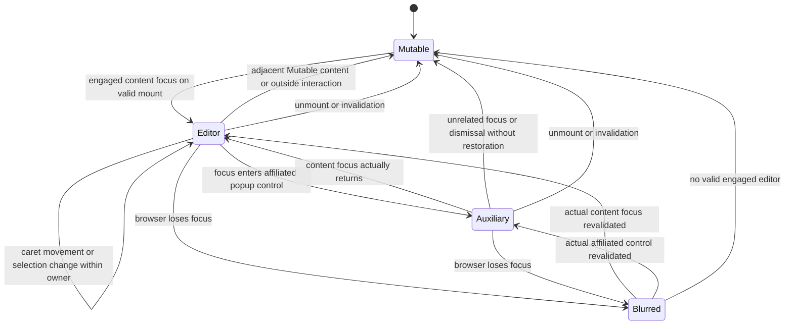

# Caret-scoped input ownership for embedded editors

**Status:** Architectural investigation; no production implementation.  
**Date:** 2026-11-23.  
**Repository baseline:** `0fe6ccc446b06afaca6005d09d4daa2af0a337da`.  
**Related report:** [CodeMirror standoff investigation](CODE_MIRROR_STANDOFF_INVESTIGATION.md).  
**Scope:** The supplied “Astra Investigation Prompt: Caret-Scoped Input Ownership for Embedded Editors”, including Mutable key bindings, clicks, slash commands, and native CodeMirror editing.

Evidence labels used below: **Repository** means inspected existing code; **SDK** means inspected installed CodeMirror code/types and official upstream source; **Probe** means an executable investigation test; **Recommendation** describes proposed changes; **Browser experiment** identifies behavior not established by these tests. No production files were changed. The examples are proposed contracts, not working APIs already present in Mutable.

## 1. Executive assessment

Caret-scoped ownership is feasible and preferable to teaching `InputGateway` how to arbitrate each CodeMirror editing operation. An embedded editor can own local input through its SDK, invoke applicable Mutable actions through the existing binding and command infrastructure, and relinquish ownership when the user leaves its editing context. This should replace the **input arbitration** recommendation in the earlier report; its canonical text/standoff transaction, persistence, coordinate conversion, and native decoration recommendations remain applicable.

The smallest reliable change is larger than an early return in `InputGateway`, but substantially smaller than a second input framework:

1. Add an optional input capability to the existing mounted occurrence handle, with a small focus/composition observation contract.
2. Track one current editing owner per DOM `Document`, using a live mount identity. Keep affiliated popup context separate from keyboard ownership.
3. Make existing capture listeners recognize the same input boundary before running Flint-local work.
4. Install a CodeMirror extension that calls the existing Mutable binding registry for supported commands and otherwise falls through to CodeMirror.
5. Preserve narrowly defined application shortcuts and repair command applicability checks before a chord prefix is consumed.

**Repository/Probe:** Three concrete constraints prevent a zero-change integration. Capture listeners before the gateway can intercept input; the binding registry consumes scoped chord prefixes before consulting their handlers; and the generic focus service treats the end of a non-textarea native surface as offset zero. None requires reproducing native editing.

“Caret ownership” should mean **the currently engaged editing surface**, not possession of a stored selection. CodeMirror keeps selection state when unfocused. A toolbar can retain an editor context while a search field owns its own text input. Mounting, styling a selected block, and calling `FocusService.adopt` do not independently grant input ownership.

The capability can be reusable without exposing a universal editor API. Its purpose is ownership and lifecycle. SDK-specific selection, semantic commands, transactions, and rendering remain in the block integration. Full browser reliability is a hypothesis to qualify with the experiments in section 8, not a result established by jsdom.

## 2. Existing architecture audit

### 2.1 Capture ordering and routing

**Repository:** [`ReactiveEditor`](src/reactive-editor/editor.ts) installs a window-capture text-protection listener in its constructor. `installGateway` installs inline-presentation interception, document Find, selection gestures, cross-block input, and then `InputGateway`. All relevant document listeners use capture. Window capture runs before document capture regardless of registration order. Other application listeners add further layers.

```text
window capture: text protection; application/Flint Save handlers
  document capture:
    inline-presentation interception
    document Find
    selection gestures / cross-block input
    InputGateway
    other application listeners, in their installation order
      target / bubble: CodeMirror SDK event handlers
```

This is the relative order of the inspected editor installation path, not a guarantee of every application's listener installation order.

| Existing source | Verified behavior | Consequence for self-managed editing |
| --- | --- | --- |
| [`src/input/gateway.ts`](src/input/gateway.ts), `install` | Captures input, beforeinput, focusin/out, keydown, composition start/end, selectionchange, pointerdown, clipboard, contextmenu, click/dblclick and custom input; observes window blur/focus | All local paths must recognize ownership, not just keydown |
| Same file, `onKeyDown` | Inline navigation, Markdown/list handling, clipboard and completion run before scope selection; history and ordinary bindings follow | A guard inside `scopes` is too late |
| Same file, input/composition | Native-text recording assumes a textarea; standoff paths reconcile Cell content and selection | Do not label a CodeMirror view `standoff` or pretend its contentDOM is a textarea |
| Same file, pointer/focus/selection | Updates caret and selection, cancels sessions/chords, adopts focused blocks and manages overlays | Preserve host focus bookkeeping but skip Flint selection/editing for SDK targets |
| Same file, `installInlinePresentationInput` | A handled `interceptInlineInput` prevents default and stops immediate propagation | This existing hook consumes events; it cannot delegate them to a later CodeMirror handler |
| [`src/runtime/document-find.ts`](src/runtime/document-find.ts), `install` | Captures the Find binding before the gateway; ignores opaque widgets and dialog/foreign form controls; stops immediate propagation on handling | Local native Find needs an explicit boundary exemption; document Find remains an explicit application command |
| [`src/input/cross-block-input.ts`](src/input/cross-block-input.ts) | Captures pointer, keyboard, selection, focus, composition, clipboard and drag events; invokes completion/clipboard key handling before checking standoff policy | Guard before those calls. Existing guards can also consume events during a cross-text selection; clear that stale session on ownership entry |
| [`src/input/selection-gestures.ts`](src/input/selection-gestures.ts), [`selection-target.ts`](src/input/selection-target.ts) | Most selection targeting requires standoff policy; toolbar affiliation is explicitly registered | Reuse the affiliation principle; reset an outgoing selection gesture once, rather than routing native movement through it |
| [`src/reactive-editor/editor.ts`](src/reactive-editor/editor.ts), `protectedInput` | Window capture can stop editing events for a protected resolved block before the SDK sees them | For eligible SDK surfaces, synchronize native read-only state and retain canonical admission checks. Do not blanket-disable protection for every descendant popup |
| [`src/features/flint/shell.tsx`](src/features/flint/shell.tsx), [`src/application/document-sessions.ts`](src/application/document-sessions.ts) | Save has direct capture handlers using Ctrl/Meta-S, target/session checks and composition guards | Global commands are not currently all centralized in a configurable gateway. Preserve the correct document target and prevent duplicate Save dispatch |

**Probe:** A document capture handler that prevents default and stops propagation prevents a real `EditorView.domEventHandlers` extension from receiving a key. Removing that handler delivers the key once. No CodeMirror precedence setting can override an ancestor capture listener that already stopped the event.

**Recommendation:** A shared mount-boundary query belongs in the existing runtime. Earlier listeners use it to **return without consuming local events**. It must distinguish observing focus from editing input. Do not stop propagation as a way of “passing control” to CodeMirror.

### 2.2 Mounted identity and focus

**Repository:** [`MountHandle` and `MountRegistry`](src/runtime/mounts.ts) already supply the appropriate registration location: root, focus element, input policy, generation, focus, optional selection hooks and composition state. `resolveEvent` walks the composed event path, then ancestors; this is better than searching all mounted editors. Registry block capabilities are discovery metadata, not proof of a mounted input environment.

Important limitations:

- Registry subscriptions notify registration, not removal. Ownership needs invalidation on disposer, final occurrence release, replacement, and editor destruction.
- Ordinary replacement increments `generation`; an old disposer does not remove a newer generation. However, `releaseOccurrence` deletes the generation counter. A subsequent mount can reuse the number. **Probe:** numeric generation repeats while the mounted handle object differs. Compare the exact current handle or a fresh token, not just `(nodeKey, generation)`. The same check should protect stale disposers after final release/remount.
- Event aliases refer to node keys. Replacement with a different root must remove old aliases and validate the returned live handle against the boundary. Otherwise an old root could resolve to a replacement.
- `instanceof Element` uses the current realm, and `resolveElement` walks `parentElement`. Real other-window elements and shadow boundaries need deliberate handling; `composedPath` alone does not solve every focus lookup.

**Repository:** [`FocusService`](src/runtime/focus.ts) already has request tokens, readiness callbacks, `valid` predicates, connected-root checks, focus adoption, and pending-request cancellation. Reuse these for delayed navigation. `focusedKey` is set before actual DOM focus succeeds, so it is not ownership evidence.

**Probe:** `request(key, {caret: 'end'})` with a non-textarea `restoreSelection` supplies `{start: 0, end: 0}`. A small optional `focusAtBoundary('start' | 'end')` mount hook would let the SDK use its own document length and selection units. The existing inline fallback counts code points and is not a CodeMirror UTF-16 adapter. Keep rich/multiple selection bookmarks local to CodeMirror; do not turn the ownership contract into a universal selection format.

**Repository:** `ReactiveEditor.adjacentEditable` traverses neighboring structural blocks, not Cells. It currently tests registry capabilities such as `inline-editor`/`native-text` and presentation eligibility. Extend that eligibility narrowly for self-managed text editors. Reuse its document/margin boundaries and FocusService; do not implement another tree navigation algorithm.

### 2.3 Commands, overlays and the existing CodeMirror block

**Repository:** [`BindingRegistry`](src/input/bindings.ts) owns action registration, configured overrides, labels, indexed triggers and a pending chord with a 1500ms timeout. It can be called from a native SDK event handler. Its scopes are matched explicitly at dispatch; a general registry capability does not automatically make a binding applicable.

Two semantics matter:

- A handler must return **explicit `false`** to fall through. `void` counts as handled and prevents default. Testing the return from a void command as if it means “unsupported” is wrong.
- Chord prefixes are filtered by scope and consumed **before** the action handler is consulted. Returning false for an unsupported action at the final step cannot recover the first key. Add an eligibility predicate before both prefix and completed-action selection. Recheck on continuation, and cancel the chord on ownership/context change.

[`CommandRegistry`](src/block-tree/registry.ts) supplies `canExecute` and admission checks; `execute` rechecks and may return void or a Promise. Binding actions and commands are not identical: a binding handler may perform work or call a gateway branch. Calling `commands.execute(actionId)` blindly would bypass some registered behavior. Retain BindingRegistry invocation and adapt its `run` callback to supported command contexts. Extract a small shared semantic handler only where an existing action is currently coupled to Cell arguments.

[`OverlayService`](src/runtime/overlays.ts) already records owner keys, focus retention, document-input permissions and return-focus information. Extend occurrence affiliation with the live mount token when needed. A canonical block ID cannot distinguish two mounted editors. Existing toolbar registration in `selection-target.ts` is a useful precedent, but neither overlay ownership nor toolbar membership proves that the editor content has keyboard focus.

[`FocusRegion`](src/runtime/focus-region.ts) concerns presentation/selection regions, not this input lease. Reusing its name or state as ownership would conflate unrelated responsibilities.

The existing [`src/blocks/code-mirror-block.ts`](src/blocks/code-mirror-block.ts) is a legacy `AbstractBlock` with `basicSetup` and JavaScript language support. Its `attachEventHandlers` is empty; its private keyboard method is not wired there. It supplies no reactive `MountHandle` ownership integration. It is evidence that CodeMirror is available, not a reusable solution to the current routing problem. The new `standoff-code-mirror-block` remains proposed, not implemented.

## 3. CodeMirror SDK assessment

Inspected installed versions: `@codemirror/state` **6.7.6**, `@codemirror/view` **6.43.13**, `@codemirror/autocomplete` **6.20.3**. Installed code/types were the primary check for this repository; official source links below provide supporting references. Upstream `main` can change. The API reference endpoint returned HTTP 403 during this pass, so claims were checked against source rather than inferred from a failed documentation fetch.

| Mechanism | Verified SDK behavior | Proposed Mutable use |
| --- | --- | --- |
| `keymap.of`, `Prec`, command `run(view)` | Ordered bindings; boolean fallthrough. `preventDefault: true` can consume even when commands return false. Multi-stroke bindings and `any(view,event)` exist | Small native boundary commands or adapters; do not set unconditional prevention on unsupported semantic commands |
| `EditorView.domEventHandlers` | Native view event extension; extension precedence applies. Returning true consumes the event and skips subsequent handling | Preferred entry to the existing BindingRegistry, preserving its exact shortcut/chord behavior without translating every binding |
| `EditorView.domEventObservers` | Observes events even if another CodeMirror handler handled them; must not prevent default | Notify focus/composition lifecycle. It still cannot observe an event stopped before it reaches the view |
| `EditorView.inputHandler` | Handles text input/replacement detected from DOM changes, with a boolean interception result | Usually leave unused for ownership. It is not a universal keyboard, pointer or IME router |
| `EditorView.updateListener` / `ViewUpdate` | Reports document, selection and focus changes | Observe selection for local tools and bridge transactions; selection-only updates must not reacquire ownership or write canonical content |
| `EditorSelection` | Native state retains ranges, main range and cursor details while blurred | Read authoritative native selection for command applicability; keep multiple cursors native |
| `hasFocus`, `focus`, `focusChangeEffect` | Focus observation/commands exist; focus effects are optional state integration | Actual content focus plus host context observations drives activation. No caret-exit event is needed |
| `composing`, `compositionStarted` | Native composition state is available; these flags have different timing | Guard semantic/boundary commands without replacing the native composition pipeline |
| Autocomplete sources, completion commands/keymaps | Native completion lifecycle and result application are extensible | Reuse Mutable search/providers behind a CodeMirror source and native result application |
| Tooltips/panels | Native UI extensions can attach to the editor or configured external parents | Use native positioning and explicitly affiliate any external popup; panels with inputs own those inputs |
| Pointer/contextmenu handlers, `posAtCoords` | SDK hooks and document hit positions are available | Invoke applicable Mutable click/menu actions without rewriting native selection and drag behavior |
| `dispatch`, transactions, `dispatchTransactions` | Native transaction/application extension points exist | Connect the separate canonical text/annotation bridge; ownership itself should not dispatch content transactions |

The keymap behavior and precedence are defined in [official keymap source](https://raw.githubusercontent.com/codemirror/view/main/src/keymap.ts). View facets and event-handler contracts are in [official EditorView source](https://raw.githubusercontent.com/codemirror/view/main/src/editorview.ts); actual event eligibility/dispatch is in [official input source](https://raw.githubusercontent.com/codemirror/view/main/src/input.ts). Selection and update contracts can also be checked in the installed `@codemirror/state` and `@codemirror/view` declarations.

**Probe:** A highest-precedence native DOM handler can call Mutable's existing BindingRegistry, honor a live remap from F8 to F9 without rebuilding the editor, and fall through once to a native keymap when unhandled. A separate probe confirms a highest-precedence `keymap.any` runs ahead of a later named binding. Thus `any` is a viable alternative, not inherently a final fallback. Prefer the DOM extension for the initial bridge because native multi-stroke-prefix handling otherwise introduces a second chord mechanism to reconcile. Install one bridge, not both.

**SDK:** Native event eligibility matters: CodeMirror ignores certain events already prevented or belonging to nested widgets that opt out. Its view handlers are not a universal capture layer for every input inside a panel. Popup controls need their own native behavior and the host's global route. `view.hasFocus` primarily concerns contentDOM, not every descendant of `view.dom`. `composing` becomes true after composition has changed content; `compositionStarted` can become true earlier and has Android-specific behavior. Do not treat either as a platform-independent “all commands disabled until false” latch. These distinctions are visible in the [official view implementation](https://raw.githubusercontent.com/codemirror/view/main/src/editorview.ts) and [input implementation](https://raw.githubusercontent.com/codemirror/view/main/src/input.ts).

### Applicable Mutable functionality

| Functionality | Adapter needed | Explicit limitation |
| --- | --- | --- |
| Entity linking, Gloss creation, annotation creation | Read the native range, convert coordinates, invoke the shared semantic service with the occurrence and canonical block | Existing standoff scopes/handlers assume Cells in places; do not enable all of them by adding `editor/standoff` |
| Annotation inspection / click actions | Resolve native position to overlapping annotation IDs; call existing inspection/selection handlers with explicit context | A clicked DOM mark is not necessarily one complete property; multiple properties may overlap |
| Slash commands and Scry | CodeMirror completion/source/transaction adapter to existing providers and command services | Current autocomplete source and provisional presentation are Cell-oriented; do not import `ProvisionalCells` into CM |
| Context menu | Native contextmenu extension invokes an applicable Mutable menu and prevents default only when handled | Preserve native selection, right-click behavior and ordinary browser fallback when no Mutable menu applies |
| Application navigation | Resolve current document/occurrence and call existing application command | Do not globally reserve every arrow or structural editing shortcut |
| Undo/Redo | Native binding invokes the authoritative history bridge selected by the standoff design | Input ownership does not authorize a second independent content history |
| Local search, indentation, editing and native completion | Use native CodeMirror extensions | Mutable document Find remains available explicitly, but should not capture local Find accidentally |

The reusable part of [`src/features/autocomplete`](src/features/autocomplete/index.tsx) is its provider/command behavior; its current source snapshot and placement/edit paths need an SDK adapter. For slash/Scry, distinguish a deliberate command trigger from language text such as division, comments or regex literals. Preserve agreed product trigger semantics; ownership alone does not decide that policy. Preview/provisional input stays local until committed. Native autocomplete and popup integration points are documented in [official autocomplete view source](https://raw.githubusercontent.com/codemirror/autocomplete/main/src/view.ts), [tooltip source](https://raw.githubusercontent.com/codemirror/view/main/src/tooltip.ts), and [panel source](https://raw.githubusercontent.com/codemirror/view/main/src/panel.ts).

## 4. Ownership lifecycle

### 4.1 State and authority

**Recommendation:** Keep one slot per DOM `Document`, shared by editor instances in that document, rather than one independent owner per `ReactiveEditor`. Store a live mounted handle/token and its registry/editor identity. The same canonical block mounted twice has two possible tokens. There is no need for a process-wide owner across genuinely different browser windows.



`Auxiliary` retains a semantic return context, **not editor-local keyboard authority**. A search input edits itself; letters must not be dispatched as CodeMirror commands. `Blurred` retains at most a candidate for restoration, with no active input lease. Direct editor A → editor B is an atomic replacement of the slot: deactivate A, activate B, and prevent A's delayed blur/disposer from clearing B.

| Observation | Ownership action | Important guard |
| --- | --- | --- |
| Mount or block selection/style change | None | A visible editor may remain inactive indefinitely |
| Pointerdown inside SDK boundary before focusin | Classify event as native; allow SDK to establish focus | Protect first interaction without prematurely claiming from pointer location alone |
| Actual content focus | Acquire/transfer lease after validating current mount and window state | FocusService intent alone is insufficient |
| Selection moves inside owner | No transfer | No full document scan, snapshot or activation callback |
| Programmatic selection in background view | None | **Probe:** native selection can change while another input remains focused |
| Focus goes to another SDK content surface | Transfer directly | Exact token, including editor/registry identity |
| Focus goes to a Mutable block | Release; ordinary gateway resumes | Destination's normal focus/selection lifecycle runs |
| Affiliated nonfocus toolbar action preserves caret | Retain editor lease; route the button's own action | Do not process its click as a text-editor click |
| Affiliated field takes focus | Suspend editor keyboard ownership; retain return context | Explicit registration, not arbitrary descendant or CSS-class heuristics |
| Click outside on a nonfocusable area | Release the editing lease | Stale DOM selection and even unchanged activeElement must not immediately reclaim it |
| Fresh keyboard/pointer engagement with the still-focused native content | Revalidate and acquire before local dispatch | This is new user engagement; a late composition event or passive selection notification is not |
| Window blur | Release active authority and cancel pending chords | Do not synthesize a Flint caret from the saved native selection |
| Unmount/replacement/destruction | Release synchronously, dispose observers/affiliations | Late callbacks must check exact current token |

### 4.2 How to observe transitions

Use existing root/document `focusin`/`focusout`, pointer observations, window blur/focus, and SDK focus/composition observers. On focusout, inspect `relatedTarget` when useful; when it is absent or transient, schedule a microtask to resolve the actual active element through the relevant document/shadow root. Fence that check with a transition epoch and mount token. A late check from A must not release B.

Use native focus notifications to reconcile state, not to write content. A `selectionSet` update alone never activates a view. For outside pointer interaction that leaves activeElement unchanged, record explicit disengagement until the user interacts with/focuses the editor again; do not reacquire merely because an unrelated selectionchange reports the old content focus. This is why DOM focus and input ownership are related but not identical.

If a subsequent real key is delivered to that still-focused content, reconcile fresh engagement before dispatch so native editing and the ownership slot agree again. Continue to protect the SDK boundary independently of whether the lease is currently active. Releasing a lease never means routing an SDK-targeted input event through Flint.

Explicitly affiliate popup roots with the originating mount token, using existing overlay/toolbar lifecycle where possible. Dispose affiliation when the popup closes or the mount becomes invalid. Restore focus only if its context and FocusService request remain valid; closing an old menu must not steal focus from a newly selected editor.

Event classification must remain source-aware even after release. A late compositionend/input targeting an outgoing connected CodeMirror surface belongs to its SDK/transaction bridge; it must not be reinterpreted as Flint input or reacquire the old lease. If a view must be destroyed during composition, finalization/rejection needs a tested transaction lifecycle; a generic ownership flag cannot guarantee text preservation.

### 4.3 Boundary navigation

**Repository:** Current gateway boundary navigation requires a collapsed selection at absolute text start/end. It does not exit from every position on the first/last visual line. Left/up go to the preceding editable block; right/down go to the next. The destination caret is `end` for left and `start` for the other three directions. This asymmetry is existing behavior, not a new recommendation to redesign navigation.

**Recommendation:** Expose a small native boundary command using the existing block-navigation service and configured binding IDs. It returns false unless there is one empty native selection at the appropriate absolute boundary, no Shift extension, no active composition, no completion/menu consuming the key, and an eligible adjacent destination. It requests focus through FocusService with a valid lease; ownership transfers when destination focus is established. If no destination exists, fall through.

Do not implement first/last *visual line* detection as part of this capability. Wrapped lines, folds and vertical preferred-column behavior remain native. Multiple cursors and Shift-selection remain native; cross-block selection from CodeMirror is separate product work. Absolute offsets are cheap; bidi left/right expectations, folded endpoints and native movement precedence still require browser tests. Preserve existing explicit block navigation and an accessible keyboard escape path; avoid making Tab a mandatory block-exit key when the editor uses it for indentation. Keep CodeMirror's native keyboard escape/accessibility conventions available. Do not trap focus when a boundary destination is unmounted or refused.

## 5. Architectural alternatives and command precedence

| Approach | Strength | Problem | Assessment |
| --- | --- | --- | --- |
| A: gateway reserves globals, returns for everything else | App actions remain centrally available | Earlier capture handlers still need fixes; broad reservations suppress native commands; split chord dispatch is hazardous | Accept only a very small explicit reservation set |
| B: all applicable Mutable bindings registered through native SDK | Native event ordering, local context, simple fallthrough; strongest separation from Flint | Every editor must implement globals correctly, including popup contexts; dead/unmounted views cannot supply them | Best local-input model, insufficient as sole application boundary |
| Hybrid: native local binding bridge plus narrow host globals | Keeps SDK input native while preserving application responsibilities | Requires one clear dispatch owner per event and coherent shared chord handling | Recommended |

### 5.1 Which commands belong where

Reserve Save Document and genuine application/window actions only where the existing application defines them as global. Resolve the target from the active document/session or explicitly affiliated popup context, not a stale globally focused block. Save remains manual Mutable JSON persistence to the opened filename. Ownership transitions never save or mark dirty.

Do not reserve all structural commands, Find, arrows, Delete, Tab, or Undo under a broad “global” category. Some are contextual and conflict with native editing. A structural block action is available when its explicit target, permissions and command applicability allow it; ordinary text deletion stays native. Undo/Redo is locally invoked but uses the canonical history bridge.

Mutable user-configured semantic shortcuts should have precedence over native defaults when applicable. Existing examples expose real collisions: annotation shortcuts include Ctrl-/ or Meta-/, which can collide with code commenting; Gloss uses Mod-G, which can collide with search-next. Keep existing IDs, configuration, labels and conflict UI. Filter unsupported actions before matching, then let CodeMirror handle an unclaimed key. Do not promise that every Flint binding works in code.

Within native content, order local handling as: active native popup/navigation policy, applicable Mutable binding adapter, then ordinary native defaults. Explicit reserved application commands can precede those. A user remap that intentionally conflicts with a popup key needs the same documented precedence and conflict treatment, not two simultaneous handlers. This ordering must be tested with real completion/search panels.

### 5.2 Preserve one chord decision

**Repository:** Local entity/Gloss actions and workspace actions can share `Ctrl-;` prefixes. Running `dispatch(event, globalScopes, ...)` at capture and then `dispatch(event, localScopes, ...)` inside CodeMirror is unsafe: the first call may consume the prefix or mutate/cancel the pending chord before the second sees it.

**Recommendation:** Use the same BindingRegistry and one combined eligible dispatch for chord prefixes/continuations while native content is active. Let the SDK bridge perform that dispatch, including applicable application chord actions. Host capture may reserve complete, unambiguous single-stroke global commands using the existing indexed/matching facilities; it must not start a separate global chord session. If a remap creates a prefix relationship, resolve that through the existing conflict rules and the combined dispatcher. Do not steal a continuation from an active chord; expose the minimum read-only pending-state query if the host needs it.

For focused affiliated form controls, use a global-only context and cancel the outgoing content chord on the focus transition. It is legitimate for that context to have a different eligible action set; it is not legitimate for two contexts to process the same key.

The direct hardcoded Save handlers found in the shell/session host currently precede this policy. Adapting them to the same binding-aware global decision for the new surface is necessary to honor Save remapping; simply adding a native configurable Save key will leave Ctrl/Meta-S captured anyway. Reuse the actual host save operation and session targeting. Do not add a third Save listener or broadly refactor unrelated shortcuts. A failing save reports its error once and does not fall through into native text editing.

### 5.3 Applicability and failure

Add an optional applicability argument to BindingRegistry dispatch/invocation, defaulting to existing behavior for current callers. Filter indexed candidates and chord starts/continuations before consumption. The predicate must be bounded and side-effect-free: supported action ID, valid mount, relevant native selection shape, text protection and existing `canExecute`. Do not enumerate all commands or inspect the whole document per key.

A handler returns false only before accepting the action. Once an asynchronous action is accepted, return handled synchronously, catch/report failure, and do not later replay the key. Unexpected adapter failure should not allow a command to execute twice. Losing a mount while an async picker is open invalidates application unless the service explicitly revalidates its target and mapped selection. The existing canonical permission checks remain authoritative at commit time.

## 6. Recommended capability contract

**Recommendation:** Extend `MountHandle`; do not create a parallel block registry, input gateway or universal command interface.

```typescript
type InputContext = {
  focus: 'content' | 'auxiliary' | 'outside';
  composing: boolean;
};

interface EditorInputCapability {
  ownership: 'self-managed';
  root: HTMLElement;
  readContext(): InputContext;
  observeContext(changed: () => void): () => void;
  onActivate?(): void;
  onDeactivate?(): void;
}

// Proposed additions to the existing MountHandle:
// editorInput?: EditorInputCapability;
// focusAtBoundary?(edge: 'start' | 'end'): void;
```

| Member | Reason |
| --- | --- |
| `ownership` | Explicit opt-in; neither contenteditable nor an iframe/widget automatically qualifies |
| `root` | Defines the SDK event boundary, which can be narrower than the whole block root; for CM, normally `view.dom`, excluding Mutable block chrome |
| `readContext` | Cheap SDK-aware focus/composition snapshot; keeps CodeMirror details out of the gateway. It provides evidence, not permission to self-appoint ownership |
| `observeContext` | Native focus/composition notifications and deterministic disposer; no per-caret-change stream required |
| Optional lifecycle hooks | Cancel occurrence-local transient work on activation/deactivation; never store content or scan documents |
| Separate mount `focusAtBoundary` | Fixes existing focus placement without adding selection/persistence responsibility to input ownership |

Reuse `MountHandle.focusElement = view.contentDOM` and its existing `focus()`. For legacy branches, `opaque-widget` is a suitable fallback input policy; the explicit capability takes precedence for new ownership-aware logic. Do not add `standoff` merely to obtain semantic commands. Registry discovery/navigation eligibility is separate from this mounted capability.

The host maintains the lease and affiliated-root mapping. Conceptually it registers `(registry, nodeKey, exactHandle, capability)`, and releases only if that exact registration remains current. Registration returns a disposer. An existing overlay's affiliated-root registration carries the same token and returns its own disposer. These are small mount/overlay helpers, not methods for arbitrary components to seize the global owner slot.

`readContext().focus === 'auxiliary'` covers native panels known to the adapter; host overlays outside the SDK root are resolved by explicit affiliation. Conflicting or stale reports are settled by actual event/focus source and token validity. Runtime registration should validate connected/same-document roots when activated, current handle identity and required functions. A capability does not authorize protected content changes.

The following are **integration obligations**, not dozens of extra interface methods:

| Required ability | CodeMirror implementation | Admission evidence |
| --- | --- | --- |
| Keyboard commands and false fallthrough | Native DOM/keymap extension and shared registry adapter | Handled/unhandled/remapped/chord tests |
| Pointer/context menus | Native view handlers; explicit popup affiliation | Selection, drag and menu browser tests |
| Selection/caret access | Native EditorSelection and SDK selection commands | Single/multiple/directional selection tests |
| Composition | Native input pipeline and composition observation | Real IME tests, including blur and read-only transitions |
| Focus lifecycle | Native observation plus host document/window reconciliation | Transition/remount/portal tests |
| Text notifications/transactions | Separate native transaction bridge | Canonical/history/dirty consistency tests |
| Programmatic semantic invocation | Shared services with native context adapter | Same result from shortcut, menu and command invocation |

A TypeScript interface cannot prove these behavioral obligations. Explicit block registration, modest runtime assertions, and integration tests are enough. Do not build a certification framework or an SDK-neutral replacement for all these APIs.

## 7. Minimal integration design

### 7.1 Runtime and gateway changes

1. Extend mount registration with the optional capability and exact-token release notifications. Clear stale aliases on replacement. Maintain the document-scoped slot and popup affiliations with deterministic disposal.
2. Add one shared classification helper used by gateway, Find, cross-block input, selection gestures and text protection. It resolves the event path/boundary or current focus context without scanning mounts. Resolve once per event where practical, with ownership epoch invalidation; do not retain a classification across a mid-event mount transition without checking its token.
3. Before local work, return for an SDK-owned event or native auxiliary control. Focus/window observers still reconcile ownership. An event targeting a valid SDK surface receives this boundary protection even before focusin and after release during a late native input sequence.
4. On ownership transitions, cancel pending chords and outgoing Flint completion/cross-selection/gesture sessions once. Do not repeatedly clear selection or trigger focus updates while the native caret moves.
5. Keep host globals on their documented path. All consuming paths check prior handling and exact context; the SDK bridge is the only local Mutable dispatcher for the editor's content events.
6. Add boundary focus placement and self-managed navigation eligibility to existing FocusService/navigation. Reuse current readiness/validity fencing.

Do not bypass protected canonical admission. Native read-only must track Mutable permissions before accepting editing transactions. Focused inputs in affiliated menus retain their own editability; a protected document is not a reason to suppress typing in a search box. The existing window capture text-protection rule therefore needs an input-context distinction, not a blanket early return for all block descendants.

### 7.2 Native extension arrangement

Illustrative extension shape, with proposed helpers clearly separated from existing API:

```typescript
const mutableInput = Prec.highest(EditorView.domEventHandlers({
  keydown(event, view) {
    if (!lease.isCurrentContent(view) || event.isComposing) return false;
    if (nativePopupNeedsKey(view, event)) return false;
    // Proposed eligibility argument; existing registry remains authoritative.
    return bindings.dispatch(event, supportedScopes, runWithNativeContext,
      action => canApplyHere(action, view, lease));
  },
  contextmenu(event, view) {
    return openApplicableMutableMenu(event, view, lease);
  },
  click(event, view) {
    return invokeApplicableMutableClick(event, view, lease);
  }
}));
```

This is pseudocode, not a currently supported four-argument `dispatch`. `supportedScopes` must be paired with action eligibility; adding the whole Flint scope alone is unsafe. Mutable mouse overrides should go through the existing registry as appropriate, preserving click/double-click/contextmenu distinctions. Focus observations should notify the lease through non-consuming SDK observers. Native popup key policy must be checked before the high-precedence semantic handler consumes its keys.

Use curated native extensions, not unexamined `basicSetup`: language support, local search, native completion, selection/drawing, the Mutable binding adapter, ownership observers and the separate standoff bridge. History extensions/keymaps must reflect the canonical history decision. Unhandled events continue through native CodeMirror mechanisms; there is no synthetic replay and no Cell reconciliation.

### 7.3 Persistent standoff integration remains separate

```text
native input / Mutable shortcut / native menu
       │
       ├─ ownership observation → occurrence-local focus/session state only
       │
       └─ accepted semantic/text change
             → canonical text + standoff transaction bridge
             → affected canonical records / history / document dirty state
             → native CodeMirror range state and decorations
```

The new block still serializes `text` plus `standoffProperties` in the ordinary Mutable property JSON shape. It still needs UTF-16/code-point conversion, overlap-aware range mapping, native decorations, revision/admission fencing and canonical history/persistence. None belongs in `EditorInputCapability`.

A semantic command reads the current native selection and converts it through the transaction adapter, calls the existing service, and applies the accepted canonical result to all relevant occurrences through the established bridge. An asynchronous result revalidates the occurrence and its range/revision mapping. Merely opening a menu, moving focus, highlighting a candidate or updating provisional command text does not invoke canonical planning, snapshots, dirty tracking or saves. Reuse established Flint temporary SVG mechanisms for any Flint-side previews; use CodeMirror's native presentation mechanisms inside CodeMirror. Do not add a parallel viewport highlight renderer.

## 8. Edge cases, tests and experimental limits

### 8.1 Executed investigation probes

[`experiments/editor-input-ownership/investigation.test.ts`](experiments/editor-input-ownership/investigation.test.ts) contains nine passing checks against existing Mutable classes and real CodeMirror instances under jsdom:

1. Unsupported scoped chord prefixes are consumed before a handler is consulted.
2. A void binding result counts as handled; explicit false is required for fallthrough.
3. Ancestor capture consumption prevents native SDK event delivery.
4. Native DOM extension dispatch preserves live Mutable remaps and single native fallthrough.
5. A high-precedence keymap `any` can precede a later named native binding.
6. Programmatic native selection does not focus a background editor.
7. Ordinary stale unmount disposal preserves a replacement generation.
8. Final release/remount can reuse generation numbers; handle identity differs.
9. Generic non-textarea end-focus currently restores offset zero.

Combined validation command:

```sh
./node_modules/.bin/vitest run \
  experiments/editor-input-ownership/investigation.test.ts \
  src/input/bindings.test.ts src/input/selection-target.test.ts
```

**Result:** 3 test files passed; **24 tests passed** (9 investigation probes, 8 binding tests, 7 selection-target tests).

These establish routing/library contracts and existing limitations. They do not implement or validate the proposed ownership coordinator, and they do not measure real typing latency, caret geometry or IME behavior.

### 8.2 Required invariants and mounted-browser tests

| Scenario | Required assertion |
| --- | --- |
| A and B both report active | Exactly one live token per DOM Document; actual latest engaged focus wins; stale blur cannot remove the winner |
| Same canonical block in two occurrences | Input/menus use the focused occurrence; persistent edits synchronize through the canonical bridge, not shared focus state |
| Replacement/unmount/final release | Owner, subscriptions, popup affiliations and pending chords disappear; late disposer/async callback cannot invalidate the replacement |
| First pointer interaction | Native click/drag selects correctly before focusin; no Flint gesture begins |
| Within-editor movement | Ownership remains stable; no repeated activation, dirty events or content transactions |
| Background programmatic selection | No activation, focus steal, document switch or popup opening |
| Outside nonfocusable click | Lease releases even if DOM selection persists; subsequent selectionchange does not reacquire it |
| Popup toolbar vs popup input | Nonfocus action can retain caret; focused field owns typing; close restores only a still-valid return target |
| Key or click handled | At most one Mutable action and one accepted edit; no duplicate native command, menu or save |
| Unsupported/remapped binding | Unsupported actions and sole unsupported chord prefixes fall through; overrides take effect without rebuilding a whole editor |
| Shared global/local chord | All eligible candidates participate in one pending session; focus transfer cancels it; Escape/repeat/timeout behave consistently |
| Native commands | Typing, deletion, indentation, local Find, commenting, completion and drag/drop work when not explicitly overridden |
| Global commands | Save targets the correct active Document exactly once, including popup and transferred-host focus; configured remaps remain effective |
| Boundary navigation | Single collapsed absolute boundary exits; Shift/multiple cursors/wrap/fold cases stay native; rejected/delayed destination cannot trap focus |
| Read-only transition | Native edits stop, selection/copy/search remain usable, canonical writes are still rejected; menu fields remain usable |
| IME | Composition start/update/end, final input ordering, popup focus, blur and unmount neither duplicate nor lose committed text; provisional input stays local |
| Nested interactive widget | Child control owns its events; nearest eligible editing surface wins only when actual content focus enters it |
| Window blur/refocus | No active authority while blurred; refocus revalidates target instead of trusting a saved selection |
| Undo/Redo | One authoritative history operation, consistent annotations/caret/dirty state; local selection undo policy is explicit |
| Async semantic picker | Apply once to a valid current/mapped target, or cancel; never silently apply to a replacement occurrence |

Run these in the actual Mutable shell with a native CodeMirror view, then Chromium and WebKit at minimum, and a real supported IME environment. Include keyboard-only and screen-reader navigation checks. Native composition cannot be established by dispatching synthetic KeyboardEvents in jsdom.

### 8.3 Portals, shadow roots and detached windows

**Repository:** Current document detachment/host transfer is managed UI within the same DOM document; transfer/presentation code checks document compatibility. It is not proof of support for an arbitrary second browser window. `ReactiveEditor` also holds one gateway installation, and several services reference global `document`/`window` or realm-specific constructors.

**Recommendation:** Same-document portals use explicit token affiliation. A real other-document move releases the old lease, registers with the destination document's host/listeners, and either updates CodeMirror with its supported `setRoot` mechanism or remounts it. Native `setRoot` does not automatically migrate Mutable services. Separate browser-window support needs a scoped experiment and runtime audit before claiming compatibility. Shadow-root focus resolution must inspect the relevant active-element chain, and event checks must be realm-safe. Do not extend this investigation into a general window framework.

### 8.4 Bounded work and validation boundaries

No production typing path changed in this investigation. Source inspection found that ownership can be based on existing event-path lookup plus a constant-size active slot; it does not require repository planning, canonical validation, snapshots, persistence, vault scans or change tracking. The proposal must preserve that separation rather than assuming all canonical transactions are cheap.

Before shipping, instrument actual mounted routing with counters and scale unrelated blocks/documents independently:

- Caret movement, focus transitions and popup previews: zero canonical content transactions, snapshots, dirty marks, saves, vault discovery/index requests or annotation inventory rebuilds.
- Ordinary native keystroke: bounded event classification and command lookup, no enumeration of all mounts/actions; repository/history work only for the committed affected change through the separate bridge.
- Annotation text rebasing: no backlink inventory refresh unless entity-reference membership actually changes; metadata and selection updates must not rebuild unrelated decorations.
- Geometry: ownership performs no layout reads. Native popup/decoration work uses SDK scheduling/caches; any Flint-side work reuses valid shared geometry and existing temporary-range infrastructure.
- Repeat with many unrelated open documents/files and assert unchanged relevant counters. Deferred full scans still fail this requirement.

Use the real Flint typing benchmark for before/after comparison once the shared capture guards are implemented, as well as a mounted CodeMirror typing case. Headless frame timing is not evidence of perceived latency. These bounded-work/browser checks remain required future validation; the nine probes above are not substitutes.

## 9. Implementation impact

| Area | Expected change | Complexity / main risk |
| --- | --- | --- |
| Mount/focus runtime | Optional capability, exact-token lifecycle, document owner slot, popup affiliation, boundary focus hook | Moderate; stale lifecycle callbacks and outside-pointer disengagement |
| InputGateway and earlier listeners | Shared early boundary classification, one-time outgoing-session cleanup, protection distinctions | Moderate; missing one early consumer can suppress native behavior |
| BindingRegistry | Applicability before matching/prefixes; context cancellation; minimal pending-state visibility if needed | Small/moderate; preserve existing chord semantics and overrides |
| Host application bindings | Reuse existing save operation; reconcile direct capture shortcuts with configured bindings and active document | Moderate; duplicate dispatch or wrong document during popup/transfer |
| CodeMirror input extension | Native binding/menu/click adapters, focus/composition observation, boundary command | Moderate; native popup precedence and IME timing |
| Semantic adapters | Entity, Gloss, annotation, slash/Scry and inspection context conversion | Per-feature work; existing Cell assumptions cannot be erased by a capability flag |
| Persistence/annotation bridge | Already required by previous standoff design | Separate effort; ownership does not reduce range/history correctness obligations |
| Real other-window hosting | Additional root/service migration if required | Separate scope; not established by current managed detachment |

Planning estimate for an engineer familiar with this code: **2–4 working days** for the mounted qualification spike, **4–8 days** for the ownership/runtime/binding integration after that spike, and **2–4 days** for cross-browser, lifecycle and regression hardening. This excludes implementing the standoff block's persistence/range bridge, all semantic feature adapters, and new real-browser-window hosting. These are architectural estimates, not measured delivery commitments; IME and host-global routing are the largest uncertainties.

Future rollout should use the new standoff CodeMirror feature's flag, **enabled by default** under repository conventions, with the mounted capability present only for eligible views. No flag is needed for this investigation because it changes no production behavior. Do not change existing feature defaults or broadly refactor Flint.

## 10. Final recommendation and decision answers

Incorporate a small `EditorInputCapability` into the planned `standoff-code-mirror-block`, subject to the mounted-browser qualification above. Prefer native SDK command registration with narrow application reservations. Keep the input gateway ignorant of CodeMirror editing details; its responsibility is recognizing the boundary and retaining the host responsibilities that actually belong there.

| Required decision | Answer |
| --- | --- |
| Can a mounted editor claim local input through a small contract? | Yes: extend MountHandle with explicit SDK capability and host-controlled lease |
| Can ownership follow the caret? | Yes in architectural terms: actual content focus, interaction context and native observations suffice; stored selection alone does not |
| Can Mutable automatically regain control? | Yes: focus/pointer exit, blur and exact-token lifecycle release restore the default route |
| Can CodeMirror avoid Flint interference? | Yes, after shared guards in all earlier local capture paths; a gateway-only guard is insufficient |
| Can Mutable commands use native extensions without duplication? | Yes: invoke the same BindingRegistry/services with native context and applicability adapters |
| How should global/conflicting shortcuts work? | Narrow binding-aware host globals; one combined chord decision; applicable Mutable overrides before native defaults; popup context explicit |
| What runtime changes are necessary? | Mount lifecycle/ownership, early boundary guards, prefix eligibility, boundary focus placement, targeted host shortcut integration |
| Is this simpler than the earlier arbitration model? | Yes: the gateway no longer implements native editing semantics; some capture and command fixes remain unavoidable |
| Is the capability reusable? | Yes for SDK editors meeting the stated obligations; arbitrary editable widgets do not qualify automatically |
| What must be proven before implementation is considered ready? | Mounted event delivery, focus/popups, true IME, navigation, save/chords, lifecycle/portals, canonical history and bounded work |

The result should be one native editing owner per engaged surface, one existing Mutable binding/command infrastructure, and a separate canonical standoff bridge. It should not add Cells to CodeMirror, imitate Flint rendering, or make focus movement a content operation.
