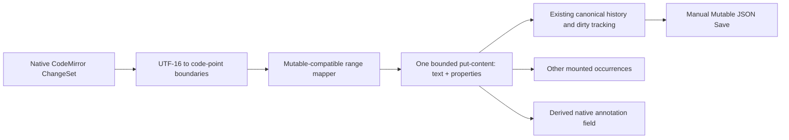

# Standoff-enabled CodeMirror implementation

Implemented and qualified on 23 November 2026. Architectural baselines: `CODE_MIRROR_STANDOFF_INVESTIGATION.md`, `EDITOR_INPUT_OWNERSHIP_INVESTIGATION.md`, `EDITOR_INPUT_OWNERSHIP_IMPLEMENTATION.md`, and `AGENTS.md`.

## 1. Implementation summary

`standoff-code-mirror-block` is a registered, editable Mutable block with native CodeMirror editing and persistent ordinary Mutable standoff properties. It supports independent overlapping annotations, authoring/inspection, Entity references, Document-local Gloss definitions, canonical history, manual native saving, and shared mounted occurrences.

The new `standoffCodeMirror` feature flag defaults to **true**. Registration also requires the existing `editorInputOwnership` flag. Disabling either leaves the stored data intact. Existing `code-mirror-block` and Flint data representations are unchanged.

### Open the representative document

1. Start the application with `npm run dev`.
2. Open `http://localhost:3000/standoff-code-mirror` in the development server. The route opens an ordinary Flint Document containing two native code blocks between Flint paragraphs.
3. Select source text and choose **Annotate**. Use **Inspect overlaps**, Alt-click, or the native context menu to choose an annotation independently of its visual nesting.
4. Use **Entity** to search the Document's verified Vault through the existing Entity service. Save the Document into that Vault first, as required by the service. The ordinary demo does not substitute a mock service.
5. Use **Gloss**, enter a JSON string such as `"note: explain this variable"`, and Apply. The definition is stored on the owning Document.
6. Use the normal manual Save / Command-S / Control-S workflow. Reopen the `.mutable.json` file through Flint.

In any ordinary Document, use **Add Block → CodeMirror**, the CodeMirror Document action, or the shared `code.standoff.create` command. The development route is a fixture, not the only creation path.

## 2. Actual files changed

New implementation:

- `src/features/standoff-code-mirror/model.ts`: coordinates, explicit import conversion, compound range mapping.
- `src/features/standoff-code-mirror/controller.ts`: native editor, canonical bridge, permissions, composition, history selection, language lifecycle, timings.
- `src/features/standoff-code-mirror/projection.ts`: independent native range index, marks, point widgets, transient previews.
- `src/features/standoff-code-mirror/ui.ts`: native panel, overlap chooser, semantic adapters, native Scry completion.
- `src/features/standoff-code-mirror/view.tsx`, `mounts.ts`, `style.css`: production registration, creation, mounted adapters, controls.
- `src/features/standoff-code-mirror/model.test.ts`, `controller.test.ts`: correctness and bounded-work tests.
- `src/features/autocomplete/commands.ts`: shared Scry command provider extracted from the existing feature.
- `src/demo/standoff-code-mirror.tsx`: representative mixed Document and explicit browser-test hooks.
- `scripts/check-standoff-code-mirror-browser.mjs`: isolated real Flint/Chromium/native-store qualification.

Existing integration seams:

- `src/configuration.ts`, `src/rendering/register-core-views.ts`, `src/App.tsx`.
- `src/input/code-mirror-input.ts`: optional additional occurrence permission; existing callers retain their behavior.
- `src/reactive-editor/editor.ts`: UTF-16 range source for this block.
- `src/block-tree/repository.ts`: opt-in timing of the existing bounded commit stages.
- `src/block-tree/gloss-plan.ts`, `src/features/gloss/controller.ts`: native CP range admission into the existing Gloss service.
- `src/application/annotation-capabilities.ts`, `src/feature-api/annotations.ts`: narrow native authoring adapter and explicit inventory coordinates.
- `src/application/live-document-entities.ts`, `document-entity-changes.ts`: native mention recognition and offset-independent updates.
- `src/features/entity-references/index.tsx`, `document-entities.ts`, `document-entities.test.ts`.
- `src/features/autocomplete/index.tsx`: shared provider and explicit native invocation.
- `src/runtime/text-search.ts`, `reveal-match.ts`: native source discovery and reveal; unsafe generic source replacement is explicitly unavailable.
- `src/knowledge/policy.ts`, `collect-facts.ts`, `facts-annotations.ts`: saved semantic extraction.
- `src/knowledge-sqlite/saved-projection.ts`, `saved-facts.ts`, `saved-facts.test.tsx`: raw CP properties versus derived UTF-16 SQL ranges, with oracle parity.

Qualification artifacts are in `docs/qualification/standoff-code-mirror/`. This report is the remaining new file.

## 3. Final block data model

The ordinary DTO is retained:

```json
{
  "id": "source-block-id",
  "type": "standoff-code-mirror-block",
  "text": "const emoji = \"😀\";",
  "metadata": { "language": "javascript" },
  "standoffProperties": [
    { "id": "property-id", "type": "note", "start": 6, "end": 10,
      "value": "Variable name", "metadata": { "reviewed": true } }
  ]
}
```

The canonical content record contains this payload, has no `inlineKind:'standoff'`, and creates no Cells or synthetic `inlineContent`. The native Mutable envelope stores the existing block/property objects through the existing codec. Unknown property types, optional fields, IDs, metadata, deletion flags, and definition references survive.

New text uses LF and inclusive code-point property indexes. No NFC/NFKC or grapheme normalization is applied. A newly authored point uses `isZeroWidth:true`, `start===end`, and explicit `affinity:'after'`; imported `before` affinity is respected.

## 4. Transactions and persistence



The bridge composes actual ChangeSets and processes simultaneous changes in reverse source order. It submits **one** `put-content` operation containing the new text and mapped properties, with `annotationOrigins` and `requireBounded:true`. Repository validation, resource membership, history, and dirty tracking remain authoritative. A rejected edit is not published into the native view.

Source-local snapshots are essential: canonical records are reconciled in place, so object identity is not a valid stale-target fence. Authoring uses a detached block snapshot, a local change epoch, the mounted occurrence identity, and current permissions. Unrelated commits do not invalidate the target.

Other occurrences receive canonical publications and update in a microtask. External source differences preserve unaffected native selections. Occurrence-local bookmarks restore native selections for the last 1,000 locally initiated history operations; text/property history remains entirely canonical. Remounts do not retain these presentation bookmarks.

Composition changes remain native provisional state, with a derived annotation preview. Composition end publishes one composed transaction after final native input. An intervening canonical change cancels the stale composition. Direct SDK destruction cancels subscriptions and ownership.

There is no autosave, source sidecar, annotation sidecar, new persistence store, or document serialization during typing.

## 5. Coordinates and range mapping

`Coordinates` explicitly maps raw code-point boundaries to normalized native UTF-16 boundaries and back. Boundaries inside supplementary characters are rejected. Combining marks and ZWJ components remain separate code points, matching the persistence contract.

The span mapping reuses `mapStandoffPropertiesForReplacement`. Insertion at either range edge stays outside the range; insertion strictly inside expands it. Partial deletion retains surviving source. Fully consumed spans disappear rather than attaching themselves to replacement text. Canonical history restores their complete records. Explicit annotation deletion writes `isDeleted:true`.

Points are mapped before span validation using the existing point mapper, fixing the alternate `end=start-1` import inconsistency within this block only. Origin indexes compose across all edits to preserve imported duplicate-ID and idless instance identities while they survive.

Non-LF imports are displayed through a normalized native projection, but their canonical bytes and raw indexes remain unchanged. Text editing is disabled until the user chooses **Convert imported line endings to LF**. That explicit, undoable operation converts text and annotations together. A property boundary between CR and LF is ambiguous and conversion refuses it; no silent offset guess is made. Invalid imported annotation records remain stored and generate a display notice.

## 6. Native decorations

A `StateField` holds a derived `RangeSet<AnnotationRange>` and `DecorationSet`. Marks have a restrained background and underline; point annotations use native widgets. The semantic index retains every independent property even where native marks are nested or split.

Overlap lookup queries ranges, not DOM ancestry. Stable mounted identities come from the existing `AnnotationIdentities` service and mapping-origin hints.

Visibility is a local StateEffect. Selection-only and visibility transactions neither reconstruct the persistent annotation projection nor commit content. Existing `editor.decorations` session ranges supply transient previews; this view projects them into native marks. Flint continues using its existing SVG renderer. No parallel viewport renderer or manual Cell geometry was added.

## 7. Authoring and inspection

The native annotation panel supports type selection from registered types (and preservation/authoring of unknown types), JSON value and metadata editing, soft deletion, and overlap selection. The type/value/metadata editor preserves fields outside the requested edit. Generic annotations can also be points at the caret.

Authoring currently targets one selection. CodeMirror itself supports multiple cursors and multi-change editing. Gloss creation requires a nonempty range. Shared Gloss values are edited through their owning service; metadata belonging to that definition is read-only here. Other shared-definition edits are explicitly refused with an explanation rather than converted into local properties.

The panel belongs to the originating native mount and uses existing popup affiliation. Its async Entity responses revalidate the target, check resolver currency, and ignore/cancel stale work when closed. Protected and passive occurrences cannot mutate text or annotations through this adapter.

## 8. Entity and Gloss integration

Entity search/inspection uses `entityService`, including its existing verified-Vault, saved-source, cancellation, and currency requirements. Applying a candidate creates the ordinary `codex/entity-reference` property. **Open Entity** invokes the existing `cardex.entity.open` command. No alternate Entity database is introduced.

Both the live inventory and the existing Entity listing recognize native references. Listing ranges are explicitly converted to UTF-16, with no synthetic Cells. Native previews and reveal use the native surface. Offset rebasing with unchanged mention text/identity does not publish an inventory update or rebuild backlink summaries. Consumed/deleted references cease to be active. Point mentions have empty source text.

The Gloss adapter calls the existing controller and bounded Gloss admission proof. Definitions retain the established `mutable/gloss`, `annotationId`, `metadata.gloss.version`, `localId`, and `links` structure on the owning Document. Foreign borrowed source restrictions remain enforced. Save/reload qualification checks definition resolution, not just the segment payload.

Saved extraction and SQL projection recognize the new block. Raw properties remain CP-based; derived SQL segment positions/text are converted to UTF-16. A new oracle test compares SQL, lightweight native, and full native semantic Facts, including Unicode and CRLF. The existing range-only Facts protocol omits native point annotations with a diagnostic; native persistence, rendering, authoring, and live inventory still retain them.

## 9. Mutable commands and Scry

`mountCodeMirrorInput` remains the only native input adapter. It uses the shared BindingRegistry for configured keyboard/click/context-menu actions and the existing boundary/focus lifecycle. Complete global Save shortcuts continue through the active Document application. There is no second command registry or chord state.

Native authoring commands are `code.annotate`, `code.inspect`, and `code.visibility`; the default annotate shortcut is Ctrl-Alt-A and is remappable. Applicable existing Entity, Gloss, Entity-list, history, and explicit autocomplete commands use narrow native adapters. The panel also exposes duplicate, delete, and reorder through the existing structural commands.

The shared Scry command provider was extracted, preserving the Flint provider's behavior. Native completion exposes the safe subset: date, Entity reference, selected-range Gloss, Entity list, and new code block. Automatic slash invocation requires only whitespace before `/` on its line. Division, comments, paths, and regex source remain ordinary text. Explicit **Commands** also invokes completion. Language completion remains enabled.

Cell-dependent table/tab/text-formatting, provisional bracket workstations, cross-Block annotation, and other unsupported commands are not offered or intercepted by the native adapter. Generic Document search replacement is disabled for this source because its text-only writer would not map annotations; use CodeMirror's native Find/Replace, whose edits pass through the atomic bridge.

## 10. Mixed-document behavior

The block uses ordinary creation, copy, move, remove, transclusion, selection handles, manual Save, reload, and repository Undo/Redo. It is navigable between adjacent Flint and native editors using the existing boundary protocol. Multiple occurrences share canonical content while maintaining local selections and visibility.

Languages offered are plain text, JavaScript, TypeScript, JSON, Markdown, XML, and SQL. Installed `@codemirror/language-data` packages load language support lazily with cancellation/epoch checks. A Compartment changes language without replacing the native editor. No dependency installation was needed.

Native read-only and canonical permission guards both apply. A browser test caught and fixed an initially competing `readOnly:false` facet from import handling; the import compartment now only contributes a true restriction when needed.

## 11. Automated tests

- Broad regression run: **191 tests passed across 15 files**, covering input ownership, bindings, selection, plain text, Flint standoff rendering, text protection, Gloss, Entity inventories/listings, SQL Facts, and the new core.
- Subsequent focused runs cover the final native selection bookmarks, passive-view restriction, and point-mention behavior. Latest run: **38 tests passed** across model, controller, and live Entity inventory; the controller now has 16 tests. This adds three cases to the broad run, for 194 distinct cases checked across these runs.
- The pure model test includes all **1,764** investigation mapping combinations, plus compound transactions, points, overlap identities, Unicode, CRLF/mixed endings, and invalid boundaries.
- Bounded tests run with 0 and 250 unrelated blocks and active semantic observers. They assert zero repository snapshots, unrelated payload reads, network requests, or inventory notifications for offset-only typing. Selection/visibility assert zero commits, flattening, or persistent projection rebuilds.
- `npm run typecheck` passes for client and server. `git diff --check` passes.

Core reproduction:

```sh
npx vitest run src/features/standoff-code-mirror \
  src/application/live-document-entities.test.ts \
  src/features/entity-references/document-entities.test.ts \
  src/knowledge-sqlite/saved-facts.test.tsx
npm run typecheck
```

jsdom tests supply empty layout stubs solely because jsdom lacks Range geometry. They make no layout-latency claim; the browser script supplies actual DOM qualification.

## 12. Browser qualification

**35 checks passed in Chrome 157.0.8103.80**, using the real Flint application, an isolated browser profile, and a temporary native store. No user Vault files are written.

Coverage includes native typing, Unicode rebasing, brackets, indentation, multiline insertion, multiple cursors, native search, native Scry completion, binding remapping, context menus, overlap choice, authoring/deletion/history, caret restoration, fixture-backed Entity UI, shared Glosses, native permissions, mixed navigation, language reconfiguration, duplication/deletion, simultaneous transcluded occurrences, Command-S, and actual fresh-page native-file reload. No uncaught browser exceptions were observed.

```sh
CODE_OUTPUT=/tmp/standoff-code-mirror-browser \
  node scripts/check-standoff-code-mirror-browser.mjs
```

The Entity browser check explicitly installs a fixture service through the existing service override. It proves the UI/service contract and native references; it does not claim a new live-Vault network qualification.

WebKit is not present in the installed Playwright browser cache. Real OS IME is **not** proven by synthetic composition lifecycle tests.

Manual outstanding protocol:

1. Open the mixed route in Safari/WebKit; repeat typing, selection dragging, native completion, Find, context panels, remapped shortcuts, and boundary navigation.
2. Enable a real Japanese or Chinese OS IME. Compose within and at both ends of overlapping annotations; change/cancel candidates and finalize them. Confirm no provisional canonical revision and exactly one final text/property commit.
3. Repeat with emoji/ZWJ text, multiple mounted occurrences, and a read-only transition during composition. Undo/redo and Save/reopen the finalized result.
4. Switch OS applications while composing and while an annotation panel is open. Confirm no stale ownership, duplicate command, caret theft, or background Save.

## 13. Performance measurements

Measured synchronous native dispatch through canonical history and native DOM update in Chromium, 40 edits per sample:

| Source sample | Median | Mean | p95 |
|---|---:|---:|---:|
| Mixed fixture, final 153 UTF-16 units / 5 properties | 0.80 ms | 0.81 ms | 1.00 ms |
| JavaScript, initial 10,000 units / 100 properties | 4.40 ms | 4.59 ms | 5.60 ms |

For the 10,000-unit sample, cumulative times over the measured 40 edits were: native transaction processing 27.9 ms; coordinate conversion/flattening 30.7 ms; Mutable mapping 9.1 ms; canonical commit 67.3 ms; annotation projection 31.7 ms; native update 11.7 ms; local target snapshots 4.1 ms. Canonical commit includes 9.3 ms of history storage, 13.9 ms of inverse/preparation, and 33.3 ms of publication/reactive work. These nested stage figures must not be added to the enclosing commit total.

The bridge intentionally does full affected-block coordinate/projection work. Cost is O(N+A) for a single splice and O(N+C×A) for C compound splices; source snapshots and history contain the affected block, not the Document. Selection-only work does not flatten the document. A larger-file claim or a frame/paint latency guarantee is not supported by these measurements. Native DOM update time does not isolate the browser's subsequent paint.

The existing real Flint benchmark used 250 paragraphs, 25,000 character spans, and 40 edits:

| Flint metric | Before | After |
|---|---:|---:|
| Median | 1.70 ms | 1.60 ms |
| Mean | 2.03 ms | 2.37 ms |
| p95 | 7.00 ms | 4.00 ms |
| Full snapshots during typing | 0 | 0 |

Unrelated Cell identity stayed stable, real insertText/Backspace/Undo/Redo passed, and split/boundary checks passed in both runs. The mean increased while median/p95 improved; these single-run distributions do not establish a causal latency change. One interrupted benchmark attempt was discarded because the inspected target navigated during development. Retained logs are complete successful runs.

Reproduce with `BENCHMARK_PRESENTATION=flint node scripts/benchmark-typing-browser.mjs` against the running development server. Run timing checks without concurrent tests/builds. The final native timing artifact was recorded after the regression workloads had finished.

## 14. Known limitations

- Safari/WebKit, real OS IME, and OS application switching still need the manual qualification above.
- Full affected-block text/range projection and history storage are appropriate to the measured modest sources; very large source files and high annotation densities are not qualified.
- Non-LF imports require explicit conversion before text editing. Malformed or CRLF-interior property boundaries are preserved, reported, and not guessed.
- Annotation authoring handles one native selection at a time. Native multi-cursor **text editing** is supported.
- Shared-definition editing is currently exposed for Gloss values; other shared definitions require their semantic service. Native point properties are omitted from the range-only saved Facts protocol with a diagnostic.
- Native Scry intentionally exposes a safe command subset. It does not emulate Flint provisional Cells or its bracket workstations.
- Occurrence-local history caret bookmarks are bounded to 1,000 operations and disappear on remount; canonical content history remains intact.
- A concurrent canonical edit cancels provisional composition rather than attempting speculative composition merging.

## 15. Optional enhancements

Incremental coordinate tables/projection updates for measured large-block needs; richer type-specific property forms; existing-definition Gloss suggestions; a dedicated point-capable saved Facts contract; additional safely adapted Scry actions; and broader real-IME/browser coverage. None requires another semantic text authority or a Cell-based CodeMirror renderer.

## 16. Acceptance assessment

The production block, atomic range bridge, native overlapping presentation, annotation authoring, Entity/Gloss service participation, shared input routing, ordinary document lifecycle, and manual native persistence are implemented and exercised. The native document reload preserves the complete source payload and resolves its shared Gloss definition.

Automated correctness and bounded-work checks pass, and real Chromium qualification passes. Cross-browser/real-OS-IME acceptance remains conditional on the explicitly unavailable manual environments. Existing Flint behavior was regression-tested and benchmarked. The implementation introduces no alternate semantic database, Cell model, independent persistence path, autosave, or sidecar.

## Follow-up: development language-import failure

The reported JavaScript/JSON dynamic-import errors were reproduced as HTTP 504 responses for stale optimized chunks. Two Vite servers (ports 3000 and 3001) shared `node_modules/.vite`; the active port-3000 server still referenced a dependency generation whose output files were missing. The two browser qualification scripts also used that shared default cache. A separate server's optimizer could invalidate chunks still referenced by an open editor.

Both `check-standoff-code-mirror-browser.mjs` and `check-editor-input-ownership-browser.mjs` now use a unique optimizer cache under their disposable browser-profile directory. Their cleanup owns only that cache. The stale assistant-owned port-3000 instance was replaced with an isolated-cache instance; the independently running development process/backend was retained. Recovery suppresses Vite's restart-ping reload so an already-open tab can save its edits before the user refreshes it.

The demo's development diagnostics now expose the installed language facet and syntax tree. Browser qualification waits for actual JavaScript/JSON parse nodes, checks TypeScript after switching, and fails on handled dynamic-import error notices. Checking only metadata, mounted editor identity, or uncaught exceptions was insufficient because the language loader reports rejected imports through a caught UI notice.

A live-route mode exercises language loading without running Vault or Save operations:

```sh
CODE_LIVE_URL=http://localhost:3000/standoff-code-mirror \
  CODE_OUTPUT=/tmp/cm-live-languages \
  node scripts/check-standoff-code-mirror-browser.mjs
```

Validation: 37 standoff browser checks passed; 39 input-ownership browser checks passed; 11 live-route checks passed, including real JavaScript, TypeScript, JSON, Markdown, XML and SQL parsing and removal of the parser for plain text. The live server's optimizer metadata hash remained unchanged across the independent qualification run, and all language parsers loaded again afterward. Client/server typechecking and diff whitespace checks passed. Results are retained in `docs/qualification/standoff-code-mirror/language-import-fix/`.

This correction changes qualification-server cache ownership and development diagnostics. It adds no typing-time scans, snapshots, persistence, geometry work, or annotation remapping.
