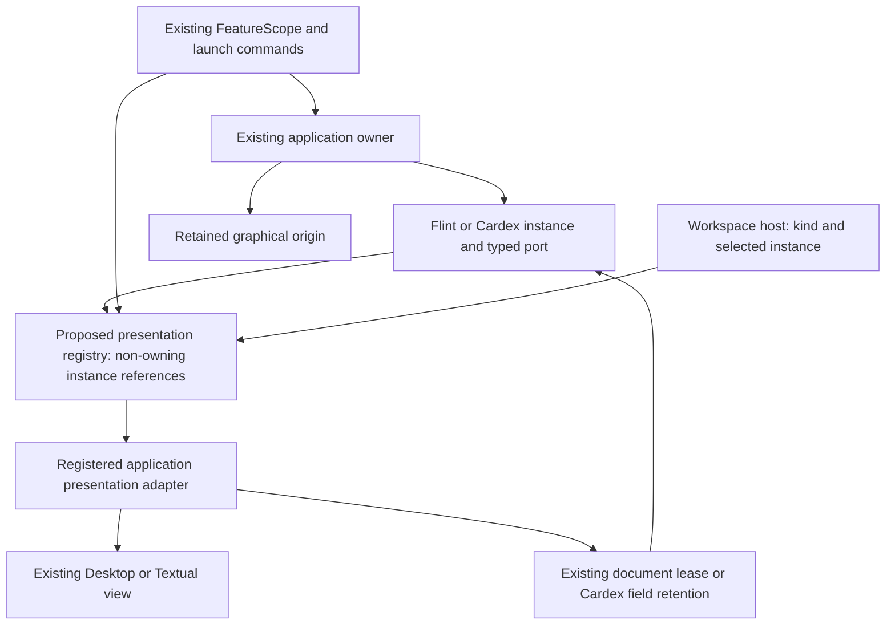

# Universal Application Presentation Contract — Stage A

2026-11-05 · Investigation and proposed design · Approved; see [Stage B qualification](UNIVERSAL_APPLICATION_PRESENTATION_CONTRACT_QUALIFICATION.md)

**Recommendation:** add a small, per-editor application-presentation registry over the existing application ports and presentation adapters. Preserve existing application creation, Solid ownership, document leases and Window Manager lifecycle. Flint and Cardex already provide the two reference integrations; neither needs a new controller or editor.

The Textual visual refinement is complete. This report implements the brief’s Stage A instruction only; no production code has changed.

## 1. What exists today

| Responsibility | Actual implementation and implication |
| --- | --- |
| Feature registration | [`FeatureHost` / `FeatureScope`](../../src/runtime/features.ts) provide per-editor activation, owned cleanup and disposal ordering. [`application/features.ts`](../../src/application/features.ts) installs Flint and other contributions. Reuse this lifetime; do not introduce a plugin runtime. |
| Application creation | [`Flint`](../../src/features/flint/index.tsx) registers a canonical Block factory and graphical view through [`DocumentApplicationCapabilities`](../../src/feature-api/document-application.ts). [`document-application-capabilities.tsx`](../../src/application/document-application-capabilities.tsx) constructs the live application inside its renderer and supplies commands, services, tabs and persistence. [`Cardex`](../../src/application/cardex.tsx) registers its Block renderer and launch commands separately. There is no universal application-definition registry. |
| Launcher | [`desktop-applications.tsx`](../../src/application/desktop-applications.tsx) is an icon/command catalogue, including placeholders. It is not an inventory of instantiated applications or supported presentations. Leave it intact. |
| Live instance discovery | [`DocumentApplicationPort`](../../src/application/document-application-ports.ts) exposes the existing application, tabs, current retained session and Save prompts. [`CardexPresentationPort`](../../src/application/cardex-presentation-ports.ts) exposes the already-mounted Entity Instrument’s state, actions and retained field DOM. Both use per-editor WeakMap registries and cleanup on owner unmount. |
| Retained editor ownership | [`DocumentSessionStore` / `DocumentHostBinding`](../../src/application/document-sessions.ts) own retained editor roots, projections, activity and final disposal. [`DocumentHostPresentations`](../../src/application/document-host-presentations.ts) leases the same DOM to another same-owner host, restores it on release, and transfers bounded scroll/selection bookmarks. It rejects competing leases, detached/experimental hosts, composition and pending operations. |
| Workspace selection | [`WorkspacePresentationState`](../../src/reactive-editor/workspace-presentation.ts) already defines `desktop`, `textual`, `canvas`, `spatial` and their layout state. [`WorkspaceSession`](../../src/application/workspace-session.ts) governs switching and admission. This is workspace state, not an application-presentation catalogue. |
| Composition | [`WorkspacePresentationView`](../../src/application/workspace-presentation-view.tsx) directly installs `TextualFlint` and Textual instrument factories. Desktop’s tree remains mounted, hidden and inert during Textual use. Canvas and Spatial retain their existing separate rendering routes. |
| Instrument presenters | [`InstrumentPresentationContext`](../../src/rendering/instrument-presentations.ts) selects optional LER, completion/Scry and Gloss components over existing models. These are document-scoped tools, not independent application instances. Preserve this useful mechanism. |
| Cardex adaptation | [`TextualCardex`](../../src/features/textual/cardex.tsx) moves existing field DOM into Textual slots and restores it on cleanup. Its controller and pending receipts remain owned by [`EntityCardInstrument`](../../src/features/cardex/view.tsx). Cardex already has a working Textual presentation, beyond the brief’s illustrative “future” example. |
| Windows | [`WindowLifecycle`](../../src/application/window-lifecycle.ts) already handles activation, focus, composition/gesture barriers, close and transfer guards. [`WindowPresentation`](../../src/runtime/window-presentation.ts) is a single optional window-chrome policy, not an application view registry. Do not overload or replace it. |

### Actual gaps

1. No common identity/instance/presentation discovery API, explicit presentation IDs, per-workspace defaults or unsupported-result policy.
2. `WorkspacePresentationView` knows Flint and the individual Textual instrument components. Its zoom callback enumerates document ports directly.
3. [`TextualFlint`](../../src/features/textual/flint.tsx) also chooses, opens, covers itself with and returns from Cardex. This application switching belongs in a small Textual host, with application-specific navigation supplied by adapters.
4. `WorkspaceSession.changePresentation()` contains the explicit `canPresentCardex` exception. Document presentation admission/bookmark preparation is another application-specific hook in that method.
5. `DocumentApplicationInstance` mixes services with `tabs` and `entityBacklinks` components. Cardex’s port similarly includes DOM slots. These are valid compatibility adapters, but should not become requirements of the universal contract.

**Important ownership constraint:** both reference application controllers are currently created under graphical renderer owners. Hiding that owner preserves the instance; unmounting it would destroy state or unregister its port. Stage B must retain these origins. Extracting fully headless application controllers would be a separate, larger change and is unnecessary for this contract.

## 2. Architectural map



The registry supplies discovery and resolution. Adapters retain application-specific knowledge. Workspace hosts arrange and activate the resolved view without checking application IDs.

## 3. Minimum proposed contract

Use the existing `PresentationName` workspace union, aliased if needed. Distinguish three identities: application definition (`flint`), live instance (its existing runtime port key), and presentation (`flint.desktop.editor`, `flint.textual.editor`). None is a new canonical Block identity.

Introduce two small registration operations, owned by `FeatureScope`:

- **Application registration:** ID/name, existing launch operation if available, and a typed adapter exposing live instances from the existing port registry. Instance references include runtime key and current window/owner identity. Do not copy their state or maintain another authoritative instance store.
- **Presentation registration:** application ID, presentation ID, workspace, label, optional default, availability/admission checks, coexistence declaration, and an attachment factory bound to that application’s instance type. Later contributions may register additional views without modifying the application’s business logic.

Conceptual factory boundary (not final API syntax):

```ts
type Admission = { ok: true } | { ok: false; reason: string };

interface PresentationAdapter<Instance> {
  id: string;
  applicationId: string;
  workspace: PresentationName;
  default?: boolean;
  check(instance: Instance): Admission;
  // Declares the interaction constraint; existing application leases enforce it.
  interaction: 'exclusive-session' | 'exclusive-instance' | 'noninteractive';
  attach(instance: Instance, host: PresentationHost): () => void;
}
```

`PresentationHost` supplies a mount destination, reactive visible/active state and a narrow host-navigation callback. It contains no Textual geometry, document model or service container. Textual adapters obtain measured-grid/preferences access through the existing Textual context. Solid adapters must attach under the correct existing owner/context; an imperative adapter can manage DOM directly. The common return value releases the presentation, not the application.

Keep typed registration helpers so Flint factories receive `DocumentApplicationPort` and Cardex factories receive `CardexPresentationPort`; any heterogeneous storage stays private to the registry. No application must implement a universal capability bag. Existing services remain accessible through its own typed port.

Use maps indexed by application/workspace/presentation ID, with an explicit default index. Discovery reacts to registration and instance lifecycle, not Document revision or typing. Reject duplicate IDs and competing defaults. Multiple presentations for the same application/workspace are supported without requiring a new view-picker UI in Stage B.

### Resolution and fallback

- An explicit presentation ID must match the application, workspace and availability checks. A failure returns a structured unavailable/unsupported reason; do not silently substitute a different view.
- Without an ID, choose the registered compatible default, or the sole compatible presentation. Multiple non-default candidates require explicit choice; never rely on registration order.
- No compatible presentation: keep the application instance intact and show an informative unsupported state with explicit return/navigation options. Do not mount graphical UI in Textual or switch workspaces automatically.
- Feature-disabled or unadapted applications retain current admission protections. Missing registration must not bypass an opaque-widget guard.
- Canvas/Spatial are valid lookup kinds, but this work registers no new views for them. Existing workspace rendering and admission remain unchanged.

## 4. Lifecycle and state ownership

| Owner | State and responsibility |
| --- | --- |
| Existing application/session | Documents, dirty status, history, service leases, pending saves/receipts, Cardex drafts, logical selection and navigation. Launch once through existing commands; unregister when its existing owner ends. |
| Presentation | Component tree, menus, local panels and layout. Reconstructible chrome may unmount; retained editor/field DOM is released back to its owner. Textual preferences remain in their existing storage. |
| Workspace | Arrangement, chosen application/presentation, visibility and activation. Existing Window Manager retains focus and window lifecycle authority. |

Transition sequence: resolve destination → check existing global and adapter admission barriers → remember current bounded bookmarks → release/return the outgoing view’s lease → attach the new presentation → restore focus/scroll when available. Mount failure cleans partial attachment and restores the previous supported presentation; it must not dispose the application or leave borrowed DOM stranded. Recheck live ownership before attachment and cancel deferred focus work on cleanup.

Do not add mandatory `mount/activate/deactivate/resize/suspend/resume` methods alongside Solid lifecycle. Attachment/cleanup plus existing reactive host activity cover current requirements. Resize remains the existing host/grid observer. Existing session suspension and stale-result tickets remain authoritative. Feature removal releases presentations before removing their services.

Flint initially declares one interactive presentation per **retained session**, enforced by its existing lease. Cardex declares one per Instrument instance. An application can register many presentations; registration does not grant simultaneous access to movable DOM. No simultaneous editing or new global lease manager is proposed.

## 5. Bounded Stage B plan and shared-code impact

Proposed feature flag: **`applicationPresentations`**, enabled by default, preserving the current path when disabled. Existing feature defaults stay unchanged; the flag affects hosting only and creates no data migrations.

| File area | Proposed modification and protection |
| --- | --- |
| New `feature-api/application-presentation.ts` and small runtime registry | Contract, typed registration, indexed resolution, disposal and structured failures. Reuse `FeatureScope`; leave the existing window `PresentationCapabilities` alone. |
| `application/features.ts`, feature flags and small application adapters | Register Flint Desktop/Textual and Cardex’s existing Desktop/Textual Instrument presentations. Launch uses current commands; instances wrap current ports. |
| `document-application-capabilities.tsx`, `features/flint/index.tsx` | Add optional registration integration and resolve the existing Desktop view through it. Preserve the legacy `view` fallback and original owner. Keep `DocumentApplicationInstance` components for compatibility. Decouple discovery eligibility from Textual alone where necessary, while retaining session availability checks. |
| `application/cardex.tsx`, `features/cardex/view.tsx`, existing port modules | Publish identity/ownership and register compatible view adapters; retain the current Instrument controller and DOM. Do not recreate the complete Cardex shell. |
| `workspace-presentation-view.tsx`, `workspace-session.ts` | Consume registered hosts and transition checks. Replace only the qualified Flint/Cardex branching, preserving global composition, modal, transfer and close barriers. Owner-scoped registration must replace the Cardex exception without admitting unrelated opaque widgets. |
| New small Textual application host; `textual/flint.tsx`, `textual/cardex.tsx` | Move current application choice/cover/return wiring into the host. Flint retains document tabs, editor commands and instrument tools; Cardex reports return/source navigation through the adapter. No window-manager redesign. |
| Instrument composition | Move the existing Textual factory bundle into the Flint presentation adapter while retaining `InstrumentPresentationContext`. Do not promote Scry or Gloss into artificial standalone applications. |

Implement and qualify Flint first, then Cardex as the second existing integration. Desktop registration must participate in actual view resolution, not merely appear in a catalogue. Keep all presentation-specific CSS and components isolated. New views should require an application-side registration and any needed workspace adapter, not another application-ID branch in the workspace.

**Principal risks:** premature disposal of graphical owners; lost Solid context after DOM movement; stale asynchronous focus restoration; duplicated Save/keyboard handlers; overly permissive opaque-widget admission; Cardex navigation losing its destination; and losing the last working presentation on attachment failure. The retained-owner approach avoids controller extraction, while targeted lifecycle tests cover these risks. Unsupported direct-to-Textual creation still uses the existing hidden graphical origin; this limitation should be documented rather than concealed by a second application implementation.

## 6. Focused qualification after approval

1. Small registry tests: registration/disposal, two views in one workspace, defaults, explicit-ID mismatch, unavailable results and instance identity. Include failed attachment cleanup and exclusive interaction refusal.
2. Reuse [`document-host-presentations.test.tsx`](../../src/application/document-host-presentations.test.tsx), the relevant [`workspace-presentation-view.test.tsx`](../../src/application/workspace-presentation-view.test.tsx) cases and [`textual/instruments.test.tsx`](../../src/features/textual/instruments.test.tsx). Verify composition/close barriers and rejection of unregistered opaque applications.
3. Adapt the existing Textual Flint/instrument browser harnesses for one Desktop → Textual → Desktop flow: same application/session/editor/Cell/Text nodes; typing, selection, Undo/Redo and manual Save; Cardex draft retention and source return; unsupported view handling. Retain bounded-work counters for snapshots, projection creation/rebuilds and service reinitialisation. Test flag-off compatibility without repeating the full Textual matrix.
4. Typecheck and concise results report. No new Canvas/Spatial implementation, exhaustive workspace matrix, performance campaign or launcher redesign.

Stage A required source inspection only; no runtime tests were rerun because no runtime code changed. The design has no unresolved requirement that needs a clarification question. Stage B was subsequently authorised and is documented in the linked qualification report.
