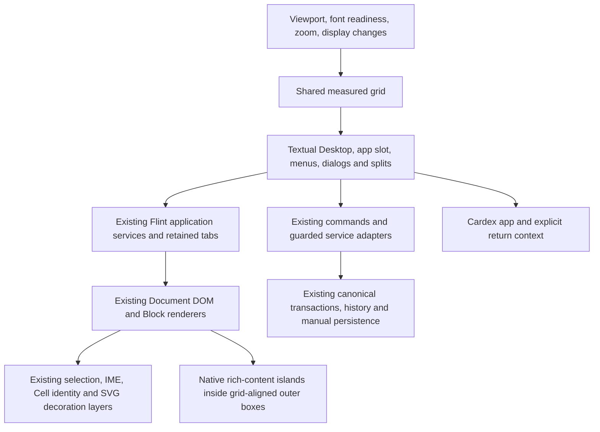

# Textual Workspace — investigation and implementation plan

**4 November 2026 · research only · source baseline `35ec08c` · updated after reference ZIP review**

Textual is feasible as a new Workspace presentation using the existing Flint application services, Document DOM, Block registry and editing pipeline. It is **not yet qualified as a strict Unicode character-cell editor**, and it cannot be implemented safely as a colour/font override. The principal work is a cell-based shell, a retained application host, presentation adapters for existing controls, and a measured typography contract. No application code, feature flags, schemas or document records were changed in this investigation.

The original supplied [brief](../../prompts/TEXTUAL_WORKSPACE_FEATURE_BRIEF.md) authorised investigation and planning only. Subsequent user instructions accepted that investigation and directed incremental implementation; the current plan below governs that work. Its seven architectural decisions are treated as requirements, not reopened by this report. Where existing behavior conflicts with them, the conflict is explicit below.

**Current implementation direction:** the user has accepted this investigation. The [four-increment plan and Shared-Code Impact Register](TEXTUAL_IMPLEMENTATION_PLAN.md) supersede the earlier staged/requalification proposals. Dedicated Textual views share services and the editor; graphical views are protected. Do not repeat the inventories.

## Evidence and deliverables

- [Feature-parity matrix](TEXTUAL_FEATURE_PARITY.md): actual source, current access, proposed Textual access, status, risk and verification for every feature family.
- [Action inventory](TEXTUAL_ACTION_INVENTORY.csv): **1,220 declaration/control/catalog records**, including direct JSX handlers, imperative controls, command objects, menu factories and expanded table/tab/surface/annotation catalogs. This counts source sites, not distinct enabled commands.
- [Action surfaces](TEXTUAL_ACTION_SURFACES.md): navigation index to the 119 source files contributing the initial action scan. The annotation catalog expansion is also in the ledger.
- [Shortcut inventory](TEXTUAL_SHORTCUT_INVENTORY.csv): **477 records**, including expanded core and Entity bindings for Mac and Windows, feature declarations and direct key-handler conditions. User overrides and invocation-specific bindings still require runtime verification.
- [Block types](TEXTUAL_BLOCK_TYPES.csv): **78 concrete types/aliases** expanded from current registrations. [Registration evidence](TEXTUAL_BLOCK_REGISTRATIONS.csv) retains 49 registration sites, including three overlay panel types and the dynamic application-registration boundary.
- [Supplementary asset review](TEXTUAL_ASSET_REVIEW.md): all nine ZIP entries reviewed; unmodified reference package archived, layout examples evaluated and screenshots reconciled with the parity plan.
- [Font probe](TEXTUAL_FONT_PROBE.json): 36 native DOM measurements in Chrome 156.0.8078.80, across three font requests, four sizes and three emulated DPR values. This is a typography experiment, not a Textual implementation or a Flint parity test.

The source audit traversed 662 current `.ts/.tsx/.js/.jsx` files, excluding ordinary test files, fixture files and legacy `library`, `components` and `blocks` trees. `src/App.tsx`, `src/application/features.ts` and `registerCoreViews()` establish the current reactive assembly; legacy implementations are not silently counted as implemented reactive features. Some browser-check/demo/debug controls are retained in the ledger, not presented as production requirements. Loops, service-provided labels, optional flags and conditional controls are recorded explicitly as families/expressions. A static inventory cannot establish that every runtime state is reachable: the implementation acceptance gate must expand those families against the running application and reconcile every ledger row. There is no claim of achieved Textual parity.

The subsequently supplied `Textual_Astra_Brief.zip` resolves the missing-reference issue. Its feature brief is byte-for-byte identical to the original. All additional files, including the three images, have now been reviewed and retained unchanged in [reference-package](reference-package/README.md). Their README explicitly identifies templates and visual references, not prequalified production code. The review adopts the supplied Borland/Paper palette tokens, left marginalia/right References layout and candidate 110/155-column split thresholds; it also identifies narrow-grid guards, typography and parity work still needed. See the [asset review](TEXTUAL_ASSET_REVIEW.md) and [bounded evaluation evidence](TEXTUAL_ASSET_REVIEW_EVIDENCE.json).

## 1. Architecture map

| Boundary | Actual implementation | Reuse and necessary adaptation |
|---|---|---|
| Workspace lifetime | `src/application/workspace-session.ts`, `WorkspaceSession` | One `ReactiveEditor`, root projection, presentation state, feature services and session ownership. Add a named Textual presentation; do not create a second editor/repository. |
| Presentation registration/persistence | `src/reactive-editor/workspace-presentation.ts`, `PresentationName`, `WorkspacePresentationState`, `validateWorkspacePresentation()`; `src/reactive-editor/workspace-manifest.ts`, `withWorkspacePresentation()` | Currently Desktop/Canvas/Spatial. Presentation sidecar is `metadata.workspacePresentation`; unknown fields/layouts are preserved. Add narrow Textual validation, availability, select/restore and round-trip tests. Runtime pixel metrics must not be persisted. |
| Presentation rendering | `src/application/workspace-presentation-view.tsx`, `WorkspacePresentationView` | Provider and overlay set survive; active roots are conditionally mounted. Managed layout is enabled only for Desktop. Merely adding another conditional branch will not preserve app/editor DOM identity across switches. |
| Application registration | `src/application/features.ts`, `registerApplicationViews()`; `src/runtime/features.ts`, `FeatureHost`, `FeatureActions` | Reuse owned registration/cleanup and scoped capabilities. A Textual host must preserve optional features and existing command guards. |
| Flint host/service boundary | `src/features/flint/index.tsx`, `createFlintFeature()`; `shell.tsx`, `FlintView`; `document-tabs.ts`, `createFlintDocumentTabs()`; `src/application/document-application-capabilities.tsx`, `documentApplicationCapabilities()` | Reuse `DocumentApplicationInstance` services and the unconditional `app.tabs` editor slot. Use a dedicated Textual Flint view through a narrow composition boundary, retaining stateful tab/session owners; keep the graphical Flint view unchanged. Avoid recreating a second Flint service instance for Textual. |
| Retained Documents | `src/application/document-sessions.ts`, `DocumentSessionStore`, `DocumentHostBinding`; `document-host-transfers.ts`, `DocumentHostTransfers` | Retains a projection and DOM root, captures focus/native selections and scroll, guards composition and pending save/recovery. Transfers currently require managed Desktop groups, selected hosts and supported resource identity; this is a real adapter boundary, not an already-generic full-screen host. |
| Application windows | `src/application/window-manager.ts`, `window-lifecycle.ts`; `src/rendering/window-manager.tsx` | Reuse lifecycle, dirty-close blocking, activity and owned surfaces. Textual uses one foreground application slot and deterministic splits; window dragging/z-order are Desktop presentations of these capabilities. |
| Editor DOM | `src/rendering/standoff-editor-view.tsx`, `StandoffEditorView`; `src/rendering/direct-character-cells.ts`; `src/reactive-editor/editor.ts` | Preserve keyed Cells, native Text nodes and both direct-DOM/Solid paths. Scoped typography and measured layout adapters are needed; no new text renderer is recommended. |
| Input and selection | `src/input/gateway.ts`, `InputGateway`; `bindings.ts`, `BindingRegistry`; `binding-catalog.ts`; `graphemes.ts`; `cross-block-input.ts`; `selection-target.ts` | Preserve `beforeinput`, IME, native-field isolation, cross-Block selection and saved toolbar selection. UI grid coordinates never replace canonical Cell coordinates. |
| Canonical mutations/history | `src/block-tree/commands.ts`, `structuralTransaction()`; `repository.ts`, `commit()` / bounded admission; `annotation-commands.ts`; `src/runtime/tables.ts`, `tab-commands.ts` | Menu, Scry and contextual presentations invoke existing operations. Layout/zoom/switches stay session work. Canonical edits retain dirty tracking, bounded validation and Undo/Redo. |
| Decorations | `src/runtime/session-decorations.ts`, `SessionDecorations`; `visual-effect-registry.ts`; `src/rendering/visual-effect-renderers.tsx`; `src/runtime/measurements.ts` | Reuse annotation SVG layers and temporary ranges. Highlights remain local to their text container; scrolling does not recreate highlight DOM. Position fixed popups separately. |
| Existing geometry differences | `src/rendering/overlay-layer.tsx`, `block-context-menu.tsx`, `managed-floating-tool.ts`; `src/features/gloss/controller.ts`, `presentation.tsx`; `src/features/autocomplete/view.tsx` | These contain pixel/fixed-position sizing, dragging or responsive panel rules. Each needs a Textual geometry presenter; a global CSS scale is insufficient. |
| Cardex | `src/application/cardex.tsx`, `createCardexFeature()`; `src/features/cardex/view.tsx`, `CardexShell`, `EntityCardInstrument`; `details.tsx` | Entity deep-link command exists; launch currently creates a canonical Window. Claim/Relationship editing exists in Entity detail tabs behind `cardexIncrement2`, but equivalent public deep-link routes and a return token to Flint are not established. Top-level Claims/Relationships/Facts panels and Dossier remain placeholders. |

### Current persistence conventions

Workspace layout uses the presentation sidecar and explicit workspace save; Document content uses manual native Save and existing file bindings (`src/persistence/native-session.ts`). Do not store Textual chrome or font preferences in a Document, nor infer automatic document saving from a presentation change.

Existing local preferences are split: Flint compact layout uses `mutable.flint.compact-layout.v1` (`src/features/flint/compact-layout.tsx`); keyboard overrides use `speedy.input-bindings.v1` (`src/input/bindings.ts`). Recommended: a separate versioned Textual local preference record for font/zoom/palette, with storage-failure fallback to session state. Use the supplied semantic palette tokens, initially Borland with Paper as an alternative; qualify all text/focus states, especially half-size text. No preference is installed by this report. Persist layout/foreground identity only through the Workspace presentation contract. Do not save raw caret DOM nodes, transient dialogs or incomplete IME state. Durable application-session restoration is a distinct contract; current managed-host transfer itself is session-only.

## 2. Feasibility against the approved decisions

| Decision | Verdict | Explicit blocker/unknown |
|---|---|---|
| Integer-cell chrome | Feasible | Existing overlays and native browser dialogs are pixel/UA controlled. Introduce one grid-boundary adapter for application-owned chrome. Browser/OS dialogs remain outside Mutable-owned chrome; native island internals retain their renderer, as the brief specifies. |
| Monospaced prose/UI; invariant advances | Conditional | Latin regular/bold/italic advances match in the probe. CJK/emoji fallback, contextual scripts, justification, superscript, headings and authored font styling do not automatically satisfy a universal cell grid. No proportional-text escape hatch is proposed. |
| Native media islands | Feasible with per-family adapters | Preserve the inner renderer; snap only the outer rectangle. Existing image, table, page and window size metadata must not be rewritten just to view Textual. Initialis and fixed authored pages need an explicit presentation policy. |
| Exact half-size marginalia | Horizontal metric feasibility demonstrated, overall qualification pending | Probe found exact 2:1 average advance, but not optical legibility, vertical ink fit, all glyphs or all platforms. 8px margin text at a 16px main size is a significant usability risk. Regular-grid fallback must remain available. |
| Fluid viewport and zoom | Feasible | Grid reflow must preserve logical scroll anchor and native selection across wrapping. Browser zoom is distinct from app zoom and DPR; real multi-display tests remain necessary. |
| Full-screen applications | Feasible with a bounded lifecycle extension | Existing retained-session transfer assumes managed Desktop hosts; Cardex/Thesis/Phosphor launches assume windows. Reuse their services through host-aware launch/presentation adapters; do not weaken Desktop transfer guards globally. |
| Complete feature parity | Achievable goal, not demonstrated | Command registry is incomplete as a UI catalog: many toolbar/menu/native controls directly invoke services. New menu adapters and a runtime reconciliation of the ledgers are essential. Outline, general pipelines and some visual effects are not implemented merely because the brief names them. |

### Phosphor precedent

`src/features/phosphor/model.ts` is a Screen model with 40/80 columns and 24 rows. `cleanInput()` segments graphemes, expands tabs and replaces unsupported glyphs with `?`; it enforces the Apple-specific repertoire from `glyphs.ts`. That would corrupt the intended Flint text semantics if reused as Textual's editor model.

`view.tsx` derives cell widths from **7 or 14 pixels times zoom**, with corresponding fixed aspect relationships. `fitCells()` snaps a fit scale using DPR. Its viewport/visible-row calculation and preference-versus-content separation are useful precedents, not a measured general font/grid engine. `geometry.ts` builds Three.js slabs and relief; it is not a character-cell layout service. Apple bitmap fonts, screen-byte decoding, CRT effects, housing, cursor and Phosphor keyboard editing stay in Phosphor.

**Recommendation:** a small Textual grid/metric service alongside the existing editor. Reuse established coordinate/lifetime interfaces; extract a Phosphor primitive only if a demonstrably common pure function exists. Do not first refactor Phosphor or impose its Screen schema on Flint.

## 3. Typography and Unicode evidence

The isolated probe used requested fonts Menlo, Monaco and Courier New, sizes 12/16/20/24px, DPR emulation 1/1.25/2, disabled kerning/ligatures and 512-character DOM runs. These are locally available/browser-resolved font requests, not a portable bundled-font selection.

At 16px / DPR 1:

| Font request | Average `M` advance | At 8px | Bold/italic advance delta | CJK `漢` / base advance | `😀` / base advance |
|---|---:|---:|---:|---:|---:|
| Menlo | 9.6328125px | 4.81640625px | 0 / 0px | 1.6951 | 2.0762 |
| Monaco | 9.6015625px | 4.80078125px | 0 / 0px | 1.7006 | 2.0830 |
| Courier New | 9.6015625px | 4.80078125px | 0 / 0px | 1.7006 | 2.0830 |

Across these 36 measurements, twice the half-size advance exactly equalled the main advance; regular/bold/italic average widths agreed. Summing 200 separately measured single-glyph widths differed from one 200-glyph run by up to **2.734375 CSS pixels**. This demonstrates measurement/rounding accumulation, **not a measured drift in Flint's actual Cell DOM**. Use common boundary coordinates, not accumulated rounded cell widths. The experiment did not establish glyph coverage, optical quality, bidi/IME behavior, vertical metric equality, actual browser zoom or cross-platform font consistency.

Unicode grapheme boundaries and display width are separate concepts. UAX #29 defines grapheme segmentation; East Asian Width is not an off-the-shelf layout algorithm for arbitrary modern text. See [Unicode text segmentation](https://www.unicode.org/reports/tr29/) and [East Asian Width](https://www.unicode.org/reports/tr11/).

Mutable already stores **code-point Cell coordinates** and uses grapheme segmentation for operations (`src/input/graphemes.ts`). Keep that model and its DOM Text nodes. Proposed presentation rules:

- Layout chrome in integer cells; do not map one code point to one visual cell.
- Use measured, non-ligating monospace UI/prose fonts, with verified bold/italic faces. Preserve canonical Unicode and all original annotations.
- Treat combining sequences and ZWJ emoji as grapheme runs for qualification; retain the existing Cell-to-DOM mapping. Do not independently give combining marks or ZWJ a full cell.
- Establish a documented 0/1/2-cell policy with measured fallback fonts for wide glyphs. Bidi and shaping must remain browser-native. If a required script cannot satisfy the measured grid while retaining current editing, mark that font/script combination unqualified and resolve it before release; do not transliterate, replace or silently reject content.
- Tabs remain canonical tabs where present; visual tab stops use integer columns. Existing Tab/Shift-Tab list commands continue to depend on input scope.
- Native soft wrapping remains a presentation operation, never inserted line breaks. Verify actual keyed Cell spans, mixed annotations, grapheme-spanning properties and IME, not just plain string measurements.
- Heading hierarchy can use bold/colour and integer row spacing; changing authored font-size or justification *presentation* needs approval. Superscript/subscript may use smaller ink within an unchanged parent advance, but it is not yet qualified. Initialis is a single canonical Cell with a wider visual surface; reserve a cell-aligned island box without rewriting its stored renderer settings, then qualify its native caret/selection geometry.

These conflicts make a blanket “all current styling unchanged and every advance fixed by one monospace font” claim unjustified today.

## 4. Proposed interfaces and dataflow

Conceptual contracts only; these are not new production interfaces:

```ts
type CellRect = { col: number; row: number; widthCells: number; heightCells: number };
type GridMetrics = {
  columns: number; rows: number; cellWidthPx: number; cellHeightPx: number;
  originPx: { x: number; y: number }; zoom: number; generation: number;
};
// Integer CellRect at every caller; one rendering boundary converts to CSS pixels.
interface TextualGrid { metrics(): GridMetrics; toCss(rect: CellRect): object; }
interface TextualAppHost {
  activate(applicationId: string, returnContext?: unknown): Promise<void>;
  previous(): Promise<void>; // lifecycle guards, no destructive remount
}
// Actual return context must identify retained session/view/occurrence,
// canonical selection boundaries, focused control and a logical scroll anchor.
interface TextualAction {
  id: string; label: string; menuPath: string[];
  available(context: unknown): boolean; execute(context: unknown): void | Promise<void>;
}
```



**Grid service:** measure font advances after `document.fonts.ready`; validate all required faces, a representative glyph set and actual line boxes. Cache by font descriptor, size, browser layout state and metric generation. Recompute on font load, explicit app zoom, relevant viewport resize and display/DPR changes, coalesced once per frame. Typing is not an invalidation source for the workspace grid.

Compute columns/rows with floor of usable dimensions divided by measured pitch. Position every boundary from the common origin (`origin + index * pitch`), never by summing rounded previous widths. Fractional CSS pixels are valid; if device-pixel snapping is selected, snap shared boundaries consistently and report its bounded error. Do not independently round a nominal pitch and accumulate it. Leave edge remainders as noninteractive background; never stretch the final column to absorb them. Native content uses DOM flow inside the allocated region.

**Subgrid:** `subCellWidth = cellWidth / 2`, `subCellHeight = cellHeight / 2`, identical origin. Assign exact line boxes explicitly and verify glyph ink ascent/descent and paired baseline alignment. Half-size text is not `transform: scale(.5)`. Test long runs and styled text; use a measured font-size/spacing compensation only after preserving shaping and readability. If exact/legible results fail, use the approved regular-grid fallback and a full-size reading view.

**Application lifecycle:** retain each application controller and its document/tab roots while inactive; set the inactive subtree inert and hide it without destroying editor instances. Use activity state to suspend optional work. Resolve the current managed-host restrictions through a narrow host policy/adapter with equivalent ownership, visibility, composition, save and rollback checks. A failed switch leaves the source attached and focused. Do not serialize app sessions or snapshots merely to switch apps.

**Return:** capture identity-based selection and a logical scroll anchor before Cardex/subview navigation; restore after layout settles, clamp only when the underlying content changed, and report unavailable/deleted targets. Preserve document, active nested tab, source occurrence, editor instance and direction of selection. Do not rely on `window.scrollY` or a single stale pixel offset after zoom. Composition, pending dialog decisions and in-flight close/save operations must gate transitions through existing lifecycle rules.

**Media:** outer width/height in cells; inner renderer retains aspect ratio using contain/letterboxing. Captions and adjacent editable text stay ordinary Blocks. Pixel sizes in authored metadata remain unchanged on presentation switches. Explicit author resize can translate a cell-step choice through the existing metadata command. Native player/browser/iframe controls remain native; their internal layout is not rewritten into a TUI. This follows the brief’s explicit native-internals exception; Mutable-owned controls and captions still follow the grid/font contract.

## 5. Command and subview integration

`CommandRegistry` (`src/block-tree/registry.ts`) exposes `list`, `canExecute`, `execute` and an optional permission predicate. `BindingRegistry` supports scope-aware defaults, user overrides and conflict detection. `FeatureActions` contributes document/add-block actions. These are reusable, but the registry alone is **not the complete action inventory**: formatting, save/import/export, inspectors, graph controls and media controls also call services or local functions directly.

Build a Textual action catalog as a presentation over existing handlers. Use the registry where available; introduce narrow adapters for direct handlers, preserving selection capture/restore, disabled reasons and async/error handling. Do not implement menus by synthetic clicks on hidden toolbars. Avoid broad command-system refactoring. Each existing operation remains accessible in Textual. Existing graphical toolbars are retained unchanged; Textual supplies its own menus and panels.

Suggested routing: **File** owns lifecycle/storage/import/export/publish; **Edit** history and clipboard; **View** subviews, zoom and presentation; **Insert** Blocks/media/tables/tabs; **Format** paragraph/text styling; **Annotate** standoff/Entity/Gloss/Initialis; **Navigate** find, occurrences and relationships; **Tools** annotation inspectors, effects and app tools; **Window** app/document switching and return; **Help** discoverable action and binding lists.

| View | Textual presentation and return rule |
|---|---|
| Scry / LER | Grid-bounded transient panel with native query input, existing source snapshot, result selection, boundary controls, review, creation and authority views. Escape follows current guarded cancellation, then restores the source. Large review/detail views may occupy a deterministic full-screen subview. |
| Gloss input | Compact grid-bounded input below/near its anchor; existing type and entity dropdown semantics, first-colon rule, Escape/Cancel, same-Gloss reuse and Undo. Temporary SVG highlight stays in the source TextBlock. |
| Marginalia / Gloss register | Deterministic half-grid margin only when qualified and roomy; regular-grid below-text or app subview otherwise. Preserve all create/edit/navigation/filter and relationship commands. |
| Local References / Backlinks | App-owned split or full-screen subview, with filters, counts and explicit return to source. Document-local Glosses remain distinct from database Entity references. |
| Graph / Mermaid / Argument | Reuse native renderers, opaque Mermaid frame and navigation token/security checks. Snap the enclosing panel; keep graph controls and return action accessible at every width. |
| Outline / outliner | Collapsible/nested list Blocks exist; a dedicated reactive Document Outline subview was not located. Treat a new Outline UI as planned work, not already implemented parity. Legacy outliner files are reference evidence only. |
| Cardex | Separate full-screen foreground app; preserve entity fields, name strata, search and semantic tabs. Add explicit Claim/Relationship routes plus a retained Flint return context. Dirty Cardex forms must participate in switching/close rules. |
| Other apps / tool windows | Full-screen app or deterministic subview/island. Preserve native tool actions; do not reinterpret Phosphor's own Screen editing as Flint text. |

**Actual Scry state:** `autocomplete/model.ts` recognises `@`, `[[`, `((` and `/`; selected-text activation exists. LER supports scopes, query editing, matching-field and match-behavior controls (`@`, `*`, `~` in its Command context), current-document mentions, recents, preparation, review and linking. Cmd/Ctrl+. **already toggles LER Query/Command interaction**, not a general workspace CLI. `LerSession` initialises `mode: 'command'`; non-inline entry calls `commandFocus()` on mount, while input focus switches to edit mode. Textual Query-first entry must therefore be an explicit Textual presentation choice; preserve the current graphical entry behavior. `ler-view.tsx` explicitly reserves `|` composition for Feature Two. General pipelines, universal desktop slash activation and a complete OS command mode must not be labelled implemented.

Existing collisions include browser Ctrl+T, Ctrl/Cmd+G, Ctrl/Cmd+Shift+P, Ctrl+. annotation inspection versus LER's scoped toggle, Ctrl+; then A for superposition versus selected-text autocomplete, and native field clipboard/history. Preserve scope resolution and user overrides. A status/function-key line may advertise effective bindings but does not authorise new F-key assignments. +/- zoom should initially be menu/control actions; any chord needs a separate conflict audit and must not steal typed `+`, `-` or browser zoom.

## 6. Rendering tradeoffs

| Approach | Result |
|---|---|
| DOM/CSS grid chrome + current editor DOM + existing SVG/WebGL/media | **Recommended.** Keeps semantic controls, native selection/IME, accessible text and existing renderer behavior. Requires scoped adapters for controls/typography and shared measured geometry. |
| Canvas text/editor | Reject for this feature. Would require replacement text hit-testing, selection, IME, accessibility, clipboard and annotation rendering, violating reuse and introducing parity risk. |
| Canvas/SVG decorative chrome around native DOM | Permissible only if all geometry comes from the shared integer grid and actual controls retain semantic DOM/hit targets. Start with CSS/SVG dividers; add canvas only for a demonstrated need. |
| Whole-application CSS transform / retro skin | Reject. Does not provide integer rectangles, actual font metrics, correct zoom reflow or native hit-test guarantees. |
| Generalised Phosphor engine first | Reject as a dependency. Its Screen geometry/repertoire are specialised; extraction would enlarge scope without supplying the required Unicode/native-editor contract. |

## 7. Responsive rules and performance budgets

These are **proposed budgets and breakpoints**, not measured Textual performance. The split thresholds below now follow the supplied layout examples; the [asset review](TEXTUAL_ASSET_REVIEW.md) records their unqualified 10×20px examples and tiny-grid failures:

- `>=155 columns`: one menu row, optional Document row, one status row. Candidate left margin width is `min(24, floor(columns × .13))`; candidate right References width is `min(44, floor(columns × .23))`, only when requested. Preserve at least 60 document columns. Graph/Argument may use a wider deterministic split or full-screen subview; the References-list width is not a universal tool width.
- `110–154 columns`: optional left margin using the same formula; References opens as a full-screen subview with Back. Opening/closing panels restores a logical scroll anchor through reflow.
- `80–109 columns`: document-first with full-screen margin/References access when requested. Menus overflow into a named More menu. The left margin no longer appears as an arbitrary 120-column split.
- Very wide grids may offer an optional cell-count reading width, leaving background inside the allocated document pane. Keep wide tables/media accessible; do not rewrite authored page dimensions or content.
- `40–79 columns`: compact top-level menu selector, document selector, document and status; no permanent side panel. Every command remains reachable through menus and contextual panels.
- `<40 columns` or `<12 rows`: single-panel navigation/reading mode with scrollable menus and explicit return; large media/tools get a dedicated scrollable island. Never disable Save, Cancel, app switching or access to commands because a tool does not fit. Below the measured editing minimum, offer zoom reduction and a full-size tool view rather than clipping controls.
- Dialog size is clamped in cells to the usable grid; a scrollable body keeps title, error state and actions reachable. Menus choose available sides and scroll where necessary. Optional shadows use integer-cell offsets and `pointer-events:none`.
- App zoom changes font/cell size, not document metadata. Capture selection, active app/subview and a logical text scroll anchor; recalculate shell boundaries once and let only affected native content reflow. Do not use a repository transaction for presentation changes.

| Path | Proposed acceptance budget |
|---|---|
| Ordinary typing | Zero new repository/document scans, snapshots, grid-font probes, graph rebuilds or unrelated Explorer updates. On the same fixture/hardware, median and p95 input-to-visible-edit regression no greater than 10% **and** 2ms over Desktop. |
| Pure scrolling | Zero highlight SVG mutations or anchor Range reads for unchanged visible ranges. No shell/font recomputation. Visibility-driven activation may occur for newly exposed native islands; measure separately. |
| Grid recomputation | One coalesced solve per invalidation frame; target <=2ms p95 for shell arithmetic, <=4ms for cached metric validation. Native document reflow measured separately, not hidden in a two-frame settle number. |
| App/subview switching | Zero content snapshots/serialization and zero remounts of retained editor roots. Target <=50ms p95 event-to-visible-and-focusable UI once assets are loaded; report cold load separately. |
| Structural/annotation actions | Existing local canonical admission and fallback remain authoritative. Count affected records, snapshots, projection rebuilds and unrelated publications; investigate any increase over Desktop. |
| Inventory/menu work | Build/copy action inventory on registration/state-source changes or menu invocation; never rescan all definitions on every text keystroke. |

Half-grid legibility should be reviewed at actual 6/8/10/12px margin text corresponding to the probed main sizes; arithmetic success alone is insufficient. Include an explicit full-size reading route and retain user zoom. Do not claim a universal minimum until font and platform choices are approved.

## 8. Current implementation plan

The accepted direction is four practical increments: **(1)** grid and Workspace shell; **(2)** Flint and its dedicated Textual view; **(3)** Scry/LER, Gloss, References and Cardex; **(4)** media, marginalia, responsive polish and targeted regression. See the [implementation plan](TEXTUAL_IMPLEMENTATION_PLAN.md) for boundaries, the Shared-Code Impact Register and each increment's graphical-protection gate.

No broad refactoring, duplicate editing engine, widespread Textual branches in graphical views or global CSS changes. Reuse shared services, commands, sessions, Block renderers, native selection/IME, history and persistence. A default-on Textual feature flag does not change the user's current Workspace or other feature defaults.

## 9. Focused qualification

Test new code and affected boundaries; reuse existing coverage for unchanged behavior. Test representative Block families and focused browser editing/selection/zoom/switching/tool flows. Investigate unusual Unicode/platform cases when there is a concrete defect or risk. Do not regenerate inventories, requalify every Block type or repeat full suites. One broader final regression run is appropriate only if the actual shared changes warrant it.

Every increment must preserve graphical Workspace appearance, interactions, defaults, persistence and editor performance. Record changed files, focused tests/results, outstanding issues and next actions in a short qualification note. Earlier metric experiments remain evidence, not a requirement for an exhaustive new audit.

## 10. Remaining implementation considerations

1. **Styles versus fixed advances:** approve a presentation-only policy for headings, justification, superscript/subscript, arbitrary authored fonts and Initialis. Recommendation: preserve authored data/actions, map headings/spacing to the grid, preserve smaller ink within stable advances where qualified, and use a cell-aligned Initialis island. Exact visual equivalence and a strict fixed-advance grid cannot both be assumed.
2. **Unicode qualification:** qualify the supplied `ui-monospace` / Cascadia Mono / Consolas fallback stack and decide whether to bundle a distributable font set; agree the explicit wide/ambiguous-glyph policy. No substitution/transliteration or proportional-text fallback. Unsupported typography must remain an acceptance blocker, not hidden data loss.
3. **Half-size marginalia:** the brief already permits regular-grid/full-size fallback. Decide the optical usability threshold after visual review; the template’s 15px/7.5px sizes have not been qualified by the earlier font probe.
4. **Feature status:** confirm whether new Document Outline, generic pipelines and universal CLI launch belong to this project or separate approved work. Existing LER mode toggle is already implemented; Query-first entry requires adjustment. No implemented capability will be omitted.
5. **Session durability:** decide whether exact application/subview/return state must survive process reload, or only live switches; persist safe logical descriptors through an explicit Workspace contract, never live DOM/draft snapshots by accident.
**Resolved by the package:** visual reference assets are now available and reviewed; native-island internals remain native under the existing brief. Mockup shortcuts and exact raster dimensions are illustrative. No additional product clarification is needed merely to incorporate these assets.

The investigation is accepted. Proceed with the four increments using the isolation boundaries above; escalate only genuine architectural blockers. The existing list is context for concrete implementation decisions, not a request to reopen accepted requirements.
